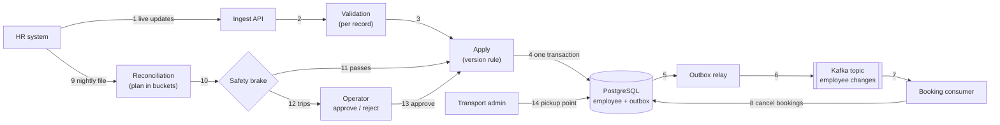
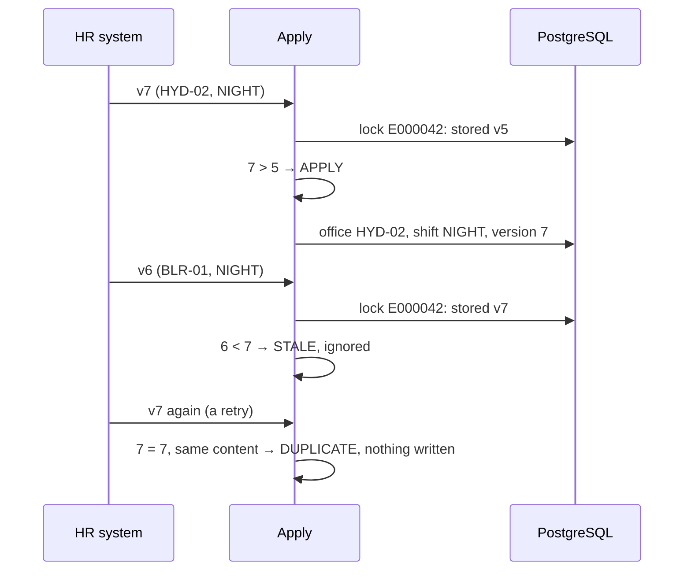
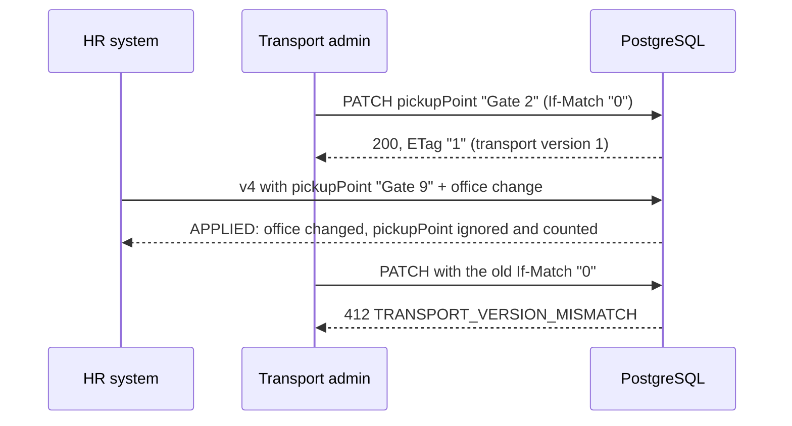
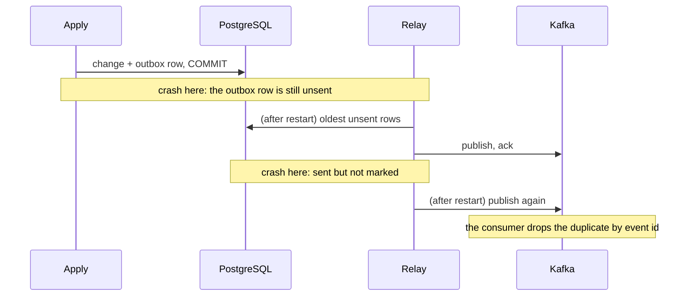
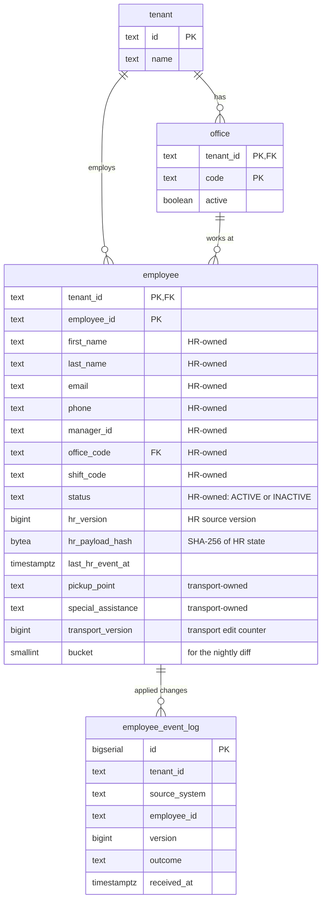
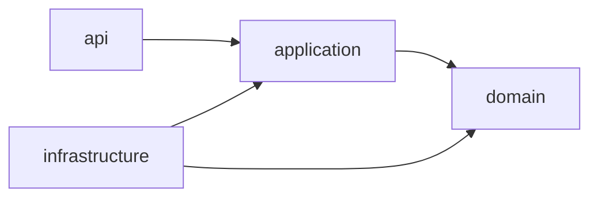

# HR Roster Sync

Companies keep their employee list in an HR system and send changes to MoveInSync, which plans employee cab transport: new joiners, office transfers, shift changes and exits. Those changes arrive one by one through an API during the day, and as a full file of up to 200,000 employees every night. In practice the same change can arrive twice, changes can arrive in the wrong order, some records contain bad data, and the nightly file is sometimes cut short. This service keeps MoveInSync's employee records correct anyway, and it refuses to act on a nightly file that looks broken until a person has checked it.

## Contents

1. [At a glance](#at-a-glance)
2. [The problem in plain words](#the-problem-in-plain-words)
3. [How it works — the big picture](#how-it-works--the-big-picture)
4. [The workflows, step by step](#the-workflows-step-by-step)
5. [The rules, explained](#the-rules-explained)
6. [Design decisions](#design-decisions)
7. [Trade-offs: consistency vs availability vs latency](#trade-offs-consistency-vs-availability-vs-latency)
8. [Security and tenant isolation](#security-and-tenant-isolation)
9. [Failure handling](#failure-handling)
10. [Monitoring — what on-call sees at 3 AM](#monitoring--what-on-call-sees-at-3-am)
11. [Caching](#caching)
12. [Performance and cost](#performance-and-cost)
13. [Data model](#data-model)
14. [API reference](#api-reference)
15. [Run it](#run-it)
16. [Project structure](#project-structure)
17. [Testing strategy](#testing-strategy)
18. [Assumptions](#assumptions)
19. [Deliberately left out](#deliberately-left-out)
20. [Glossary](#glossary)

## At a glance

| Hard rule from the case study | Status | Proof (a test that fails if the rule breaks) |
|---|---|---|
| Validate at the boundary; one bad record never fails a batch | Done | [`IngestControllerIT.oneBadRecordDoesNotFailBatch`](src/test/java/com/moveinsync/rostersync/api/ingest/IngestControllerIT.java) |
| Apply each employee's changes in version order; ignore older ones | Done | [`ExampleUseCaseIT.transferV7BeforeShiftV6`](src/test/java/com/moveinsync/rostersync/ExampleUseCaseIT.java), [`ConcurrentApplyIT`](src/test/java/com/moveinsync/rostersync/ConcurrentApplyIT.java) |
| The same change twice changes nothing (idempotency) | Done | [`ReplayFeedTwiceIT`](src/test/java/com/moveinsync/rostersync/ReplayFeedTwiceIT.java) |
| HR never overwrites what the transport team owns | Done | [`ApplyServiceIT.hrCannotOverwriteTransportFields`](src/test/java/com/moveinsync/rostersync/application/ApplyServiceIT.java), [`EmployeeRepositoryIT.hrWritesNeverTouchTransportColumns`](src/test/java/com/moveinsync/rostersync/infrastructure/persistence/EmployeeRepositoryIT.java) |
| Compare the nightly file efficiently, not fully in memory | Done | [`ReconciliationBenchmarkIT`](src/test/java/com/moveinsync/rostersync/ReconciliationBenchmarkIT.java) (200,000 rows on a 256 MB heap) |
| Safety brake: never deactivate 30 % or more without a person | Done | [`ExampleUseCaseIT.truncatedFileAt120kDeactivatesNobody`](src/test/java/com/moveinsync/rostersync/ExampleUseCaseIT.java) |
| Publish every change reliably, even across a crash (outbox) | Done | [`OutboxCrashRecoveryIT`](src/test/java/com/moveinsync/rostersync/OutboxCrashRecoveryIT.java), [`BrokerDownIT`](src/test/java/com/moveinsync/rostersync/infrastructure/messaging/BrokerDownIT.java) |
| An exit cancels future cab bookings and frees seats | Done | [`DeactivationConsumerIT`](src/test/java/com/moveinsync/rostersync/DeactivationConsumerIT.java) |
| No personal data in logs | Done | [`NoPiiInLogsIT`](src/test/java/com/moveinsync/rostersync/NoPiiInLogsIT.java) |
| One client can never see another's data | Done | [`TenantIsolationIT`](src/test/java/com/moveinsync/rostersync/TenantIsolationIT.java) |

Every case-study line is mapped to its proof in the [traceability matrix](docs/traceability.md).

| Headline number | Value |
|---|---|
| Nightly comparison of 200,000 employees (plan) | **3.0 s** |
| Peak memory during it, whole application included | **127 MB** of a 256 MB heap |
| Live ingest throughput | **5,858 records/s** |
| p99 latency of a 50-record batch under that load | **556 ms** |

Measured on one Apple M2 laptop (8 cores, 8 GB) running the app, database, broker and monitoring together; details in [Performance and cost](#performance-and-cost).

## The problem in plain words

A company with 200,000 employees uses MoveInSync to get its people to work by cab. MoveInSync has to know who works there, at which office, on which shift, and where to pick them up. The company's HR system tells it, in two ways: small updates through an API during the day ("Asha joined", "Ravi moved to Hyderabad", "Meera left"), and a full list of everyone every night.

In the real world those messages misbehave:

| What happens | What it costs if nothing guards against it |
|---|---|
| The same update arrives twice (a retry after a timeout) | Two cab bookings, double notifications, or a "change" that undoes a newer one |
| Updates arrive in the wrong order (v7 before v6) | Ravi's transfer is overwritten by his older shift change, and a cab goes to the wrong office |
| A record is broken (bad phone number, unknown office code) | If one bad record fails the whole batch, 999 good changes are lost with it |
| HR's update carries old transport data | The pickup point the transport team just fixed is overwritten, and the cab waits at the old gate |
| The nightly file is cut off at row 120,000 of 200,000 | 80,000 people look like they left: their accounts are deactivated and their cabs cancelled |
| The service crashes right after saving a change | The booking system never hears about an exit, and a cab still waits for someone who has left |

This service keeps the employee records correct through all of that. Where something is too risky to decide alone, as with the cut-off file, it stops and asks a person.

## How it works — the big picture



1. The HR system sends a batch of changes, signed with a token that names the client (tenant).
2. Each record is checked on its own: required fields, email, phone format, office code. A bad record is rejected with a code; the rest carry on.
3. The apply step locks that employee's row and compares versions: newer is applied, same is a duplicate, older is ignored.
4. The change, a record of it, and a change event (the "outbox" row) are saved in **one** database transaction, so they can never disagree.
5. A background relay picks up unsent change events in order.
6. It publishes them to a Kafka topic, keyed by employee so each employee's events stay in order, and marks them sent only once the broker confirms.
7. The booking consumer reads the events.
8. For an exit, it cancels that person's future bookings and frees the seats, exactly once even if an event arrives twice.
9. Every night HR uploads the full list of employees.
10. The comparison is planned first, bucket by bucket so memory stays small, and the plan is checked by the safety brake.
11. If the file is complete and would deactivate fewer than 30 % of active staff, the plan is applied through the same apply step as live changes.
12. Otherwise nothing is applied; an alert fires and the run waits.
13. An operator reviews the numbers and approves (the plan is applied, skipping anyone who changed meanwhile) or rejects it.
14. The transport admin edits pickup points and special-assistance notes. Those fields belong to transport, and HR can never overwrite them.

Code layers (enforced by [`ArchitectureTest`](src/test/java/com/moveinsync/rostersync/ArchitectureTest.java)): `api` (HTTP) → `application` (use cases, transactions) → `domain` (the rules, plain Java) ← `infrastructure` (database, Kafka, caches). The rules can be tested without a server or database.

## The workflows, step by step

### a. A real-time update arrives

```mermaid
sequenceDiagram
    participant HR as HR system
    participant API as Ingest API
    participant A as Apply
    participant DB as PostgreSQL
    HR->>API: POST /hr/events:batch [E1001 v1 CREATE]
    API->>API: verify token, tenant = acme
    API->>A: record 0
    A->>A: validate (office BLR-01 is active)
    A->>DB: BEGIN; lock E1001 (none yet); INSERT employee; INSERT event log; INSERT outbox; COMMIT
    A-->>API: APPLIED
    API-->>HR: {"results":[{"index":0,"employeeId":"E1001","outcome":"APPLIED"}]}
```
1. The token is verified, and the tenant is taken from it, never from the request body.
2. The record is validated on its own.
3. One transaction stores the employee, the applied-change record and the change event.
4. The answer lists every record's outcome. Real output: [curl examples §1](docs/curl-examples.md#1-a-new-joiner-arrives).

### b. Updates arrive twice or out of order (the case study's example)

E000042 is at version 5 (office BLR-01, shift MORNING). HR then makes two changes: v6 (shift → NIGHT) and v7 (transfer to HYD-02, still NIGHT). v7 arrives first.


1. Every event carries the employee's **full** HR state, so v7 already contains the NIGHT shift that v6 introduced. Ignoring v6 loses nothing.
2. The final state is HYD-02 / NIGHT / v7, whatever order the events arrive in.
3. Proof: [`ExampleUseCaseIT.transferV7BeforeShiftV6`](src/test/java/com/moveinsync/rostersync/ExampleUseCaseIT.java), and with 32 threads racing shuffled versions, [`ConcurrentApplyIT`](src/test/java/com/moveinsync/rostersync/ConcurrentApplyIT.java).

### c. HR and the transport admin edit the same employee


1. HR's update and the admin's edit use separate SQL statements and separate version counters. HR's statement cannot write a transport column.
2. A transport field sent by HR is ignored and counted (`hr_owned_field_violation_total`); the record still applies.
3. Two admins can't silently overwrite each other: an edit must name the version it was based on.

### d. The nightly file — a normal night

```mermaid
sequenceDiagram
    participant HR as HR system
    participant API as Reconciliation API
    participant P as Planner
    participant DB as PostgreSQL
    participant A as Apply
    HR->>API: upload file (header: tenant, as_of; trailer: count)
    API-->>HR: 202 {runId}
    P->>P: pass 1: read rows, validate, hash, write to 64 bucket files
    loop each bucket
        P->>DB: read the same bucket of stored employees
        P->>P: compare: create / update / deactivate
    end
    P->>P: brake: trailer OK, 0 of 1 active missing → pass
    P->>A: apply 10 creates
    A->>DB: same rules as live updates
```
1. Unchanged employees (same version, same content hash) produce nothing.
2. Only one bucket (about 1/64 of the file) is in memory at a time.
3. Real output: [curl examples §9](docs/curl-examples.md#9-the-nightly-file-a-normal-night).

### e. The nightly file is cut off at row 120,000 (the safety brake)

```mermaid
sequenceDiagram
    participant P as Planner
    participant B as Safety brake
    participant OP as Operator
    participant A as Apply
    P->>P: 120,000 rows, a half-written last line, no trailer
    P->>B: activeBefore 200,000; toDeactivate 79,999; trailer missing
    B-->>P: TRIP: FILE_TRUNCATED → AWAITING_APPROVAL
    Note over P,A: nothing applied; alert "ReconciliationBrakeTripped" fires
    OP->>P: GET run (numbers), GET errors (line 120,003 MALFORMED_RECORD)
    alt reject
        OP->>P: POST reject → REJECTED, nobody touched
    else approve
        OP->>A: POST approve → each change re-checked against live data, then applied
    end
```
1. The brake trips when the trailer is missing or wrong, **or** when 30 % or more of the active employees would be deactivated.
2. The half-written line counts as present, so 79,999 deactivations are planned, not 80,000.
3. Approving later is safe: anyone who changed through the live feed since the file was taken is skipped.
4. Proof: [`ExampleUseCaseIT.truncatedFileAt120kDeactivatesNobody`](src/test/java/com/moveinsync/rostersync/ExampleUseCaseIT.java) with 200,000 real rows; real API output: [curl examples §10–11](docs/curl-examples.md#10-the-file-is-cut-off-the-safety-brake).

### f. An employee leaves

```mermaid
sequenceDiagram
    participant A as Apply
    participant DB as PostgreSQL
    participant R as Relay
    participant K as Kafka
    participant C as Booking consumer
    A->>DB: E1001 INACTIVE + outbox EMPLOYEE_DEACTIVATED (one commit)
    R->>K: publish (key acme:E1001), wait for the broker's ack, mark sent
    K->>C: EMPLOYEE_DEACTIVATED
    C->>DB: BEGIN; remember event id; cancel future bookings; free seats; COMMIT
    K->>C: the same event again (redelivery)
    C->>C: event id already seen → nothing
```
1. Bookings on trips that already ran stay as history.
2. Proof: [`DeactivationConsumerIT`](src/test/java/com/moveinsync/rostersync/DeactivationConsumerIT.java), including a late duplicate after a rehire.

### g. The process crashes right after saving


1. Because the change and its event are saved together, a crash can delay an event but never lose one.
2. A crash between publishing and marking sends it twice, and consumers keep a list of handled event ids. The result: delivered at least once, acted on exactly once.
3. Proof: [`OutboxCrashRecoveryIT`](src/test/java/com/moveinsync/rostersync/OutboxCrashRecoveryIT.java) (both crash points). For a real container kill: `docker compose kill app`, then `docker compose up -d --wait app`. The data is intact and the outbox drains.

## The rules, explained

Each rule from the case study: what it says, what goes wrong without it, how it is solved, why this way, and the test that proves it.

### Validate at the boundary; one bad record never fails a batch

- **The rule.** Reject invalid records (malformed phone, unknown office code, missing fields) with a per-record error report. One bad record must never fail a whole batch.
- **Without it.** A typo in one of 100 joiners blocks the other 99 from getting a cab until someone fixes the file, or a malformed phone number is stored and the driver cannot call.
- **How.**
  - The batch endpoint keeps each event as raw JSON until it is that record's turn, so even a wrongly typed field rejects only its own record.
  - Each record is validated by a chain of validators ([`CompositeValidator`](src/main/java/com/moveinsync/rostersync/domain/validation/CompositeValidator.java)):
    - required fields;
    - email shape;
    - phone in canonical E.164, checked with Google's libphonenumber;
    - office code known for this client.
  - Each valid record is applied in **its own database transaction** ([`ApplyService`](src/main/java/com/moveinsync/rostersync/application/ApplyService.java)).
  - The response is `200` with one result per record: index, employee id, outcome, and an error code for rejections.
- **Why this way.** Wrapping the whole batch in one transaction would let a single database error roll back 99 good records. Per-record transactions cost more round trips but make every record independent.
- **Proof.**
  - [`IngestControllerIT.oneBadRecordDoesNotFailBatch`](src/test/java/com/moveinsync/rostersync/api/ingest/IngestControllerIT.java): 1 bad phone in 100 → 99 applied, 1 rejected with `INVALID_PHONE`.
  - `wronglyTypedFieldRejectsOnlyItsRecord`.
  - [`CompositeValidatorTest`](src/test/java/com/moveinsync/rostersync/domain/validation/CompositeValidatorTest.java).

### Per-employee order, idempotency key and version comparison

- **The rule.** Apply changes per employee in version order; a stale update is ignored and a duplicate is a no-op. Define the idempotency key and the version comparison.
- **Without it.** A retry is applied twice, or an older shift change that arrives late overwrites a newer transfer, and the employee is sent to the wrong office.
- **How.** Every event carries the source system's per-employee `version` and the employee's **full** HR-owned state, not just the changed field. Inside a transaction that locks the employee's row (`SELECT … FOR UPDATE`), [`VersionPolicy`](src/main/java/com/moveinsync/rostersync/domain/VersionPolicy.java) decides:

  | Stored | Incoming | Decision | Effect |
  |---|---|---|---|
  | nothing | any | APPLY | create the employee |
  | v | > v | APPLY | write HR fields, record the change |
  | v | = v, same content hash | DUPLICATE | nothing written |
  | v | = v, different content hash | REJECTED `VERSION_CONFLICT` | nothing written |
  | v | < v | STALE | nothing written |

  - **Idempotency key:** `(tenant_id, source_system, employee_id, version)`. The database enforces it with a unique key on the applied-event log.
  - **Content hash:** SHA-256 of the employee's HR state, in a fixed encoding.
  - **Defence in depth:** the write itself is conditional: `UPDATE … WHERE hr_version < :incoming`.
- **Why this way.**
  - Because events carry full state, "accept only newer versions" gives the same end result as applying every event in order, without queues or reordering buffers.
  - The lock serialises events for one employee only; different employees proceed in parallel.
  - The case study's example: a transfer (v7) arrives before a shift change (v6). v6 is stale, and the employee ends up in the new office with the v7 shift, which already contains the v6 change.
- **Proof.**
  - [`ExampleUseCaseIT.transferV7BeforeShiftV6`](src/test/java/com/moveinsync/rostersync/ExampleUseCaseIT.java).
  - [`ApplyServiceIT`](src/test/java/com/moveinsync/rostersync/application/ApplyServiceIT.java): `staleIgnored`, `duplicateIsNoOp`, `sameVersionWithDifferentContentIsRejectedAsConflict`.
  - [`ReplayFeedTwiceIT`](src/test/java/com/moveinsync/rostersync/ReplayFeedTwiceIT.java): a shuffled 1,000-event feed sent twice; after the second run every row, column by column including timestamps, and the change log are identical.
  - [`ConcurrentApplyIT`](src/test/java/com/moveinsync/rostersync/ConcurrentApplyIT.java): 32 threads, versions 1–200 shuffled → final version 200, no version applied twice, no lost update. Without the lock and the conditional update this test fails.

### Field ownership and the conflict rule

- **The rule.** HR owns name, email, manager and office; the transport admin owns pickup point and special-assistance needs. An HR update never overwrites a transport-owned field, and the conflict rule is written down.
- **Without it.** A routine HR update wipes the pickup point the transport admin set, and the cab goes to the wrong address.
- **The conflict rule.**
  1. Every field has exactly one owner ([`EmployeeField`](src/main/java/com/moveinsync/rostersync/domain/EmployeeField.java)). Phone, shift and status come from the HR system and are HR-owned (an assumption: the case study lists only name, email, manager and office).
  2. Only the owner's write path changes a field, and each owner has its own version (`hr_version`, `transport_version`), so neither can make the other's updates look stale.
  3. A value for a field the writer does not own is ignored and counted (`hr_owned_field_violation_total`); the rest of the record is still applied.
  4. There is no "last write wins" across owners.
- **How.** The HR update statement names only HR columns and the transport update only transport columns. Writes never go through the ORM, whose change tracking would write every column.
- **Proof.**
  - [`ApplyServiceIT.hrCannotOverwriteTransportFields`](src/test/java/com/moveinsync/rostersync/application/ApplyServiceIT.java).
  - [`IngestControllerIT.transportFieldsInAnHrPayloadAreIgnoredAndCounted`](src/test/java/com/moveinsync/rostersync/api/ingest/IngestControllerIT.java).
  - [`EmployeeRepositoryIT.hrWritesNeverTouchTransportColumns`](src/test/java/com/moveinsync/rostersync/infrastructure/persistence/EmployeeRepositoryIT.java).
  - [`FieldOwnershipPolicyTest`](src/test/java/com/moveinsync/rostersync/domain/FieldOwnershipPolicyTest.java).

### No personal data in logs or error reports

- **The rule.** Never write personal data into logs or error reports; use employee ids.
- **How.**
  - Logs are JSON lines carrying `traceId`, `tenantId` and `employeeId` as fields.
  - Error responses carry a stable `code` and the `traceId`, plus field *names* for validation errors.
  - Exception messages are never copied into a response or a log line, because a database message can contain the very value it rejected.
  - `toString()` of every domain object that holds personal data lists field names only.
  - Metric labels are tenant ids, outcomes and codes. Change events carry field *names*, not values.
  - A broken line in a nightly file is reported by line number and code. Its first field is not reported as an employee id, because a garbled line can start with a name.
- **Proof.**
  - [`IngestControllerIT.errorReportContainsNoPersonalData`](src/test/java/com/moveinsync/rostersync/api/ingest/IngestControllerIT.java).
  - [`GlobalExceptionHandlerTest`](src/test/java/com/moveinsync/rostersync/api/GlobalExceptionHandlerTest.java).
  - The domain `toString` tests.
  - [`NoPiiInLogsIT`](src/test/java/com/moveinsync/rostersync/NoPiiInLogsIT.java) runs every flow that handles personal data with distinctive values, valid and invalid. It covers ingest with every rejection type, transport edits, a booking cancelled by an exit through the broker, and a nightly file with garbled lines. It then searches all log output (background threads included), the metrics scrape and every error body for those values. This test found the garbled-line case above.

### Reliable change events (the outbox)

- **The rule.** Publish a change event for every applied change using the outbox pattern, so the database update and the event can never disagree.
- **Without it.** The obvious code saves the employee and then sends the event. If the process dies in between, the employee is marked as left but nobody downstream hears about it, and their cab bookings stay. Sending first and saving second fails the other way: an event for a change that was rolled back.
- **How.**
  - In **the same database transaction** as the employee update, a row is written to the `outbox` table ([`ApplyService`](src/main/java/com/moveinsync/rostersync/application/ApplyService.java), [`JdbcOutbox`](src/main/java/com/moveinsync/rostersync/infrastructure/persistence/JdbcOutbox.java)). Both commit or neither does, and the outbox refuses a write outside a transaction.
  - A background relay ([`OutboxRelay`](src/main/java/com/moveinsync/rostersync/application/OutboxRelay.java)) runs every 200 ms:
    - it locks up to 100 unsent rows in order (`FOR UPDATE SKIP LOCKED`);
    - it sends each to the topic `rostersync.employee-changes`, keyed by `tenant:employee` so each employee's events stay in order;
    - it **waits for the broker's acknowledgement** before marking the row sent.
  - On a failure it records the attempt, **stops the batch** so no later event overtakes an earlier one, and backs off exponentially, up to 10 s.
  - A Postgres advisory lock keeps exactly one relay active across instances. Skipping locked rows alone would let a second instance send an employee's newer event while the first retries an older one.
  - Events carry ids, versions, status and the *names* of the changed fields, never their values. A consumer that needs details asks the API.
- **Why this way.**
  - Delivery is **at least once**: a crash after sending but before marking means the event is sent again.
  - Consumers turn that into an **exactly-once effect** by remembering event ids.
  - Exactly-once *delivery* across a database and a broker would need a distributed transaction. Reading the database's change log (CDC, e.g. Debezium) would avoid polling but adds a connector service to run.
- **Proof.**
  - [`OutboxIT.eventWrittenInSameTransaction`](src/test/java/com/moveinsync/rostersync/OutboxIT.java): a failing event write leaves no employee change behind. The same class shows duplicates and stale records write no event.
  - [`OutboxRelayIT`](src/test/java/com/moveinsync/rostersync/application/OutboxRelayIT.java): order per key, stop at the first failure, one active relay.
  - [`OutboxCrashRecoveryIT`](src/test/java/com/moveinsync/rostersync/OutboxCrashRecoveryIT.java): **the process dies between the database write and the publish**, both before and after the broker received the event, and the effect still happens exactly once.
  - [`BrokerDownIT`](src/test/java/com/moveinsync/rostersync/infrastructure/messaging/BrokerDownIT.java): while the broker is down, updates keep being accepted and the backlog drains in order afterwards.

### Deactivation side effects

- **The rule.** An employee who leaves has their future cab bookings cancelled and their seat freed.
- **Without it.** A cab waits at the pickup point of someone who no longer works there, and the seat cannot be given to anyone else.
- **How.**
  - A consumer of the change topic ([`EmployeeChangeListener`](src/main/java/com/moveinsync/rostersync/infrastructure/messaging/EmployeeChangeListener.java) → [`DeactivationHandler`](src/main/java/com/moveinsync/rostersync/application/DeactivationHandler.java)) reacts to `EMPLOYEE_DEACTIVATED`.
  - In one transaction it records the event id in `processed_message`. If the id is already there, it does nothing.
  - Otherwise it cancels the employee's bookings on trips that have not started and frees one seat per cancelled booking. Both happen in a single SQL statement, so they cannot get out of step.
  - Bookings on trips that already ran are left as history.
  - A failing side effect is retried with growing pauses for up to ten minutes.
- **Why the event id check matters.** Cancelling is mostly idempotent on its own, since a second run finds nothing still booked. The dangerous case is a **late copy** of an old exit that arrives after the person was rehired and booked again. Without the check it would cancel the new booking.
- **Proof.**
  - [`DeactivationConsumerIT`](src/test/java/com/moveinsync/rostersync/DeactivationConsumerIT.java), including `lateCopyOfAnOldExitDoesNotCancelBookingsMadeAfterRehire`. That test fails if the check is removed.
  - [`BookingApiIT.anExitSentByHrCancelsTheBookingEndToEnd`](src/test/java/com/moveinsync/rostersync/api/booking/BookingApiIT.java).

### Nightly reconciliation

- **The rule.** Every night HR sends the full list of employees. Compare it with what we hold and fix the differences: create the employees we do not have, update the ones that changed, deactivate the ones that are gone.
- **Without care.** The simple version loads 200,000 file rows and 200,000 database rows into two maps. That needs hundreds of megabytes and grows with every client. Worse, it treats "not in the file" as "left the company", so a file that was cut short would deactivate everyone after the cut.
- **The file.** A header names the client and the moment the export was taken, and a trailer states how many rows it holds:
  ```
  #HEADER,tenant=acme,as_of=2026-10-30T02:00:00Z
  employee_id,version,first_name,last_name,email,phone,manager_id,office_code,shift_code,status
  E000001,12,…,ACTIVE
  #TRAILER,count=200000
  ```
  A file without the trailer, or with a wrong count, is treated as cut short.
- **How: plan first, in two passes, then apply.** [`ReconciliationPlanner`](src/main/java/com/moveinsync/rostersync/application/reconciliation/ReconciliationPlanner.java):
  1. **Pass 1** streams the file one row at a time ([`ExportReader`](src/main/java/com/moveinsync/rostersync/application/reconciliation/ExportReader.java)). It validates each row with the same validators as the API, hashes its HR state, and appends a short line to one of 64 temporary bucket files. The bucket is `floorMod(murmur3(employee_id), 64)`, the same value stored in `employee.bucket`.
  2. **Pass 2** takes one bucket at a time. It loads that bucket's file rows (about 3,000) and the matching database rows (`WHERE tenant_id = ? AND bucket = ?`, indexed), then compares them ([`ReconciliationDiffer`](src/main/java/com/moveinsync/rostersync/domain/reconciliation/ReconciliationDiffer.java)):
     | File row | Stored employee | Plan |
     |---|---|---|
     | valid, not stored | – | `CREATE` |
     | newer version, different hash | any | `UPDATE` |
     | same version, same hash | any | nothing |
     | same version, different hash | any | conflict, reported, nothing changed |
     | older version | any | nothing (the live feed is ahead) |
     | missing | `ACTIVE`, last HR event at or before `as_of` | `DEACTIVATE` |
     | invalid (bad phone, cut-off line…) | any | nothing; **the employee counts as present** |
  3. The plan is stored in `reconciliation_item`, and bad lines in `reconciliation_error` by line number and code, never values. The temporary files are deleted.
  4. If the safety brake (below) allows it, the plan is applied one employee at a time through the same [`ApplyService`](src/main/java/com/moveinsync/rostersync/application/ApplyService.java) as live events: same locking, same version rules, same outbox events.
- **Why this way.**
  - At most one bucket is in memory, so memory stays flat as files grow; the benchmark below runs on a 256 MB heap.
  - Hashes make "has anything changed?" a comparison of 32 bytes instead of nine fields.
  - **A missing employee is deactivated at the stored version, and only if nothing happened since the export.** The live feed keeps running while the file is processed or waits for approval. If the employee was changed after `as_of`, or their version moved since the plan was made, the deactivation is skipped. A stale file never undoes a newer live event.
  - An invalid row never deactivates its employee. A broken line says nothing about whether the person left.
- **Proof.**
  - [`ReconciliationDifferTest`](src/test/java/com/moveinsync/rostersync/domain/reconciliation/ReconciliationDifferTest.java) covers every row of the table.
  - [`ReconciliationPlannerIT`](src/test/java/com/moveinsync/rostersync/application/reconciliation/ReconciliationPlannerIT.java): only changes are planned, bad lines are recorded by number and code, an invalid row never deactivates, and the working files are deleted.
  - [`ReconciliationIT.approvalLaterStillRespectsLiveChangesMadeInBetween`](src/test/java/com/moveinsync/rostersync/application/reconciliation/ReconciliationIT.java).
  - [`ReconciliationBenchmarkIT`](src/test/java/com/moveinsync/rostersync/ReconciliationBenchmarkIT.java): 200,000 employees, see [Performance and cost](#performance-and-cost).

### The safety brake

- **The rule.** If tonight's file would deactivate 30 % or more of a client's active employees, deactivate nobody, alert an operator, and wait for a human.
- **Without it.** The case study's example: a file that stops at row 120,000 of 200,000 would mark 80,000 people as having left and cancel their cabs.
- **How.** [`SafetyBrake`](src/main/java/com/moveinsync/rostersync/domain/reconciliation/SafetyBrake.java) looks at the finished plan, before anything is applied:
  - `FILE_TRUNCATED`: the trailer is missing or its count is wrong. This trips even when nobody would be deactivated, because the file cannot be trusted.
  - `MISSING_RATIO_EXCEEDED`: planned deactivations ÷ active employees ≥ `rostersync.reconciliation.brake-threshold` (default `0.30`), computed with `BigDecimal`.
  - When it trips, the **whole** plan waits, creates and updates included: the run goes to `AWAITING_APPROVAL`. The counter `reconciliation.brake.tripped{tenant,reason}` goes up and a WARN line with the run id is logged.
  - An operator reviews the counts with `GET /api/v1/reconciliations/{id}`, then calls `approve` (the plan is applied, still skipping anyone changed in the meantime) or `reject` (nothing is applied).
  - Deciding twice, or deciding a run that is not waiting, is `409 RUN_NOT_AWAITING_APPROVAL`, so a double click cannot apply a plan twice.
- **Why hold the whole plan?** A file cut short is suspect in every row, not only in the missing ones. Applying half a plan would also leave a state that matches neither the file nor yesterday.
- **Proof.**
  - [`SafetyBrakeTest`](src/test/java/com/moveinsync/rostersync/domain/reconciliation/SafetyBrakeTest.java): thresholds, boundaries, zero active employees.
  - [`ReconciliationIT.brakeStopsRun`](src/test/java/com/moveinsync/rostersync/application/reconciliation/ReconciliationIT.java) and `fileWithoutTrailerTripsEvenWhenNobodyIsMissing`.
  - [`BrakeThresholdConfigIT`](src/test/java/com/moveinsync/rostersync/application/reconciliation/BrakeThresholdConfigIT.java): the threshold comes from configuration.
  - [`ExampleUseCaseIT.truncatedFileAt120kDeactivatesNobody`](src/test/java/com/moveinsync/rostersync/ExampleUseCaseIT.java): 200,000 employees and a file cut at row 120,000, mid-row. The run waits with `FILE_TRUNCATED` and 79,999 planned deactivations; the half row counts as present. Nobody is deactivated and no event is written, including after an operator rejects the run.
  - [`ReconciliationApiIT`](src/test/java/com/moveinsync/rostersync/api/reconciliation/ReconciliationApiIT.java): approve, reject, deciding twice, roles.

## Design decisions

| # | Decision | Why | Alternative considered | What we gave up |
|---|---|---|---|---|
| D1 | Java 21 + Spring Boot 4, Maven wrapper | Records, sealed types and pattern matching for the domain; the standard Java service stack | Go, Kotlin, Gradle | More boilerplate and memory than Go |
| D2 | PostgreSQL as the single source of truth | The change and its event in one ACID transaction; row locks, `SKIP LOCKED`, JSONB | MongoDB, MySQL | One primary: a write ceiling and a failover concern |
| D3 | Kafka protocol, served by Redpanda | Ordered per key, replayable; one light container for the demo | RabbitMQ, direct HTTP to bookings | Redpanda locally vs Kafka in production (same client, no code change) |
| D4 | Events carry the full HR state | Ignoring an older event loses nothing | Deltas with per-field versions | Bigger payloads; HR must send whole records |
| D5 | Per-employee version from HR; apply / duplicate / conflict / stale | One comparison gives order and idempotency | Timestamps, arrival order, a dedupe table per event | Relies on HR's versions being correct |
| D6 | Idempotency key `(tenant, source system, employee, version)` | The natural key HR already sends; unique index in the event log | `Idempotency-Key` header per request | Two HR systems for one employee are not supported |
| D7 | Field ownership by separate write paths and versions | HR's SQL cannot touch transport columns | `if` checks in code, one version per row | Two version columns, two endpoints |
| D8 | One transaction per record on ingest | One bad record can't undo the batch | One transaction per batch, async inbox | Latency per batch |
| D9 | Nightly diff in 64 hash buckets, two passes | Memory O(n / 64) | Two in-memory maps, sort-merge, SQL diff in a staging table | Temporary disk, two passes |
| D10 | Plan first, then apply | The brake judges a complete plan; nothing to undo | Apply while reading, roll back on trip | The plan is stored; a delay before apply |
| D11 | Apply the plan through the live apply path | A file taken at 02:00 can't overwrite a live change from 02:05 | A separate bulk write path | Slower than a bulk update |
| D12 | Transactional outbox + one ordered relay | Change and event never disagree; per-employee order | Dual write, Debezium (CDC), Kafka transactions | ≤ 200 ms latency; one relay is the ceiling |
| D13 | Booking side effects in an idempotent consumer | Separate concern; dedupe by event id in the same transaction | Cancel inside the apply transaction | Cancellations are ~1 s later (eventual) |
| D14 | JWT with roles; tenant only from the token; 404 across tenants | Stateless; no tenant spoofing; existence isn't leaked | Sessions, API keys, tenant in the URL | HS256 demo key; production uses RS256 from an identity provider |
| D15 | `tenant_id` in every key and every repository method | Impossible to write a query that forgets the tenant | Postgres row-level security | Verbose signatures |
| D16 | In-process Caffeine caches, read paths only | Fewer repeated reads, bounded staleness | Redis, no cache | Per-instance staleness (≤ 30 s / 5 min) |
| D17 | RFC 7807 problem details with stable codes | Clients branch on `code`; no personal data | Ad-hoc error bodies | — |
| D18 | Micrometer → Prometheus → Grafana; JSON logs with trace id | Standard, alertable, searchable | OpenTelemetry collector | Two more containers |
| D19 | Strong consistency for the roster, eventual downstream | A wrong roster is worse than a short refusal | Accept writes without the database | Ingest is down while the database is |
| D20 | Layered design with a framework-free domain, enforced by a test | Rules tested in milliseconds; can't drift into frameworks | Controller–service–repository with JPA entities as the model | Mapping code between layers |

**The three that matter most.**
- **The version rule (D4 + D5).** Ordering, duplicates and retries are all handled by one comparison on full-state events, inside a row lock. There is no clock to trust and no separate dedupe store on the hot path. The cost is a dependency on HR's versions being right, so a reset at HR would show up as a spike in `STALE` and needs an operational fix.
- **The outbox (D12).** It's the only way to make "save" and "tell the others" atomic without a distributed transaction. The relay keeps per-employee order even after the [load-test-driven change](#performance-and-cost) that pipelines sends: one employee never has two events in flight.
- **Plan, then brake (D9 + D10 + D11).** Nothing from the nightly file is applied until the whole file is known to be complete and plausible. Even then, every change goes through the same version rule as live updates, so an old file can never undo a newer live change.

## Trade-offs: consistency vs availability vs latency

| Data | Consistency | How long "eventually" is in practice |
|---|---|---|
| Employee record (HR and transport fields) | **Strong.** One Postgres primary, row locks, conditional updates | Visible to every database read on commit |
| Admin read endpoints | Read-your-writes on the same instance; another instance's change shows within 30 s (cache) | ≤ 30 s |
| Office codes in validation | A new office is valid at once; a deactivated one may still be accepted | ≤ 5 min |
| Change events and booking cancellations | **Eventual**, at least once, deduplicated | Relay poll ≤ 200 ms + broker; under ~5,900 records/s of load the oldest unsent event waited at most 6.6 s |
| Nightly file | Applied only when the brake passes, or after an operator approves | Minutes normally; hours when held, by design |

- **Availability vs correctness.** When the database is down, ingest refuses instead of accepting changes it can't store safely (a CP choice for the roster). HR systems retry, and versions make retries harmless. When the broker is down, ingest keeps working: events wait in the outbox and drain in order.
- **Latency vs safety.** One transaction per record costs latency (about 150 ms per 50-record batch under load) but guarantees one bad record can't undo the others. The outbox adds up to 200 ms before downstream hears about a change.
- **Why this is acceptable for cab rosters.** Cabs are planned minutes to hours ahead. A booking cancelled a second after the exit is fine; a roster that is wrong, or an exit that is silently lost, is not.

## Security and tenant isolation

Every request carries a signed token (a JWT: a small JSON document signed with a key only the server holds, so it cannot be forged or altered). The token says who is calling, which client (tenant) they belong to, and which roles they have.

### Roles

| Role | Who | May call |
|---|---|---|
| `HR_INTEGRATION` | The client's HR system (a machine, not a person) | `POST /api/v1/hr/events:batch`, `POST /api/v1/reconciliations` (upload only) |
| `ADMIN` | MoveInSync transport admin | `GET /api/v1/employees/{id}`, `PATCH /api/v1/employees/{id}/transport` |
| `EMPLOYEE` | An employee | `GET /api/v1/employees/me` (own record only; the id is the token's subject) |
| `OPERATOR` | Reviews nightly reconciliation runs | `POST /api/v1/reconciliations`, `GET /api/v1/reconciliations/{id}` and `/errors`, `POST …/approve` and `…/reject` |

- Everything not listed is **denied by default**: a new endpoint is closed until someone decides who may use it.
- `HR_INTEGRATION` is an addition to the case study's three roles. The HR system is not a person, and giving it `ADMIN` would let it edit transport fields.
- Refusals are problem documents: `401 UNAUTHENTICATED` for a missing, expired, forged or tenant-less token; `403 FORBIDDEN` for the wrong role.

### How the tenant is decided

**Only from the verified token's `tenant_id` claim.** Never from the URL, the body or a header.
- Controllers receive the tenant as a typed parameter that only the token can fill, so there is no code path that reads it from the request.
- Every table's key starts with `tenant_id`, and every storage method requires the tenant.
- An employee's office must belong to the same tenant (a composite foreign key).

### Why another tenant's data answers 404, not 403

`403 Forbidden` would confirm that the record exists, just not for you. That alone leaks information, for example whether a competitor employs someone with a given id. A request for another tenant's employee gets exactly the same `404` body as a request for an id that exists nowhere.

Proof: [`TenantIsolationIT`](src/test/java/com/moveinsync/rostersync/TenantIsolationIT.java), and in it `anotherTenantsEmployeeLooksExactlyLikeAMissingOne`.

### Personal data

| Data | Stored in | Never appears in |
|---|---|---|
| Name, email, phone, manager | `employee` (HR-owned columns) | logs, error responses, metric labels, the batch report |
| Pickup point (a home location), special-assistance needs (possibly health data) | `employee` (transport-owned columns) | the same, and HR write paths |

These fields are returned only to an authorised caller: an `ADMIN` of the same tenant, or the employee themself.

### Tokens and keys

- Tokens are HS256-signed with `rostersync.security.jwt-secret`. The application refuses to start without it.
- `POST /dev/token` issues tokens for local evaluation. It exists **only** under the `dev` and `demo` profiles, logs a warning when enabled, and returns `404` everywhere else.
- A production deployment would use RS256 tokens from the company's identity provider, so the API holds only a public key. That is listed under "Deliberately left out".

## Failure handling

| What fails | What the user sees | How the system recovers | Proof |
|---|---|---|---|
| Database down | Requests fail (500, or `PROCESSING_FAILED` per record); nothing half-written | HR retries; versions make retries harmless | [`OutboxIT.afterAFailedRecordTheNextOneStillApplies`](src/test/java/com/moveinsync/rostersync/OutboxIT.java) |
| Broker down | Nothing: ingest keeps answering `APPLIED` | Events queue in the outbox; the relay retries the oldest with backoff; `OutboxNotDraining` pages after 60 s; the backlog drains in order | [`BrokerDownIT`](src/test/java/com/moveinsync/rostersync/infrastructure/messaging/BrokerDownIT.java) |
| Crash between saving and publishing | Nothing | The event is still unsent; the relay sends it after restart | [`OutboxCrashRecoveryIT`](src/test/java/com/moveinsync/rostersync/OutboxCrashRecoveryIT.java) |
| Crash between publishing and marking sent | Nothing | Sent again; the consumer drops the duplicate | [`OutboxCrashRecoveryIT`](src/test/java/com/moveinsync/rostersync/OutboxCrashRecoveryIT.java) |
| Duplicate messages | `DUPLICATE`, no change, no event | Version rule; consumer dedupe by event id | [`ReplayFeedTwiceIT`](src/test/java/com/moveinsync/rostersync/ReplayFeedTwiceIT.java), [`DeactivationConsumerIT`](src/test/java/com/moveinsync/rostersync/DeactivationConsumerIT.java) |
| Out-of-order messages | `STALE` for the older one | Version rule over full-state events | [`ExampleUseCaseIT`](src/test/java/com/moveinsync/rostersync/ExampleUseCaseIT.java), [`ConcurrentApplyIT`](src/test/java/com/moveinsync/rostersync/ConcurrentApplyIT.java) |
| Bad rows | `REJECTED` + code for that record only | Per-record parsing, validation and transaction | [`IngestControllerIT`](src/test/java/com/moveinsync/rostersync/api/ingest/IngestControllerIT.java) |
| Truncated nightly file | Run held: `AWAITING_APPROVAL`, `FILE_TRUNCATED` | Nothing applied; alert; operator rejects or approves | [`ExampleUseCaseIT.truncatedFileAt120kDeactivatesNobody`](src/test/java/com/moveinsync/rostersync/ExampleUseCaseIT.java) |
| Operator never approves | The run stays held; nothing changes | The next file is planned against live data as usual; the held run can still be rejected | [`ReconciliationApiIT`](src/test/java/com/moveinsync/rostersync/api/reconciliation/ReconciliationApiIT.java) |
| Approval long after the plan | Some changes reported as `skipped` | Each change is re-checked against live data under the row lock | [`ReconciliationIT.approvalLaterStillRespectsLiveChangesMadeInBetween`](src/test/java/com/moveinsync/rostersync/application/reconciliation/ReconciliationIT.java) |
| Stale cache | An older view for ≤ 30 s, or a deactivated office for ≤ 5 min | TTL expiry; writes never read the cache; a stale ETag gets `412` | [`EmployeeReadCacheIT`](src/test/java/com/moveinsync/rostersync/api/employee/EmployeeReadCacheIT.java), [`OfficeCacheTest`](src/test/java/com/moveinsync/rostersync/infrastructure/persistence/OfficeCacheTest.java) |
| App container killed | Requests fail until it restarts (about 6 s here) | Committed data and unsent events survive; the relay resumes | `docker compose kill app` drill; [`OutboxCrashRecoveryIT`](src/test/java/com/moveinsync/rostersync/OutboxCrashRecoveryIT.java) |
| Crash during a nightly run | The run stays `RUNNING` | Nothing is half-applied (one transaction per employee); uploading the file again is safe | Known limit; see [Deliberately left out](#deliberately-left-out) |

More detail, with diagrams: [docs/design-note.md](docs/design-note.md).

## Monitoring — what on-call sees at 3 AM

`docker compose up --build --wait` (see [Run it](#run-it)) starts, next to the app:
- **Prometheus** on [localhost:9090](http://localhost:9090), scraping the app's `/actuator/prometheus` every 15 s;
- **Grafana** on [localhost:3000](http://localhost:3000), with the provisioned dashboard **HR Roster Sync** (anonymous view; `admin`/`admin` for local editing).

The app exposes only `/actuator/health` (UP or DOWN, plus `/liveness` and `/readiness`) and `/actuator/prometheus`, both without a token. Labels are tenant ids, outcomes and codes, never personal data. In production both would sit behind the internal network.

### The metrics

| Metric | Meaning | If it's high |
|---|---|---|
| `hr_events_total{tenant,outcome,code}` | Every HR record, by outcome (`APPLIED`, `DUPLICATE`, `STALE`, `REJECTED`) and error code | `REJECTED` by `code` shows *what* the client is sending wrong. `STALE` / `DUPLICATE` are normal for retries, but a jump means the client is replaying |
| `hr_ingest_lag_seconds` (histogram) | From HR's `occurredAt` to our commit, live events only | The client's HR integration is late, or our ingest is slow |
| `hr_apply_retries_total` | Records retried after two first events for a new employee raced | A few are normal; a steady stream means the client sends many parallel creates |
| `hr_owned_field_violation_total{tenant,field}` | Transport-owned fields sent by HR, ignored | Tell the client to stop sending them |
| `outbox_depth` | Change events not yet acknowledged by the broker | Downstream (bookings) is behind; see the next row |
| `outbox_oldest_age_seconds` | Age of the oldest unsent event | > 60 s: the broker is down or rejecting. Ingest still works; see `outbox.last_error_code` |
| `outbox_published_total`, `outbox_publish_failures_total` | Relay throughput and failed attempts | Failures with a flat `published` mean an outage |
| `kafka_consumer_fetch_manager_records_lag_max` | How far the booking-cancellation consumer is behind | Cancellations are delayed; check the consumer's logs |
| `reconciliation_duration_seconds{phase,result}` | Time to plan a nightly file / apply its plan | Plan > 60 s means the file or the table has grown past the design; see Performance |
| `reconciliation_brake_tripped_total{tenant,reason}` | Runs held by the safety brake | A person must look at the run: approve or reject |
| `cache_gets_total{cache,result}` | Hits and misses of the `offices` and `employees` caches | A low hit ratio means more database reads, not wrong answers |

### The alerts ([`ops/prometheus/alerts.yml`](ops/prometheus/alerts.yml))

| Alert | Fires when | Severity |
|---|---|---|
| `ReconciliationBrakeTripped` | A run was held in the last 15 minutes, including a tenant's first-ever trip (a new counter series, which `increase()` alone misses) | page |
| `OutboxNotDraining` | The oldest unsent event is older than 60 s for 1 minute | page |
| `HrRejectionSpike` | More than 20 % of a tenant's records are rejected for 10 minutes, at more than 3 records a minute | ticket |
| `HrIngestLagHigh` | p99 ingest lag above 5 minutes for 15 minutes | ticket |
| `RosterSyncDown` | Prometheus cannot scrape the app for 2 minutes | page |

The rules have unit tests ([`alerts.test.yml`](ops/prometheus/alerts.test.yml)): `scripts/check-alerts.sh` runs `promtool` from the same Prometheus image to validate the config and test every rule, including "a single rejection in a quiet hour is not a spike".

### Proof
- [`MetricsIT`](src/test/java/com/moveinsync/rostersync/MetricsIT.java) sends real traffic (applied, duplicate, stale, two rejection codes, a foreign field, a read, a relay pass, a truncated nightly file). It then asserts every series above on `/actuator/prometheus`, the outbox depth before (3) and after (0) the relay, and that `env`, `beans`, `heapdump` and `metrics` are not exposed.
- `scripts/check-alerts.sh`: every rule fires and resolves as specified. Changing a threshold makes it fail.
- Run live: with the app on the host, the scrape target was up, a truncated export made `ReconciliationBrakeTripped` fire, and Grafana answered queries through its provisioned Prometheus data source.

## Caching

Two in-process [Caffeine](https://github.com/ben-manes/caffeine) caches. Each instance of the service has its own.

| Cache | Holds | TTL / size | Evicted | Stale for at most |
|---|---|---|---|---|
| `offices` ([`CachingOfficeDirectory`](src/main/java/com/moveinsync/rostersync/infrastructure/persistence/CachingOfficeDirectory.java)) | "this office code is active for this tenant" | 5 min / 10,000 | on expiry | 5 min, and only one way: a deactivated office may still be accepted. A new office is accepted at once, because "unknown" answers are not cached |
| `employees` ([`EmployeeReadCache`](src/main/java/com/moveinsync/rostersync/application/EmployeeReadCache.java)) | employee records for `GET /employees/{id}` and `/me` | 30 s / 50,000 | by this instance after every change it commits (HR apply, deactivation as missing, transport edit) | 30 s for changes made by *another* instance |

- **Never from the cache:** version checks and writes. Every write locks the row and reads it from the database (`SELECT … FOR UPDATE`). A stale read can therefore never cause a wrong write.
- **The ETag case:** a cached record can carry an old transport version. A `PATCH` with that `If-Match` gets `412`, so the edit is refused, never lost.
- **Why these two:** validating a 1,000-record batch or a 200,000-row file would otherwise query `office` once per record; admin screens re-read the same employees. Employee writes are not cached: they must see the truth.
- **Multi-instance:** no cross-instance invalidation. The TTLs are the bound, and they are stated rather than hidden. A shared cache (Redis) or broadcast eviction would be the next step, and isn't needed at this scale.
- **Proof.**
  - [`OfficeCacheTest`](src/test/java/com/moveinsync/rostersync/infrastructure/persistence/OfficeCacheTest.java) and [`EmployeeReadCacheTest`](src/test/java/com/moveinsync/rostersync/application/EmployeeReadCacheTest.java) drive a fake clock through hits, expiry exactly at the TTL, "unknown is not cached", tenant separation and eviction.
  - [`EmployeeReadCacheIT`](src/test/java/com/moveinsync/rostersync/api/employee/EmployeeReadCacheIT.java) checks over HTTP that local changes show at once, that an outside change shows once the entry is gone, and that a stale ETag gets `412`.

## Performance and cost

### HR event ingest under load

[`loadtest/ingest.js`](loadtest/ingest.js) with k6 2.3.0 (`scripts/loadtest.sh`) against the compose stack. 20 virtual users each own 50 employees. Every request is a batch of 50 records: the first creates them, and each later one sends the next version of all 50 with a changed shift. So every record is a real change: row lock, version check, update, event log row and outbox row.

| 60 s run | |
|---|---|
| Records applied | 352,350, all `APPLIED`, 0 failed requests |
| Throughput | **5,858 records/s** (117 batches/s) |
| Batch latency (50 records) | p50 **145 ms**, p90 226 ms, p95 290 ms, **p99 556 ms**, max 1.9 s |
| Outbox during the run | peak 30,929 unsent events, oldest at most **6.6 s** old (alert at 60 s), empty 20 s after the run |
| Booking-cancellation consumer lag | 0 |

Three runs gave 7,541, 6,610 and 5,858 records/s; each run left about 400,000 more employees in the table. The numbers above are the last run.

Machine: Apple M2 (8 cores), 8 GB RAM, macOS 27.0.1. Docker 28.1.1 with 8 CPUs and 6 GB. The app runs on Temurin 21.0.12 in its container; tests ran on Temurin 21.0.13. The app, Postgres, Redpanda, Prometheus, Grafana and k6 **all share this one laptop**, so these are lower bounds for a real deployment, not capacity figures.

**What the load test found.** The first run pushed the outbox to 473,000 unsent events. The relay waited for the broker's acknowledgement of each event before sending the next, which gave **137 events/s** against 7,500 records/s coming in. It now sends a batch in segments where no employee repeats and waits for the acknowledgements together. That gives **7,138 events/s** on the same backlog, with the same ordering and failure rules ([`OutboxRelay`](src/main/java/com/moveinsync/rostersync/application/OutboxRelay.java)).

### Cost of each path

| Path | Time | Space | Stops scaling when |
|---|---|---|---|
| Apply one HR record | O(1): one indexed row lock, one update, two inserts; validation is O(fields), office lookup O(1) from cache | O(1) | Many writers on *one* employee serialise on its row lock (by design); otherwise Postgres write throughput |
| Batch of n records | O(n) independent transactions | O(n) for the request and response | The request body: batches are capped at 1,000 |
| Nightly diff | O(n + m) for n file rows and m stored rows | O(n / 64) heap, O(n) temp disk | Each bucket grows past a few thousand rows: raise `bucket-count` |
| Safety brake | O(1) on the plan's counts | O(1) | — |
| Relay | O(events), one broker round trip per segment of up to 100 | O(batch) | A single relay per database (advisory lock) is the ceiling, here ≈ 7,000 events/s; next step is partitioning the relay by key hash |
| Deactivation side effect | O(bookings of that employee), one statement | O(1) | — |

### Nightly reconciliation at 200,000 employees

[`ReconciliationBenchmarkIT`](src/test/java/com/moveinsync/rostersync/ReconciliationBenchmarkIT.java), run with `./mvnw verify -Pbenchmark`. The test JVM has a 256 MB heap (`-Xmx256m`); Postgres runs in Testcontainers on the same machine.

| | |
|---|---|
| Stored employees | 200,000 |
| Tonight's file | 201,000 employees with 1,000 changed, 1,000 missing (199,995 rows) |
| Plan | 995 creates, 1,000 updates, 1,000 deactivations, 0 conflicts |
| Planning (both passes, plan stored) | **3.0 s** (2,955 ms) |
| Planning + applying 2,995 changes | **24.9 s** (budget: 60 s) |
| Peak heap, Spring context included | **127 MB** of 256 MB (109 MB before the caches and metrics were added) |

Machine: as above (tests on Temurin 21.0.13).

- **Time.** Planning is O(n) in file rows plus stored rows: one streaming pass, then one indexed bucket query and an O(bucket) hash-map comparison per bucket. Applying is O(changes), one short transaction each. On a quiet night that is a few thousand changes, not 200,000.
- **Space.** O(n / 64) in memory, for one bucket's file rows and stored rows, plus O(n) on disk for the temporary bucket files (about 16 MB for 200,000 rows). Doubling the client size doubles the disk use and the time, not the heap. Beyond a few million employees per client, `bucket-count` would be raised so that each bucket stays small.
- **Where it stops scaling.** The apply step runs one employee per transaction (about 7 ms each here). A night that changes everyone, for example after a data migration at HR, would take around 25 minutes. That is acceptable for a nightly job and keeps each change safe against live events; batching would be the next step.

## Data model

Every table carries the client's id (`tenant_id`), and every key starts with it, so a row can only be reached together with the client it belongs to. The schema is created by Flyway from [`V1__core_schema.sql`](src/main/resources/db/migration/V1__core_schema.sql); the application never creates tables itself.



| Table | What it holds |
|---|---|
| `tenant` | One row per corporate client. |
| `office` | A client's office codes. An event naming an office that is missing or inactive is rejected. |
| `employee` | The current state of each employee. HR-owned and transport-owned columns are written by separate statements, each checking its own version (`hr_version`, `transport_version`), so neither owner can overwrite the other. `bucket` is `floorMod(murmur3(employee_id), 64)`, the slice of the nightly comparison the employee belongs to. |
| `employee_event_log` | One row per applied HR change. The unique key `(tenant_id, source_system, employee_id, version)` means the database itself refuses to record the same change twice (idempotency). |

Tables for change events, bookings and nightly reconciliation are added by later migrations, alongside the code that uses them.

Nightly reconciliation ([`V4__reconciliation.sql`](src/main/resources/db/migration/V4__reconciliation.sql)):

| Table | What it holds |
|---|---|
| `reconciliation_run` | One row per uploaded file: client, `as_of`, status (`RUNNING` → `PLANNED` → `APPLYING` → `COMPLETED`, or `AWAITING_APPROVAL` → `APPLYING` / `REJECTED`, or `FAILED`), the plan's counts, the trailer check, the brake's decision and reason, who decided and when, and how many changes were applied or skipped. |
| `reconciliation_item` | The plan: one row per create, update or deactivation, with the version it was planned at. Creates and updates carry the HR fields to apply (JSONB) until the run is decided. |
| `reconciliation_error` | One row per bad line: line number, employee id when readable, error code. Never the line's values. |

## API reference

All endpoints are under `/api/v1`, take and return JSON, and need a bearer token. The client (tenant) is taken from the token's `tenant_id` claim, never from the URL or body.

| Method and path | Role | Purpose |
|---|---|---|
| `POST /api/v1/hr/events:batch` | `HR_INTEGRATION` | Up to 1,000 HR events, a result per record |
| `GET /api/v1/employees/{id}` | `ADMIN` | One employee; `ETag` = transport version |
| `GET /api/v1/employees/me` | `EMPLOYEE` | Own record (id from the token) |
| `PATCH /api/v1/employees/{id}/transport` | `ADMIN` | Pickup point and special assistance; `If-Match` required |
| `POST /api/v1/bookings`, `GET /api/v1/bookings?employeeId=` | `ADMIN` | Book a seat; list bookings |
| `POST /api/v1/reconciliations` | `HR_INTEGRATION`, `OPERATOR` | Upload a nightly file → `202 {runId}` |
| `GET /api/v1/reconciliations/{id}`, `…/errors` | `OPERATOR` | A run and its bad lines |
| `POST /api/v1/reconciliations/{id}/approve`, `…/reject` | `OPERATOR` | Decide a held run |
| `POST /dev/token` | none (demo/dev profiles only) | A token for any demo identity |
| `GET /actuator/health`, `GET /actuator/prometheus` | none | Health; metrics |

Every request with real output: [docs/curl-examples.md](docs/curl-examples.md). Postman: [docs/postman_collection.json](docs/postman_collection.json) (run its "0. Tokens" folder first).

### `POST /api/v1/hr/events:batch`

Up to 1,000 HR events; each is handled on its own.

```json
{
  "sourceSystem": "workday",
  "events": [
    { "type": "UPDATE", "employeeId": "E000042", "version": 7, "occurredAt": "2026-10-30T08:00:07Z",
      "firstName": "…", "lastName": "…", "email": "…", "phone": "+919876543210",
      "managerId": "E000001", "officeCode": "HYD-02", "shiftCode": "NIGHT" },
    { "type": "DEACTIVATE", "employeeId": "E000043", "version": 12, "occurredAt": "2026-10-30T09:00:00Z" }
  ]
}
```

- `type` is `CREATE`, `UPDATE` or `DEACTIVATE`.
- A `DEACTIVATE` may send only the header, as above, or the full record (recommended): with the full record, an exit that arrives before any other event for that employee is still recorded.

Response `200`:
```json
{ "results": [
  { "index": 0, "employeeId": "E000042", "outcome": "APPLIED" },
  { "index": 1, "employeeId": "E000043", "outcome": "REJECTED", "errorCode": "UNKNOWN_EMPLOYEE" }
] }
```

`outcome` is `APPLIED`, `DUPLICATE`, `STALE` or `REJECTED`. Rejection codes:
- `MALFORMED_RECORD`
- `INVALID_EVENT_TYPE`
- `MISSING_REQUIRED_FIELD`
- `INVALID_VERSION`
- `INVALID_EMAIL`
- `INVALID_PHONE`
- `UNKNOWN_OFFICE`
- `UNKNOWN_EMPLOYEE`
- `VERSION_CONFLICT`

### `GET /api/v1/employees/{id}` (ADMIN) and `GET /api/v1/employees/me` (EMPLOYEE)

These return the employee record. The `ETag` header carries the transport version (`"0"`, `"1"`, …), which a transport edit must send back. An id that is not in the caller's tenant answers `404`.

### `PATCH /api/v1/employees/{id}/transport` (ADMIN)

```http
PATCH /api/v1/employees/E000042/transport
If-Match: "0"
Content-Type: application/json

{ "pickupPoint": "Gate 2, Tech Park" }
```

- `200` with the updated record and `ETag: "1"`.
- A field left out keeps its value; a field sent as `null` is cleared.
- `428 PRECONDITION_REQUIRED` without `If-Match`, and `412 TRANSPORT_VERSION_MISMATCH` if someone else edited first. Nothing changes in either case.
- `400 FIELD_NOT_OWNED` if the body names an HR-owned field (such as `officeCode`), and `400 INVALID_REQUEST` for an unknown field. Both list the field names.

### `POST /api/v1/bookings` and `GET /api/v1/bookings?employeeId=` (ADMIN)

These are minimal, there to show what an exit does to bookings.
- `POST {"tripId":"T1","employeeId":"E000042"}` → `201` with the booking.
- `409` when the trip is full (`TRIP_FULL`), already departed (`TRIP_DEPARTED`), the employee is inactive (`EMPLOYEE_INACTIVE`), or the employee already holds a seat on it (`ALREADY_BOOKED`).
- `404` for an unknown trip or employee, or one in another tenant.
- `GET` lists the employee's bookings with status and cancel reason.

### Change events (topic `rostersync.employee-changes`)

Key: `tenant:employee`. Headers: `eventId`, `eventType`. Value:
```json
{ "eventId": "41dd…", "tenantId": "acme", "employeeId": "E000042", "type": "EMPLOYEE_DEACTIVATED",
  "status": "INACTIVE", "hrVersion": 12, "transportVersion": 3, "changedFields": ["status"],
  "occurredAt": "2026-10-30T09:00:00Z" }
```
- `type` is one of `EMPLOYEE_CREATED`, `EMPLOYEE_UPDATED`, `EMPLOYEE_DEACTIVATED`, `EMPLOYEE_REACTIVATED` or `TRANSPORT_UPDATED`.
- Delivery is at least once, so consumers must ignore an `eventId` they have already handled.

### Nightly reconciliation

`POST /api/v1/reconciliations` (`HR_INTEGRATION` or `OPERATOR`), multipart with the export as part `file`, up to 100 MB:
```bash
curl -s -X POST localhost:8080/api/v1/reconciliations -H "Authorization: Bearer $TOKEN" \
  -F file=@data/generated/full-200k.csv
# 202 {"runId":"9b2e…","status":"RUNNING"}, Location: /api/v1/reconciliations/9b2e…
```
- The header is checked straight away: `400 INVALID_EXPORT_HEADER` for a missing or malformed one, and `400 EXPORT_TENANT_MISMATCH` when it names another client. In both cases no run is created.
- Everything else happens in the background, one run at a time.

`GET /api/v1/reconciliations/{id}` (`OPERATOR`) returns the run: status, counts (`rowsRead`, `rowsInvalid`, `toCreate`, `toUpdate`, `toDeactivate`, `conflicts`, `activeBefore`, `missingRatio`), `trailerOk`, `brakeTripped`, `brakeReason`, `applied`, `skipped`, `decidedBy` and timestamps.

`GET /api/v1/reconciliations/{id}/errors?page=0` (`OPERATOR`) lists 100 bad lines per page: `{"lineNo":13,"employeeId":"E11","code":"UNKNOWN_OFFICE"}`.

`POST /api/v1/reconciliations/{id}/approve` → `202`, the plan is applied in the background. `POST …/reject` → `200`, nothing is applied. Both are `OPERATOR` only. A run that is not `AWAITING_APPROVAL` gives `409 RUN_NOT_AWAITING_APPROVAL`; another client's run gives `404`.

A test export of any size: `scripts/generate-export.sh --rows 200000 [--truncate-at 120000] --out data/generated/x.csv`.

### `POST /dev/token` (only under the `dev` / `demo` profiles)

```bash
curl -s -X POST localhost:8080/dev/token -H 'Content-Type: application/json' \
  -d '{"tenantId":"acme","subject":"workday","roles":["HR_INTEGRATION"]}'
# {"token":"eyJ…","expiresAt":"…"}
```

### Errors

Every error is an [RFC 7807](https://www.rfc-editor.org/rfc/rfc7807) problem document with a stable `code` and the request's `traceId`. The same id is returned in the `X-Trace-Id` header and appears on every log line of that request.

```json
{ "type": "urn:rostersync:error:invalid-request", "title": "Bad Request", "status": 400,
  "code": "INVALID_REQUEST", "fields": ["events"], "traceId": "6f1c…" }
```

## Run it

### One command (Docker only)

```bash
docker compose up --build --wait
```

This builds the app image and starts five services. `--wait` returns once all of them report healthy, about 3 minutes on the first build and seconds afterwards.

| Service | Address | What it is |
|---|---|---|
| `app` | http://localhost:8080 | The API, built from the [`Dockerfile`](Dockerfile), under the **`demo` profile** |
| `postgres` | localhost:5432 | PostgreSQL 16 (database, user and password `rostersync`) |
| `redpanda` | localhost:19092 | Kafka-compatible broker |
| `prometheus` | http://localhost:9090 | Metrics and alert rules |
| `grafana` | http://localhost:3000 | Dashboard "HR Roster Sync" (view anonymously; `admin`/`admin` to edit) |

> **The `demo` profile is for local evaluation only, and it is off unless you ask for it.** It turns on `POST /dev/token`, which hands out a token for any tenant and role, and it loads demo data. Its signing key comes from `ROSTERSYNC_SECURITY_JWT_SECRET`, which defaults to a demo key in `docker-compose.yml`. A real deployment runs without `demo` or `dev`, provides its own key, and gets tokens from its identity provider.

**Demo data** ([`R__demo_seed.sql`](src/main/resources/db/demo/R__demo_seed.sql)):
- tenants `acme` (offices `BLR-01`, `HYD-02`, and `PUN-03`, which is inactive) and `globex` (`BLR-01`, `CHN-01`);
- trips `T-ACME-1`, `T-ACME-2` and `T-GLOBEX-1` tomorrow, plus `T-ACME-OLD`, which already ran.
Employees come in through the API, as in real life.

**Demo users** are token identities; ask `/dev/token` for any of them:

| Tenant | Subject | Role | Use |
|---|---|---|---|
| `acme` | `workday` | `HR_INTEGRATION` | send HR events, upload a nightly file |
| `acme` | `admin-1` | `ADMIN` | read employees, edit transport fields, book trips |
| `acme` | `ops-1` | `OPERATOR` | review, approve or reject nightly runs |
| `acme` | `E000042` | `EMPLOYEE` | `GET /api/v1/employees/me` once E000042 exists |
| `globex` | `workday` | `HR_INTEGRATION` | the second tenant, to see isolation |

```bash
TOKEN=$(curl -s -X POST localhost:8080/dev/token -H 'Content-Type: application/json' \
  -d '{"tenantId":"acme","subject":"workday","roles":["HR_INTEGRATION"]}' | python3 -c 'import sys,json;print(json.load(sys.stdin)["token"])')
curl -s -X POST localhost:8080/api/v1/hr/events:batch -H "Authorization: Bearer $TOKEN" -H 'Content-Type: application/json' \
  -d '{"sourceSystem":"workday","events":[{"type":"CREATE","employeeId":"E000042","version":1,"occurredAt":"2026-10-30T08:00:00Z",
       "firstName":"Asha","email":"asha@acme.example","phone":"+919876543210","officeCode":"BLR-01","shiftCode":"DAY"}]}'
# {"results":[{"index":0,"employeeId":"E000042","outcome":"APPLIED"}]}
```

### A 5-minute guided tour

```bash
scripts/demo-tour.sh
```
On a fresh stack, it runs every rule through the real API in order:
- a joiner, a duplicate, and v3-before-v2;
- a batch with bad records;
- field ownership with `If-Match`;
- the cross-tenant 404;
- a booking cancelled by an exit;
- a normal night;
- a **truncated night** that the brake holds and the operator rejects;
- a night that drops half the staff, held and then approved.

Each step's command and its real output are in [docs/curl-examples.md](docs/curl-examples.md).

Stop it with `docker compose down`, which keeps the data; `docker compose down -v` also deletes the volumes.

### Developing (JDK 21 + Docker)

Maven is not required; the project ships with the Maven wrapper.

```bash
docker compose up -d postgres redpanda                 # only the database and broker
./mvnw spring-boot:run -Dspring-boot.run.profiles=dev  # the API on localhost:8080, with a local-only signing key
./mvnw test                                            # unit tests, no Docker needed
./mvnw verify                                          # unit + integration tests; each test context starts its own Postgres and Redpanda
./mvnw verify -Pbenchmark                              # only the 200,000-employee reconciliation benchmark, 256 MB heap
scripts/generate-export.sh --rows 200000               # a synthetic nightly export in data/generated/
scripts/check-alerts.sh                                # validate the Prometheus config and unit-test the alert rules (Docker)
scripts/loadtest.sh                                    # k6 ingest load test against the compose app (Docker)
```

- The application refuses to start without a token signing key (`rostersync.security.jwt-secret`, at least 32 bytes). The `dev` profile supplies a local-only one.
- Prometheus scrapes the `app` container. To watch an app started with `spring-boot:run` instead, stop the container (`docker compose stop app`) and change the target in [`prometheus.yml`](ops/prometheus/prometheus.yml) to `host.docker.internal:8080`.
- Integration tests never use the compose services: they start their own containers through Testcontainers, so Docker must be running for `./mvnw verify`. At most three test contexts (and their containers) are alive at a time ([`spring.properties`](src/test/resources/spring.properties)), so a full run fits in 6 GB of Docker memory next to the running stack.

## Project structure

```
src/main/java/com/moveinsync/rostersync/
├── api/                 HTTP: controllers, request/response shapes, errors (ProblemDetail), trace ids
│   ├── ingest/          POST /hr/events:batch, one result per record
│   ├── employee/        GET employee, GET /me, PATCH transport fields with If-Match
│   ├── booking/         minimal bookings, to show what an exit does
│   ├── reconciliation/  nightly file upload, runs, approve / reject
│   └── security/        JWT verification, roles, tenant from the token, /dev/token (dev/demo only)
├── application/         use cases and transactions: ApplyService, outbox relay, booking consumer, caches
│   └── reconciliation/  file reader, two-pass planner, applier, run service and runner
├── domain/              the rules, plain Java: events, Employee, version policy, field ownership, outbox port
│   ├── validation/      required fields, email, phone (E.164), office code
│   └── reconciliation/  safety brake, bucket assignment (murmur3), the per-bucket diff
└── infrastructure/
    ├── persistence/     JDBC writes per owner, JPA reads, outbox, reconciliation store, office cache, gauges
    └── messaging/       Kafka publisher and the change-event listener
src/main/resources/db/   Flyway migrations (migration/), demo seed (demo/, demo profile only)
src/test/java/…          unit tests next to their packages; *IT integration tests; support/ and tools/
ops/                     Prometheus config, alert rules and their tests; Grafana provisioning and dashboard
loadtest/, scripts/      k6 load test; export generator, demo tour, alert checks, load test runner
docs/                    design note, traceability matrix, curl examples, Postman collection
```


`domain` depends on nothing but the JDK and libphonenumber; `application` never depends on `api` or `infrastructure`. [`ArchitectureTest`](src/test/java/com/moveinsync/rostersync/ArchitectureTest.java) fails the build otherwise.

## Testing strategy

| Kind | What it proves | Examples | Run |
|---|---|---|---|
| Unit (177) | Every business rule in isolation, in milliseconds, with no server or database | [`VersionPolicyTest`](src/test/java/com/moveinsync/rostersync/domain/VersionPolicyTest.java), [`SafetyBrakeTest`](src/test/java/com/moveinsync/rostersync/domain/reconciliation/SafetyBrakeTest.java), [`ReconciliationDifferTest`](src/test/java/com/moveinsync/rostersync/domain/reconciliation/ReconciliationDifferTest.java), [`OfficeCacheTest`](src/test/java/com/moveinsync/rostersync/infrastructure/persistence/OfficeCacheTest.java) | `./mvnw test` |
| Architecture | The layers stay as designed | [`ArchitectureTest`](src/test/java/com/moveinsync/rostersync/ArchitectureTest.java) | `./mvnw test` |
| Integration (158) | The full application against real PostgreSQL 16 and a real Kafka-compatible broker (Testcontainers) | [`IngestControllerIT`](src/test/java/com/moveinsync/rostersync/api/ingest/IngestControllerIT.java), [`ReconciliationApiIT`](src/test/java/com/moveinsync/rostersync/api/reconciliation/ReconciliationApiIT.java), [`TenantIsolationIT`](src/test/java/com/moveinsync/rostersync/TenantIsolationIT.java) | `./mvnw verify` |
| Concurrency | No lost or reordered update under contention: 32 threads, shuffled versions 1–200 for one employee | [`ConcurrentApplyIT`](src/test/java/com/moveinsync/rostersync/ConcurrentApplyIT.java) | `./mvnw verify` |
| Failure injection | Crashes at both outbox crash points, a broker outage, a failing record mid-batch, a late duplicate after a rehire | [`OutboxCrashRecoveryIT`](src/test/java/com/moveinsync/rostersync/OutboxCrashRecoveryIT.java), [`BrokerDownIT`](src/test/java/com/moveinsync/rostersync/infrastructure/messaging/BrokerDownIT.java), [`DeactivationConsumerIT`](src/test/java/com/moveinsync/rostersync/DeactivationConsumerIT.java) | `./mvnw verify` |
| Data protection | No seeded personal value appears in any log line, metric or error body | [`NoPiiInLogsIT`](src/test/java/com/moveinsync/rostersync/NoPiiInLogsIT.java) | `./mvnw verify` |
| Benchmark | 200,000 rows within 60 s on a 256 MB heap | [`ReconciliationBenchmarkIT`](src/test/java/com/moveinsync/rostersync/ReconciliationBenchmarkIT.java) | `./mvnw verify -Pbenchmark` |
| Alert rules | Each alert fires and resolves as specified | [`alerts.test.yml`](ops/prometheus/alerts.test.yml) | `scripts/check-alerts.sh` |
| Load | Throughput and latency under sustained real changes | [`loadtest/ingest.js`](loadtest/ingest.js) | `scripts/loadtest.sh` |
| End to end | Every rule through the real HTTP API on the one-command stack | [`scripts/demo-tour.sh`](scripts/demo-tour.sh), output in [curl examples](docs/curl-examples.md) | `scripts/demo-tour.sh` |

- One test class: `./mvnw test -Dtest=VersionPolicyTest`. One integration test: `./mvnw verify -Dit.test=TenantIsolationIT -Dtest=None -Dsurefire.failIfNoSpecifiedTests=false`.
- The tests for the key guarantees were checked to fail when the guarded code is broken: without the consumer's dedupe table, without the row lock, with a changed alert threshold, and with the personal-data leak the PII test found.
- Every case-study line maps to its proof in the [traceability matrix](docs/traceability.md).

## Assumptions

| Assumption | If it were wrong |
|---|---|
| Every HR event carries the employee's **full** HR state | With deltas, ignoring a stale event could lose a change. We would need per-field versions or an adapter that rebuilds full records |
| HR gives each employee a version that only increases | A reset would make every update look `STALE` (visible as a spike); it needs a one-off reset or an epoch prefix |
| One HR system per employee | Two systems would share one version counter. We would need per-source fields and versions |
| HR owns name, email, phone, manager, office, **shift** and status; transport owns pickup point and special assistance | Changing an owner means moving the field between write paths (a documented recipe), not adding `if`s |
| An HR system is a machine client with its own role, `HR_INTEGRATION` | Giving it `ADMIN` would let it edit transport fields |
| Phone numbers arrive in international E.164 format (`+919876543210`) | Guessing a country for local numbers could turn a valid number into someone else's; normalisation would need the tenant's default country |
| An update for an unknown employee creates them; an exit with full data for an unknown employee creates them inactive | Events can arrive before the create. An exit with no data for an unknown employee is rejected (`UNKNOWN_EMPLOYEE`) |
| The nightly file has a header (tenant, `as_of`) and a trailer with the row count | Without a trailer, a cut-off file can't be told from a smaller one, and the brake would rely on the ratio alone |
| `as_of` is when HR took the snapshot; live changes after it win | If `as_of` were wrong (too late), a stale file could deactivate someone rehired in between |
| Office codes are maintained outside this service (seeded per tenant) | An office API would be needed; the cache rules stay the same |
| 30 % is the right brake threshold for every tenant | It is configurable (`rostersync.reconciliation.brake-threshold`), but globally, not per tenant |
| Times are UTC ISO-8601 | Local times without an offset would make `as_of` comparisons wrong |

## Deliberately left out

| Left out | Why | What it would take |
|---|---|---|
| A real identity provider (RS256 tokens) | Local evaluation uses HS256 demo tokens from `/dev/token`; verification code is the same | Point the resource server at the provider's key set |
| PostgreSQL row-level security | Tenant isolation is enforced in every key and method, and tested | Policies per table and a per-connection tenant setting, as defence in depth |
| Change data capture (Debezium) | The polling relay is simpler to run and reaches ≈ 7,000 events/s here | Kafka Connect + Debezium on the database log |
| Partitioned relays | One active relay is enough for this load | Relays owning a hash range of employees each |
| Async ingest (accept now, apply later) | Synchronous per-record results are simpler for HR to consume | An inbox table, workers by employee hash, a status API |
| Per-tenant brake thresholds | One configured threshold covers the case study | A threshold column per tenant |
| Multi-region | Out of scope for a roster service of this size | Regional databases, or one primary with failover |
| Shared cache (Redis) or cross-instance eviction | Staleness is bounded and stated; writes never read the cache | Evict on change events, or a shared cache |
| Sweeping runs left `RUNNING` by a crash | Nothing is half-applied and re-uploading is safe | Mark stale runs `FAILED` at startup |
| A `503 Retry-After` when the database is down | Clients already retry safely on any failure | A health-aware exception mapping |
| A management port for health and metrics | They hold no personal data | `management.server.port` on an internal network |
| Retention for the event log and outbox | Not needed at demo scale | Partition by month; drop old partitions |
| A user interface | The case study asks for the backend | — |

## Glossary

| Term | Meaning |
|---|---|
| Tenant | One corporate client; every record belongs to exactly one |
| HR-owned / transport-owned field | Who is allowed to change a field: the client's HR system, or MoveInSync's transport team |
| Version | A number HR attaches to each change of an employee; higher is newer |
| Idempotency | Doing the same thing twice has the same effect as doing it once |
| Duplicate / stale / conflict | Same version and content again / an older version / same version with different content |
| Full-state event | A change message carrying all of an employee's HR fields, not only what changed |
| Batch | Up to 1,000 HR events in one request, each handled on its own |
| Transaction | A group of database writes that all happen or none do |
| Row lock (`SELECT … FOR UPDATE`) | Makes other writers for the same employee wait until this one finishes |
| Optimistic concurrency, ETag, If-Match | "Change this only if it's still the version I saw"; the version travels in the `ETag` / `If-Match` headers |
| Outbox | A table of change events written in the same transaction as the change |
| Relay | The background job that publishes outbox rows and marks them sent |
| Kafka, topic, partition, key | A message log; a named stream; an ordered shard; what decides the shard (here: the employee) |
| At least once / exactly once in effect | Never lost, maybe repeated / repeats are recognised and ignored |
| Consumer, dedupe | A reader of events; remembering which events were already handled |
| Reconciliation | Comparing the nightly full list with stored records and fixing the differences |
| Bucket | One of 64 slices of employees, by a hash of the employee id, so the comparison fits in memory |
| Content hash | A short fingerprint of an employee's HR fields; equal hashes mean nothing changed |
| Trailer | The file's last line, stating how many rows it should have |
| `as_of` | When HR took the nightly snapshot |
| Safety brake | Holds a nightly plan that is truncated or would deactivate 30 % or more of active staff |
| Operator | A person who approves or rejects a held nightly run |
| JWT, role, claim | A signed token; what the caller may do; a field inside the token (such as `tenant_id`) |
| ProblemDetail (RFC 7807) | A standard JSON shape for errors, with a stable `code` |
| Trace id | An id on every log line of one request, also returned to the caller |
| Personal data (PII) | Names, emails, phones, pickup points, assistance notes: never in logs, metrics or errors |
| Cache, TTL | A short-lived copy of data; how long a copy may be used |
| Metric, alert | A number Prometheus collects; a rule that pages someone when a number is wrong |
| p50 / p99 | Half / 99 % of requests were faster than this |
| Testcontainers | Real PostgreSQL and Kafka started in Docker for the tests |
| Flyway migration | A versioned SQL script that builds the database schema |
| Demo profile | A local-only setting that adds demo data and `/dev/token` |
