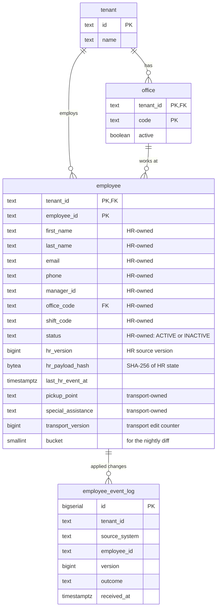

# HR Roster Sync

Companies keep their employee list in an HR system and send changes to MoveInSync, which plans employee cab transport: new joiners, office transfers, shift changes and exits. Those changes arrive one by one through an API during the day, and as a full file of up to 200,000 employees every night. In practice the same change can arrive twice, changes can arrive in the wrong order, some records contain bad data, and the nightly file is sometimes cut short. This service keeps MoveInSync's employee records correct anyway, and it refuses to act on a nightly file that looks broken until a person has checked it.

## Contents

1. [At a glance](#at-a-glance)
2. [The problem in plain words](#the-problem-in-plain-words)
3. [How it works — the big picture](#how-it-works--the-big-picture)
4. [The workflows, step by step](#the-workflows-step-by-step)
5. [The rules, explained](#the-rules-explained)
6. [Design decisions](#design-decisions)
7. [Trade-offs: consistency vs availability vs latency](#trade-offs-consistency-vs-availability-vs-latency)
8. [Security and tenant isolation](#security-and-tenant-isolation)
9. [Failure handling](#failure-handling)
10. [Monitoring — what on-call sees at 3 AM](#monitoring--what-on-call-sees-at-3-am)
11. [Caching](#caching)
12. [Performance and cost](#performance-and-cost)
13. [Data model](#data-model)
14. [API reference](#api-reference)
15. [Run it](#run-it)
16. [Project structure](#project-structure)
17. [Testing strategy](#testing-strategy)
18. [Assumptions](#assumptions)
19. [Deliberately left out](#deliberately-left-out)
20. [Glossary](#glossary)

## At a glance

_Pending._

## The problem in plain words

_Pending._

## How it works — the big picture

_Pending._

## The workflows, step by step

_Pending._

## The rules, explained

_Pending._

## Design decisions

_Pending._

## Trade-offs: consistency vs availability vs latency

_Pending._

## Security and tenant isolation

_Pending._

## Failure handling

_Pending._

## Monitoring — what on-call sees at 3 AM

_Pending._

## Caching

_Pending._

## Performance and cost

_Pending._

## Data model

Every table carries the client's id (`tenant_id`), and every key starts with it, so a row can only be reached together with the client it belongs to. The schema is created by Flyway from [`V1__core_schema.sql`](src/main/resources/db/migration/V1__core_schema.sql); the application never creates tables itself.



| Table | What it holds |
|---|---|
| `tenant` | One row per corporate client. |
| `office` | A client's office codes. An event naming an office that is missing or inactive is rejected. |
| `employee` | The current state of each employee. HR-owned and transport-owned columns are written by separate statements, each checking its own version (`hr_version`, `transport_version`), so neither owner can overwrite the other. `bucket` is `floorMod(murmur3(employee_id), 64)`, the slice of the nightly comparison the employee belongs to. |
| `employee_event_log` | One row per applied HR change. The unique key `(tenant_id, source_system, employee_id, version)` means the database itself refuses to record the same change twice (idempotency). |

Tables for change events, bookings and nightly reconciliation are added by later migrations, alongside the code that uses them.

## API reference

_Pending._

## Run it

Prerequisites: JDK 21 and Docker. Maven is not required; the project ships with the Maven wrapper.

```bash
docker compose up -d postgres   # Postgres 16 on localhost:5432 (local-only credentials: rostersync / rostersync)
./mvnw test                     # unit tests, no Docker needed
./mvnw verify                   # unit + integration tests; each run starts its own throwaway Postgres
docker compose down -v          # stop and delete the local database
```

Integration tests never use the `docker compose` database: they start a separate Postgres through Testcontainers, so Docker must be running for `./mvnw verify`.

## Project structure

_Pending._

## Testing strategy

_Pending._

## Assumptions

_Pending._

## Deliberately left out

_Pending._

## Glossary

_Pending._
