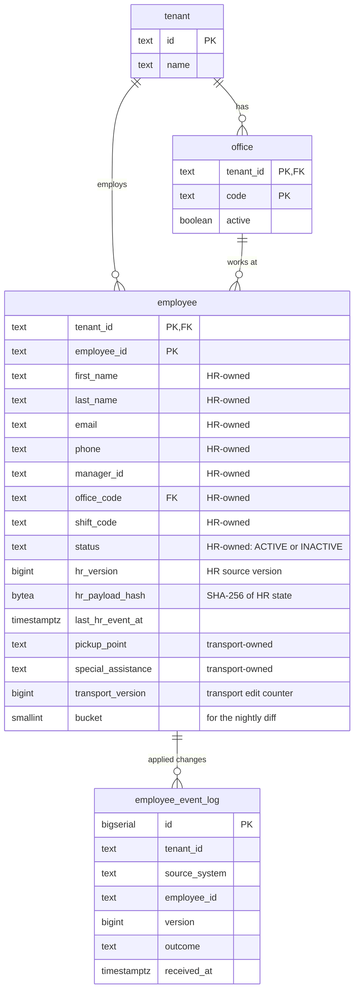

# HR Roster Sync

Companies keep their employee list in an HR system and send changes to MoveInSync, which plans employee cab transport: new joiners, office transfers, shift changes and exits. Those changes arrive one by one through an API during the day, and as a full file of up to 200,000 employees every night. In practice the same change can arrive twice, changes can arrive in the wrong order, some records contain bad data, and the nightly file is sometimes cut short. This service keeps MoveInSync's employee records correct anyway, and it refuses to act on a nightly file that looks broken until a person has checked it.

## Contents

1. [At a glance](#at-a-glance)
2. [The problem in plain words](#the-problem-in-plain-words)
3. [How it works — the big picture](#how-it-works--the-big-picture)
4. [The workflows, step by step](#the-workflows-step-by-step)
5. [The rules, explained](#the-rules-explained)
6. [Design decisions](#design-decisions)
7. [Trade-offs: consistency vs availability vs latency](#trade-offs-consistency-vs-availability-vs-latency)
8. [Security and tenant isolation](#security-and-tenant-isolation)
9. [Failure handling](#failure-handling)
10. [Monitoring — what on-call sees at 3 AM](#monitoring--what-on-call-sees-at-3-am)
11. [Caching](#caching)
12. [Performance and cost](#performance-and-cost)
13. [Data model](#data-model)
14. [API reference](#api-reference)
15. [Run it](#run-it)
16. [Project structure](#project-structure)
17. [Testing strategy](#testing-strategy)
18. [Assumptions](#assumptions)
19. [Deliberately left out](#deliberately-left-out)
20. [Glossary](#glossary)

## At a glance

_Pending._

## The problem in plain words

_Pending._

## How it works — the big picture

_Pending._

## The workflows, step by step

_Pending._

## The rules, explained

Each rule from the case study: what it says, what goes wrong without it, how it is solved, why this way, and the test that proves it.

### Validate at the boundary; one bad record never fails a batch

- **The rule.** Reject invalid records (malformed phone, unknown office code, missing fields) with a per-record error report. One bad record must never fail a whole batch.
- **Without it.** A typo in one of 100 joiners blocks the other 99 from getting a cab until someone fixes the file, or a malformed phone number is stored and the driver cannot call.
- **How.**
  - The batch endpoint keeps each event as raw JSON until it is that record's turn, so even a wrongly typed field rejects only its own record.
  - Each record is validated by a chain of validators ([`CompositeValidator`](src/main/java/com/moveinsync/rostersync/domain/validation/CompositeValidator.java)):
    - required fields;
    - email shape;
    - phone in canonical E.164, checked with Google's libphonenumber;
    - office code known for this client.
  - Each valid record is applied in **its own database transaction** ([`ApplyService`](src/main/java/com/moveinsync/rostersync/application/ApplyService.java)).
  - The response is `200` with one result per record: index, employee id, outcome, and an error code for rejections.
- **Why this way.** Wrapping the whole batch in one transaction would let a single database error roll back 99 good records. Per-record transactions cost more round trips but make every record independent.
- **Proof.**
  - [`IngestControllerIT.oneBadRecordDoesNotFailBatch`](src/test/java/com/moveinsync/rostersync/api/ingest/IngestControllerIT.java): 1 bad phone in 100 → 99 applied, 1 rejected with `INVALID_PHONE`.
  - `wronglyTypedFieldRejectsOnlyItsRecord`.
  - [`CompositeValidatorTest`](src/test/java/com/moveinsync/rostersync/domain/validation/CompositeValidatorTest.java).

### Per-employee order, idempotency key and version comparison

- **The rule.** Apply changes per employee in version order; a stale update is ignored and a duplicate is a no-op. Define the idempotency key and the version comparison.
- **Without it.** A retry is applied twice, or an older shift change that arrives late overwrites a newer transfer, and the employee is sent to the wrong office.
- **How.** Every event carries the source system's per-employee `version` and the employee's **full** HR-owned state, not just the changed field. Inside a transaction that locks the employee's row (`SELECT … FOR UPDATE`), [`VersionPolicy`](src/main/java/com/moveinsync/rostersync/domain/VersionPolicy.java) decides:

  | Stored | Incoming | Decision | Effect |
  |---|---|---|---|
  | nothing | any | APPLY | create the employee |
  | v | > v | APPLY | write HR fields, record the change |
  | v | = v, same content hash | DUPLICATE | nothing written |
  | v | = v, different content hash | REJECTED `VERSION_CONFLICT` | nothing written |
  | v | < v | STALE | nothing written |

  - **Idempotency key:** `(tenant_id, source_system, employee_id, version)`. The database enforces it with a unique key on the applied-event log.
  - **Content hash:** SHA-256 of the employee's HR state, in a fixed encoding.
  - **Defence in depth:** the write itself is conditional: `UPDATE … WHERE hr_version < :incoming`.
- **Why this way.**
  - Because events carry full state, "accept only newer versions" gives the same end result as applying every event in order, without queues or reordering buffers.
  - The lock serialises events for one employee only; different employees proceed in parallel.
  - The case study's example: a transfer (v7) arrives before a shift change (v6). v6 is stale, and the employee ends up in the new office with the v7 shift, which already contains the v6 change.
- **Proof.**
  - [`ExampleUseCaseIT.transferV7BeforeShiftV6`](src/test/java/com/moveinsync/rostersync/ExampleUseCaseIT.java).
  - [`ApplyServiceIT`](src/test/java/com/moveinsync/rostersync/application/ApplyServiceIT.java): `staleIgnored`, `duplicateIsNoOp`, `sameVersionWithDifferentContentIsRejectedAsConflict`.
  - [`ReplayFeedTwiceIT`](src/test/java/com/moveinsync/rostersync/ReplayFeedTwiceIT.java): a shuffled 1,000-event feed sent twice; after the second run every row, column by column including timestamps, and the change log are identical.
  - [`ConcurrentApplyIT`](src/test/java/com/moveinsync/rostersync/ConcurrentApplyIT.java): 32 threads, versions 1–200 shuffled → final version 200, no version applied twice, no lost update. Without the lock and the conditional update this test fails.

### Field ownership and the conflict rule

- **The rule.** HR owns name, email, manager and office; the transport admin owns pickup point and special-assistance needs. An HR update never overwrites a transport-owned field, and the conflict rule is written down.
- **Without it.** A routine HR update wipes the pickup point the transport admin set, and the cab goes to the wrong address.
- **The conflict rule.**
  1. Every field has exactly one owner ([`EmployeeField`](src/main/java/com/moveinsync/rostersync/domain/EmployeeField.java)). Phone, shift and status come from the HR system and are HR-owned (an assumption: the case study lists only name, email, manager and office).
  2. Only the owner's write path changes a field, and each owner has its own version (`hr_version`, `transport_version`), so neither can make the other's updates look stale.
  3. A value for a field the writer does not own is ignored and counted (`hr_owned_field_violation_total`); the rest of the record is still applied.
  4. There is no "last write wins" across owners.
- **How.** The HR update statement names only HR columns and the transport update only transport columns. Writes never go through the ORM, whose change tracking would write every column.
- **Proof.**
  - [`ApplyServiceIT.hrCannotOverwriteTransportFields`](src/test/java/com/moveinsync/rostersync/application/ApplyServiceIT.java).
  - [`IngestControllerIT.transportFieldsInAnHrPayloadAreIgnoredAndCounted`](src/test/java/com/moveinsync/rostersync/api/ingest/IngestControllerIT.java).
  - [`EmployeeRepositoryIT.hrWritesNeverTouchTransportColumns`](src/test/java/com/moveinsync/rostersync/infrastructure/persistence/EmployeeRepositoryIT.java).
  - [`FieldOwnershipPolicyTest`](src/test/java/com/moveinsync/rostersync/domain/FieldOwnershipPolicyTest.java).

### No personal data in logs or error reports

- **The rule.** Never write personal data into logs or error reports; use employee ids.
- **How.**
  - Logs are JSON lines carrying `traceId`, `tenantId` and `employeeId` as fields.
  - Error responses carry a stable `code` and the `traceId`, plus field *names* for validation errors.
  - Exception messages are never copied into a response or a log line, because a database message can contain the very value it rejected.
  - `toString()` of every domain object that holds personal data lists field names only.
- **Proof.**
  - [`IngestControllerIT.errorReportContainsNoPersonalData`](src/test/java/com/moveinsync/rostersync/api/ingest/IngestControllerIT.java).
  - [`GlobalExceptionHandlerTest`](src/test/java/com/moveinsync/rostersync/api/GlobalExceptionHandlerTest.java).
  - The domain `toString` tests.
  - A test that captures every log line of the whole suite comes with the monitoring work.

### Reliable change events (the outbox)

- **The rule.** Publish a change event for every applied change using the outbox pattern, so the database update and the event can never disagree.
- **Without it.** The obvious code saves the employee and then sends the event. If the process dies in between, the employee is marked as left but nobody downstream hears about it, and their cab bookings stay. Sending first and saving second fails the other way: an event for a change that was rolled back.
- **How.**
  - In **the same database transaction** as the employee update, a row is written to the `outbox` table ([`ApplyService`](src/main/java/com/moveinsync/rostersync/application/ApplyService.java), [`JdbcOutbox`](src/main/java/com/moveinsync/rostersync/infrastructure/persistence/JdbcOutbox.java)). Both commit or neither does, and the outbox refuses a write outside a transaction.
  - A background relay ([`OutboxRelay`](src/main/java/com/moveinsync/rostersync/application/OutboxRelay.java)) runs every 200 ms:
    - it locks up to 100 unsent rows in order (`FOR UPDATE SKIP LOCKED`);
    - it sends each to the topic `rostersync.employee-changes`, keyed by `tenant:employee` so each employee's events stay in order;
    - it **waits for the broker's acknowledgement** before marking the row sent.
  - On a failure it records the attempt, **stops the batch** so no later event overtakes an earlier one, and backs off exponentially, up to 10 s.
  - A Postgres advisory lock keeps exactly one relay active across instances. Skipping locked rows alone would let a second instance send an employee's newer event while the first retries an older one.
  - Events carry ids, versions, status and the *names* of the changed fields, never their values. A consumer that needs details asks the API.
- **Why this way.**
  - Delivery is **at least once**: a crash after sending but before marking means the event is sent again.
  - Consumers turn that into an **exactly-once effect** by remembering event ids.
  - Exactly-once *delivery* across a database and a broker would need a distributed transaction. Reading the database's change log (CDC, e.g. Debezium) would avoid polling but adds a connector service to run.
- **Proof.**
  - [`OutboxIT.eventWrittenInSameTransaction`](src/test/java/com/moveinsync/rostersync/OutboxIT.java): a failing event write leaves no employee change behind. The same class shows duplicates and stale records write no event.
  - [`OutboxRelayIT`](src/test/java/com/moveinsync/rostersync/application/OutboxRelayIT.java): order per key, stop at the first failure, one active relay.
  - [`OutboxCrashRecoveryIT`](src/test/java/com/moveinsync/rostersync/OutboxCrashRecoveryIT.java): **the process dies between the database write and the publish**, both before and after the broker received the event, and the effect still happens exactly once.
  - [`BrokerDownIT`](src/test/java/com/moveinsync/rostersync/infrastructure/messaging/BrokerDownIT.java): while the broker is down, updates keep being accepted and the backlog drains in order afterwards.

### Deactivation side effects

- **The rule.** An employee who leaves has their future cab bookings cancelled and their seat freed.
- **Without it.** A cab waits at the pickup point of someone who no longer works there, and the seat cannot be given to anyone else.
- **How.**
  - A consumer of the change topic ([`EmployeeChangeListener`](src/main/java/com/moveinsync/rostersync/infrastructure/messaging/EmployeeChangeListener.java) → [`DeactivationHandler`](src/main/java/com/moveinsync/rostersync/application/DeactivationHandler.java)) reacts to `EMPLOYEE_DEACTIVATED`.
  - In one transaction it records the event id in `processed_message`. If the id is already there, it does nothing.
  - Otherwise it cancels the employee's bookings on trips that have not started and frees one seat per cancelled booking. Both happen in a single SQL statement, so they cannot get out of step.
  - Bookings on trips that already ran are left as history.
  - A failing side effect is retried with growing pauses for up to ten minutes.
- **Why the event id check matters.** Cancelling is mostly idempotent on its own, since a second run finds nothing still booked. The dangerous case is a **late copy** of an old exit that arrives after the person was rehired and booked again. Without the check it would cancel the new booking.
- **Proof.**
  - [`DeactivationConsumerIT`](src/test/java/com/moveinsync/rostersync/DeactivationConsumerIT.java), including `lateCopyOfAnOldExitDoesNotCancelBookingsMadeAfterRehire`. That test fails if the check is removed.
  - [`BookingApiIT.anExitSentByHrCancelsTheBookingEndToEnd`](src/test/java/com/moveinsync/rostersync/api/booking/BookingApiIT.java).

### Nightly reconciliation

- **The rule.** Every night HR sends the full list of employees. Compare it with what we hold and fix the differences: create the employees we do not have, update the ones that changed, deactivate the ones that are gone.
- **Without care.** The simple version loads 200,000 file rows and 200,000 database rows into two maps. That needs hundreds of megabytes and grows with every client. Worse, it treats "not in the file" as "left the company", so a file that was cut short would deactivate everyone after the cut.
- **The file.** A header names the client and the moment the export was taken, and a trailer states how many rows it holds:
  ```
  #HEADER,tenant=acme,as_of=2026-10-30T02:00:00Z
  employee_id,version,first_name,last_name,email,phone,manager_id,office_code,shift_code,status
  E000001,12,…,ACTIVE
  #TRAILER,count=200000
  ```
  A file without the trailer, or with a wrong count, is treated as cut short.
- **How: plan first, in two passes, then apply.** [`ReconciliationPlanner`](src/main/java/com/moveinsync/rostersync/application/reconciliation/ReconciliationPlanner.java):
  1. **Pass 1** streams the file one row at a time ([`ExportReader`](src/main/java/com/moveinsync/rostersync/application/reconciliation/ExportReader.java)). It validates each row with the same validators as the API, hashes its HR state, and appends a short line to one of 64 temporary bucket files. The bucket is `floorMod(murmur3(employee_id), 64)`, the same value stored in `employee.bucket`.
  2. **Pass 2** takes one bucket at a time. It loads that bucket's file rows (about 3,000) and the matching database rows (`WHERE tenant_id = ? AND bucket = ?`, indexed), then compares them ([`ReconciliationDiffer`](src/main/java/com/moveinsync/rostersync/domain/reconciliation/ReconciliationDiffer.java)):
     | File row | Stored employee | Plan |
     |---|---|---|
     | valid, not stored | – | `CREATE` |
     | newer version, different hash | any | `UPDATE` |
     | same version, same hash | any | nothing |
     | same version, different hash | any | conflict, reported, nothing changed |
     | older version | any | nothing (the live feed is ahead) |
     | missing | `ACTIVE`, last HR event at or before `as_of` | `DEACTIVATE` |
     | invalid (bad phone, cut-off line…) | any | nothing; **the employee counts as present** |
  3. The plan is stored in `reconciliation_item`, and bad lines in `reconciliation_error` by line number and code, never values. The temporary files are deleted.
  4. If the safety brake (below) allows it, the plan is applied one employee at a time through the same [`ApplyService`](src/main/java/com/moveinsync/rostersync/application/ApplyService.java) as live events: same locking, same version rules, same outbox events.
- **Why this way.**
  - At most one bucket is in memory, so memory stays flat as files grow; the benchmark below runs on a 256 MB heap.
  - Hashes make "has anything changed?" a comparison of 32 bytes instead of nine fields.
  - **A missing employee is deactivated at the stored version, and only if nothing happened since the export.** The live feed keeps running while the file is processed or waits for approval. If the employee was changed after `as_of`, or their version moved since the plan was made, the deactivation is skipped. A stale file never undoes a newer live event.
  - An invalid row never deactivates its employee. A broken line says nothing about whether the person left.
- **Proof.**
  - [`ReconciliationDifferTest`](src/test/java/com/moveinsync/rostersync/domain/reconciliation/ReconciliationDifferTest.java) covers every row of the table.
  - [`ReconciliationPlannerIT`](src/test/java/com/moveinsync/rostersync/application/reconciliation/ReconciliationPlannerIT.java): only changes are planned, bad lines are recorded by number and code, an invalid row never deactivates, and the working files are deleted.
  - [`ReconciliationIT.approvalLaterStillRespectsLiveChangesMadeInBetween`](src/test/java/com/moveinsync/rostersync/application/reconciliation/ReconciliationIT.java).
  - [`ReconciliationBenchmarkIT`](src/test/java/com/moveinsync/rostersync/ReconciliationBenchmarkIT.java): 200,000 employees, see [Performance and cost](#performance-and-cost).

### The safety brake

- **The rule.** If tonight's file would deactivate 30 % or more of a client's active employees, deactivate nobody, alert an operator, and wait for a human.
- **Without it.** The case study's example: a file that stops at row 120,000 of 200,000 would mark 80,000 people as having left and cancel their cabs.
- **How.** [`SafetyBrake`](src/main/java/com/moveinsync/rostersync/domain/reconciliation/SafetyBrake.java) looks at the finished plan, before anything is applied:
  - `FILE_TRUNCATED`: the trailer is missing or its count is wrong. This trips even when nobody would be deactivated, because the file cannot be trusted.
  - `MISSING_RATIO_EXCEEDED`: planned deactivations ÷ active employees ≥ `rostersync.reconciliation.brake-threshold` (default `0.30`), computed with `BigDecimal`.
  - When it trips, the **whole** plan waits, creates and updates included: the run goes to `AWAITING_APPROVAL`. The counter `reconciliation.brake.tripped{tenant,reason}` goes up and a WARN line with the run id is logged.
  - An operator reviews the counts with `GET /api/v1/reconciliations/{id}`, then calls `approve` (the plan is applied, still skipping anyone changed in the meantime) or `reject` (nothing is applied).
  - Deciding twice, or deciding a run that is not waiting, is `409 RUN_NOT_AWAITING_APPROVAL`, so a double click cannot apply a plan twice.
- **Why hold the whole plan?** A file cut short is suspect in every row, not only in the missing ones. Applying half a plan would also leave a state that matches neither the file nor yesterday.
- **Proof.**
  - [`SafetyBrakeTest`](src/test/java/com/moveinsync/rostersync/domain/reconciliation/SafetyBrakeTest.java): thresholds, boundaries, zero active employees.
  - [`ReconciliationIT.brakeStopsRun`](src/test/java/com/moveinsync/rostersync/application/reconciliation/ReconciliationIT.java) and `fileWithoutTrailerTripsEvenWhenNobodyIsMissing`.
  - [`BrakeThresholdConfigIT`](src/test/java/com/moveinsync/rostersync/application/reconciliation/BrakeThresholdConfigIT.java): the threshold comes from configuration.
  - [`ExampleUseCaseIT.truncatedFileAt120kDeactivatesNobody`](src/test/java/com/moveinsync/rostersync/ExampleUseCaseIT.java): 200,000 employees and a file cut at row 120,000, mid-row. The run waits with `FILE_TRUNCATED` and 79,999 planned deactivations; the half row counts as present. Nobody is deactivated and no event is written, including after an operator rejects the run.
  - [`ReconciliationApiIT`](src/test/java/com/moveinsync/rostersync/api/reconciliation/ReconciliationApiIT.java): approve, reject, deciding twice, roles.

## Design decisions

_Pending._

## Trade-offs: consistency vs availability vs latency

_Pending._

## Security and tenant isolation

Every request carries a signed token (a JWT: a small JSON document signed with a key only the server holds, so it cannot be forged or altered). The token says who is calling, which client (tenant) they belong to, and which roles they have.

### Roles

| Role | Who | May call |
|---|---|---|
| `HR_INTEGRATION` | The client's HR system (a machine, not a person) | `POST /api/v1/hr/events:batch`, `POST /api/v1/reconciliations` (upload only) |
| `ADMIN` | MoveInSync transport admin | `GET /api/v1/employees/{id}`, `PATCH /api/v1/employees/{id}/transport` |
| `EMPLOYEE` | An employee | `GET /api/v1/employees/me` (own record only; the id is the token's subject) |
| `OPERATOR` | Reviews nightly reconciliation runs | `POST /api/v1/reconciliations`, `GET /api/v1/reconciliations/{id}` and `/errors`, `POST …/approve` and `…/reject` |

- Everything not listed is **denied by default**: a new endpoint is closed until someone decides who may use it.
- `HR_INTEGRATION` is an addition to the case study's three roles. The HR system is not a person, and giving it `ADMIN` would let it edit transport fields.
- Refusals are problem documents: `401 UNAUTHENTICATED` for a missing, expired, forged or tenant-less token; `403 FORBIDDEN` for the wrong role.

### How the tenant is decided

**Only from the verified token's `tenant_id` claim.** Never from the URL, the body or a header.
- Controllers receive the tenant as a typed parameter that only the token can fill, so there is no code path that reads it from the request.
- Every table's key starts with `tenant_id`, and every storage method requires the tenant.
- An employee's office must belong to the same tenant (a composite foreign key).

### Why another tenant's data answers 404, not 403

`403 Forbidden` would confirm that the record exists, just not for you. That alone leaks information, for example whether a competitor employs someone with a given id. A request for another tenant's employee gets exactly the same `404` body as a request for an id that exists nowhere.

Proof: [`TenantIsolationIT`](src/test/java/com/moveinsync/rostersync/TenantIsolationIT.java), and in it `anotherTenantsEmployeeLooksExactlyLikeAMissingOne`.

### Personal data

| Data | Stored in | Never appears in |
|---|---|---|
| Name, email, phone, manager | `employee` (HR-owned columns) | logs, error responses, metric labels, the batch report |
| Pickup point (a home location), special-assistance needs (possibly health data) | `employee` (transport-owned columns) | the same, and HR write paths |

These fields are returned only to an authorised caller: an `ADMIN` of the same tenant, or the employee themself.

### Tokens and keys

- Tokens are HS256-signed with `rostersync.security.jwt-secret`. The application refuses to start without it.
- `POST /dev/token` issues tokens for local evaluation. It exists **only** under the `dev` and `demo` profiles, logs a warning when enabled, and returns `404` everywhere else.
- A production deployment would use RS256 tokens from the company's identity provider, so the API holds only a public key. That is listed under "Deliberately left out".

## Failure handling

_Pending._

## Monitoring — what on-call sees at 3 AM

_Pending._

## Caching

_Pending._

## Performance and cost

### Nightly reconciliation at 200,000 employees

[`ReconciliationBenchmarkIT`](src/test/java/com/moveinsync/rostersync/ReconciliationBenchmarkIT.java), run with `./mvnw verify -Pbenchmark`. The test JVM has a 256 MB heap (`-Xmx256m`); Postgres runs in Testcontainers on the same machine.

| | |
|---|---|
| Stored employees | 200,000 |
| Tonight's file | 201,000 employees with 1,000 changed, 1,000 missing (199,995 rows) |
| Plan | 995 creates, 1,000 updates, 1,000 deactivations, 0 conflicts |
| Planning (both passes, plan stored) | **3.0 s** |
| Planning + applying 2,995 changes | **25.3 s** (budget: 60 s) |
| Peak heap, Spring context included | **109 MB** of 256 MB |

Machine: Apple M2, 8 cores, 8 GB RAM, macOS, JDK 21.0.13 (Temurin), Docker with 6 GB.

- **Time.** Planning is O(n) in file rows plus stored rows: one streaming pass, then one indexed bucket query and an O(bucket) hash-map comparison per bucket. Applying is O(changes), one short transaction each. On a quiet night that is a few thousand changes, not 200,000.
- **Space.** O(n / 64) in memory, for one bucket's file rows and stored rows, plus O(n) on disk for the temporary bucket files (about 16 MB for 200,000 rows). Doubling the client size doubles the disk use and the time, not the heap. Beyond a few million employees per client, `bucket-count` would be raised so that each bucket stays small.
- **Where it stops scaling.** The apply step runs one employee per transaction (about 7 ms each here). A night that changes everyone, for example after a data migration at HR, would take around 25 minutes. That is acceptable for a nightly job and keeps each change safe against live events; batching would be the next step.

## Data model

Every table carries the client's id (`tenant_id`), and every key starts with it, so a row can only be reached together with the client it belongs to. The schema is created by Flyway from [`V1__core_schema.sql`](src/main/resources/db/migration/V1__core_schema.sql); the application never creates tables itself.



| Table | What it holds |
|---|---|
| `tenant` | One row per corporate client. |
| `office` | A client's office codes. An event naming an office that is missing or inactive is rejected. |
| `employee` | The current state of each employee. HR-owned and transport-owned columns are written by separate statements, each checking its own version (`hr_version`, `transport_version`), so neither owner can overwrite the other. `bucket` is `floorMod(murmur3(employee_id), 64)`, the slice of the nightly comparison the employee belongs to. |
| `employee_event_log` | One row per applied HR change. The unique key `(tenant_id, source_system, employee_id, version)` means the database itself refuses to record the same change twice (idempotency). |

Tables for change events, bookings and nightly reconciliation are added by later migrations, alongside the code that uses them.

Nightly reconciliation ([`V4__reconciliation.sql`](src/main/resources/db/migration/V4__reconciliation.sql)):

| Table | What it holds |
|---|---|
| `reconciliation_run` | One row per uploaded file: client, `as_of`, status (`RUNNING` → `PLANNED` → `APPLYING` → `COMPLETED`, or `AWAITING_APPROVAL` → `APPLYING` / `REJECTED`, or `FAILED`), the plan's counts, the trailer check, the brake's decision and reason, who decided and when, and how many changes were applied or skipped. |
| `reconciliation_item` | The plan: one row per create, update or deactivation, with the version it was planned at. Creates and updates carry the HR fields to apply (JSONB) until the run is decided. |
| `reconciliation_error` | One row per bad line: line number, employee id when readable, error code. Never the line's values. |

## API reference

All endpoints are under `/api/v1`, take and return JSON, and need a bearer token. The client (tenant) is taken from the token's `tenant_id` claim, never from the URL or body.

### `POST /api/v1/hr/events:batch`

Up to 1,000 HR events; each is handled on its own.

```json
{
  "sourceSystem": "workday",
  "events": [
    { "type": "UPDATE", "employeeId": "E000042", "version": 7, "occurredAt": "2026-10-30T08:00:07Z",
      "firstName": "…", "lastName": "…", "email": "…", "phone": "+919876543210",
      "managerId": "E000001", "officeCode": "HYD-02", "shiftCode": "NIGHT" },
    { "type": "DEACTIVATE", "employeeId": "E000043", "version": 12, "occurredAt": "2026-10-30T09:00:00Z" }
  ]
}
```

- `type` is `CREATE`, `UPDATE` or `DEACTIVATE`.
- A `DEACTIVATE` may send only the header, as above, or the full record (recommended): with the full record, an exit that arrives before any other event for that employee is still recorded.

Response `200`:
```json
{ "results": [
  { "index": 0, "employeeId": "E000042", "outcome": "APPLIED" },
  { "index": 1, "employeeId": "E000043", "outcome": "REJECTED", "errorCode": "UNKNOWN_EMPLOYEE" }
] }
```

`outcome` is `APPLIED`, `DUPLICATE`, `STALE` or `REJECTED`. Rejection codes:
- `MALFORMED_RECORD`
- `INVALID_EVENT_TYPE`
- `MISSING_REQUIRED_FIELD`
- `INVALID_VERSION`
- `INVALID_EMAIL`
- `INVALID_PHONE`
- `UNKNOWN_OFFICE`
- `UNKNOWN_EMPLOYEE`
- `VERSION_CONFLICT`

### `GET /api/v1/employees/{id}` (ADMIN) and `GET /api/v1/employees/me` (EMPLOYEE)

These return the employee record. The `ETag` header carries the transport version (`"0"`, `"1"`, …), which a transport edit must send back. An id that is not in the caller's tenant answers `404`.

### `PATCH /api/v1/employees/{id}/transport` (ADMIN)

```http
PATCH /api/v1/employees/E000042/transport
If-Match: "0"
Content-Type: application/json

{ "pickupPoint": "Gate 2, Tech Park" }
```

- `200` with the updated record and `ETag: "1"`.
- A field left out keeps its value; a field sent as `null` is cleared.
- `428 PRECONDITION_REQUIRED` without `If-Match`, and `412 TRANSPORT_VERSION_MISMATCH` if someone else edited first. Nothing changes in either case.
- `400 FIELD_NOT_OWNED` if the body names an HR-owned field (such as `officeCode`), and `400 INVALID_REQUEST` for an unknown field. Both list the field names.

### `POST /api/v1/bookings` and `GET /api/v1/bookings?employeeId=` (ADMIN)

These are minimal, there to show what an exit does to bookings.
- `POST {"tripId":"T1","employeeId":"E000042"}` → `201` with the booking.
- `409` when the trip is full (`TRIP_FULL`), already departed (`TRIP_DEPARTED`), the employee is inactive (`EMPLOYEE_INACTIVE`), or the employee already holds a seat on it (`ALREADY_BOOKED`).
- `404` for an unknown trip or employee, or one in another tenant.
- `GET` lists the employee's bookings with status and cancel reason.

### Change events (topic `rostersync.employee-changes`)

Key: `tenant:employee`. Headers: `eventId`, `eventType`. Value:
```json
{ "eventId": "41dd…", "tenantId": "acme", "employeeId": "E000042", "type": "EMPLOYEE_DEACTIVATED",
  "status": "INACTIVE", "hrVersion": 12, "transportVersion": 3, "changedFields": ["status"],
  "occurredAt": "2026-10-30T09:00:00Z" }
```
- `type` is one of `EMPLOYEE_CREATED`, `EMPLOYEE_UPDATED`, `EMPLOYEE_DEACTIVATED`, `EMPLOYEE_REACTIVATED` or `TRANSPORT_UPDATED`.
- Delivery is at least once, so consumers must ignore an `eventId` they have already handled.

### Nightly reconciliation

`POST /api/v1/reconciliations` (`HR_INTEGRATION` or `OPERATOR`), multipart with the export as part `file`, up to 100 MB:
```bash
curl -s -X POST localhost:8080/api/v1/reconciliations -H "Authorization: Bearer $TOKEN" \
  -F file=@data/generated/full-200k.csv
# 202 {"runId":"9b2e…","status":"RUNNING"}, Location: /api/v1/reconciliations/9b2e…
```
- The header is checked straight away: `400 INVALID_EXPORT_HEADER` for a missing or malformed one, and `400 EXPORT_TENANT_MISMATCH` when it names another client. In both cases no run is created.
- Everything else happens in the background, one run at a time.

`GET /api/v1/reconciliations/{id}` (`OPERATOR`) returns the run: status, counts (`rowsRead`, `rowsInvalid`, `toCreate`, `toUpdate`, `toDeactivate`, `conflicts`, `activeBefore`, `missingRatio`), `trailerOk`, `brakeTripped`, `brakeReason`, `applied`, `skipped`, `decidedBy` and timestamps.

`GET /api/v1/reconciliations/{id}/errors?page=0` (`OPERATOR`) lists 100 bad lines per page: `{"lineNo":13,"employeeId":"E11","code":"UNKNOWN_OFFICE"}`.

`POST /api/v1/reconciliations/{id}/approve` → `202`, the plan is applied in the background. `POST …/reject` → `200`, nothing is applied. Both are `OPERATOR` only. A run that is not `AWAITING_APPROVAL` gives `409 RUN_NOT_AWAITING_APPROVAL`; another client's run gives `404`.

A test export of any size: `scripts/generate-export.sh --rows 200000 [--truncate-at 120000] --out data/generated/x.csv`.

### `POST /dev/token` (only under the `dev` / `demo` profiles)

```bash
curl -s -X POST localhost:8080/dev/token -H 'Content-Type: application/json' \
  -d '{"tenantId":"acme","subject":"workday","roles":["HR_INTEGRATION"]}'
# {"token":"eyJ…","expiresAt":"…"}
```

### Errors

Every error is an [RFC 7807](https://www.rfc-editor.org/rfc/rfc7807) problem document with a stable `code` and the request's `traceId`. The same id is returned in the `X-Trace-Id` header and appears on every log line of that request.

```json
{ "type": "urn:rostersync:error:invalid-request", "title": "Bad Request", "status": 400,
  "code": "INVALID_REQUEST", "fields": ["events"], "traceId": "6f1c…" }
```

## Run it

Prerequisites: JDK 21 and Docker. Maven is not required; the project ships with the Maven wrapper.

```bash
docker compose up -d postgres redpanda                 # Postgres 16 on :5432, Kafka-compatible Redpanda on :19092
./mvnw spring-boot:run -Dspring-boot.run.profiles=dev  # the API on localhost:8080, with a local-only signing key
./mvnw test                                            # unit tests, no Docker needed
./mvnw verify                                          # unit + integration tests; each run starts its own Postgres
./mvnw verify -Pbenchmark                              # only the 200,000-employee reconciliation benchmark, 256 MB heap
scripts/generate-export.sh --rows 200000               # a synthetic nightly export in data/generated/
docker compose down -v                                 # stop and delete the local database
```

The application refuses to start without a token signing key (`rostersync.security.jwt-secret`, at least 32 bytes). The `dev` profile supplies a local-only one; any real deployment must provide its own.

Integration tests never use the `docker compose` services: they start their own Postgres and Redpanda through Testcontainers, so Docker must be running for `./mvnw verify`.

## Project structure

_Pending._

## Testing strategy

_Pending._

## Assumptions

_Pending._

## Deliberately left out

_Pending._

## Glossary

_Pending._
