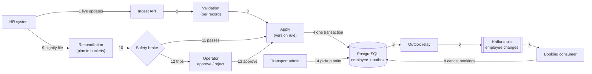
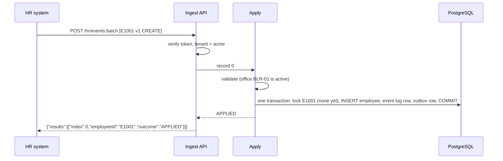
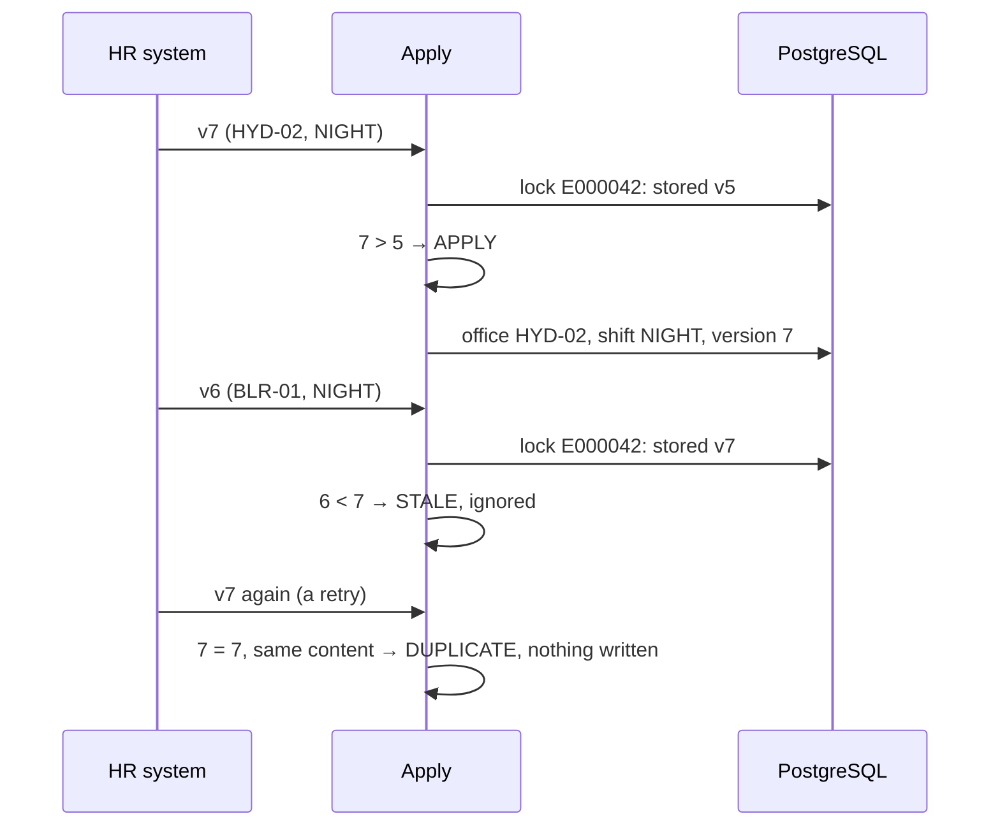
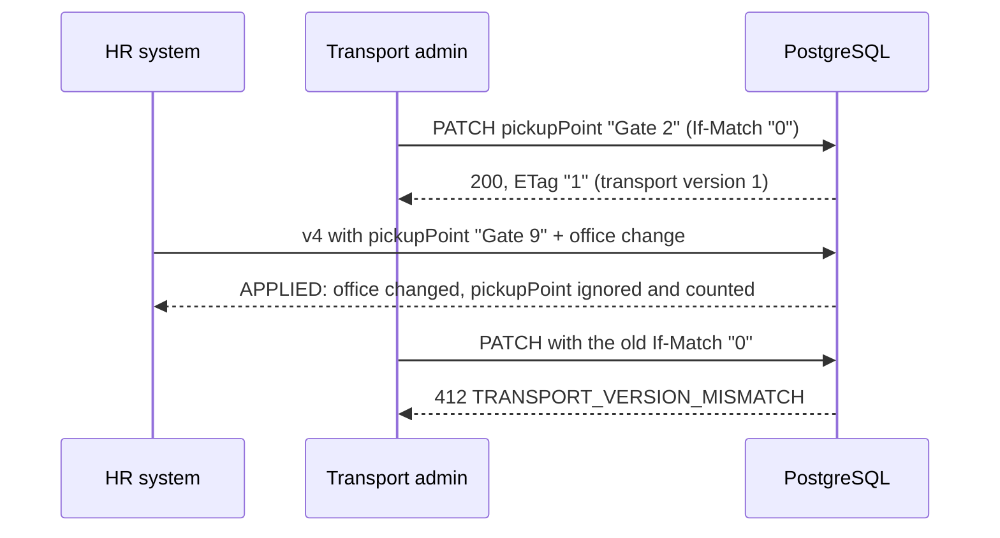
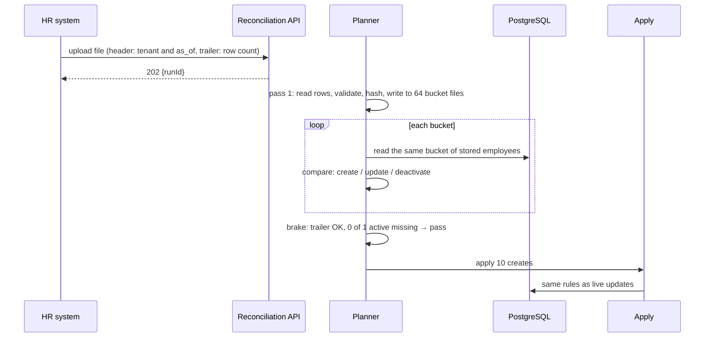
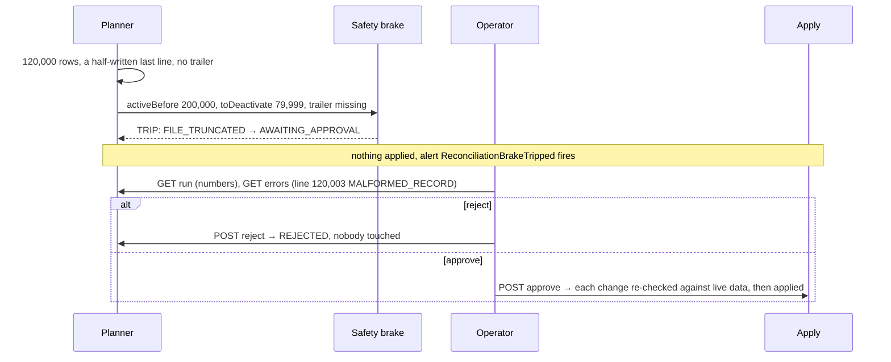
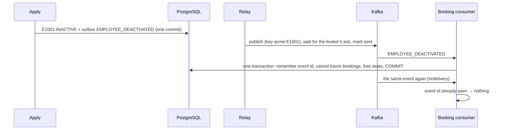
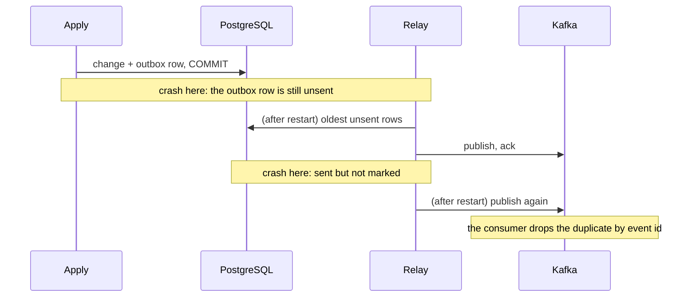
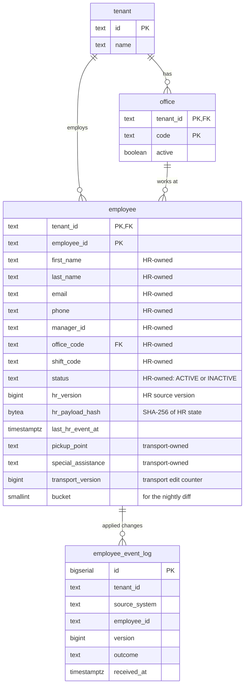
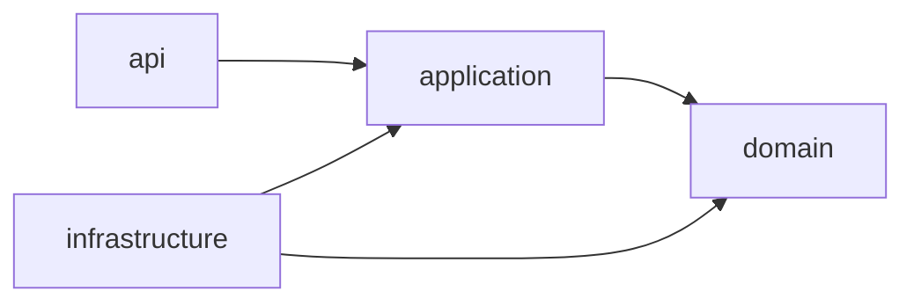

# HR Roster Sync

Companies keep their employee list in an HR system and send changes to MoveInSync, which plans employee cab transport: new joiners, office transfers, shift changes and exits. Those changes arrive one by one through an API during the day, and as a full file of up to 200,000 employees every night. In practice the same change can arrive twice, changes can arrive in the wrong order, some records contain bad data, and the nightly file is sometimes cut short. This service keeps MoveInSync's employee records correct anyway, and it refuses to act on a nightly file that looks broken until a person has checked it.

## Contents

1. [Run it in 5 minutes](#run-it-in-5-minutes)
2. [At a glance](#at-a-glance)
3. [The problem](#the-problem)
4. [The problems we solved](#the-problems-we-solved), each with how, the decisions, and how to test it
5. [How it works — the big picture](#how-it-works--the-big-picture), and [where the core logic lives](#where-the-core-logic-lives)
6. [The workflows, step by step](#the-workflows-step-by-step)
7. [API reference: every route](#api-reference-every-route)
8. [Testing](#testing): every rule by hand, and the automated suite
9. [Trade-offs: consistency vs availability vs latency](#trade-offs-consistency-vs-availability-vs-latency)
10. [Security and tenant isolation](#security-and-tenant-isolation)
11. [Failure handling](#failure-handling)
12. [Monitoring and alerting](#monitoring-and-alerting)
13. [Caching](#caching)
14. [Performance and cost](#performance-and-cost)
15. [Data model](#data-model)
16. [Technology choices](#technology-choices)
17. [Assumptions](#assumptions)
18. [Deliberately left out](#deliberately-left-out)
19. [Project structure](#project-structure)
20. [For developers](#for-developers)
21. [Glossary](#glossary)

More: [testing guide](docs/testing-guide.md) · [tests by problem](docs/problem-tests.md) · [design note](docs/design-note.md) (architecture, sequences, failure modes) · [traceability matrix](docs/traceability.md) · [curl examples](docs/curl-examples.md) · [Postman collection](docs/postman_collection.json)

## Run it in 5 minutes

### Requirements

| | |
|---|---|
| **Docker** | [Docker Desktop](https://www.docker.com/products/docker-desktop/) on macOS or Windows, or Docker Engine with Compose v2 on Linux. Give it **at least 6 GB of memory** (Settings → Resources) |
| **Free ports** | 8080 (API), 3000 (Grafana), 9090 (Prometheus), 5432 (PostgreSQL), 19092 (Kafka) |
| **For the guided tour** (optional) | `bash`, `curl` and `python3`. macOS and Linux have them; on Windows use Git Bash or WSL, or use Postman instead |

No Java, Maven, database or Kafka installation is needed: everything runs in containers.

### 1. Start everything with one command

```bash
git clone https://github.com/Hemal2005/Hr_Roster_Sync.git
cd Hr_Roster_Sync
docker compose up -d --build --wait
```

- The first run builds the application image and downloads the others: about 3–5 minutes. Later starts take seconds.
- `--wait` returns once all five services report healthy. Plain `docker compose up` works too: it keeps the logs in that terminal, so use a second terminal for the steps below.
- Check it's ready:
  ```bash
  curl -s localhost:8080/actuator/health
  # {"groups":["liveness","readiness"],"status":"UP"}
  ```

### 2. Exercise the API (one of three ways)

**A. The guided tour (recommended, about 30 seconds).** It walks through every rule against the running service and prints what happens:
```bash
scripts/demo-tour.sh
```
It covers a new joiner, a duplicate, changes out of order, a batch with bad records, HR vs transport fields, another client being refused, a booking cancelled by an exit, a normal night, a cut-off night held by the safety brake, and an operator approving a held night. Each step, with its expected output, is in [docs/curl-examples.md](docs/curl-examples.md). Every rule, checked step by step with commands and outputs: [testing guide](docs/testing-guide.md).

**B. Postman.** Import [docs/postman_collection.json](docs/postman_collection.json). Run the requests in folder **"0. Tokens"** first, which saves the tokens, then any request in folders 1–5.

**C. Three requests by hand:**
```bash
# 1. a token for the demo HR system of client "acme"
TOKEN=$(curl -s -X POST localhost:8080/dev/token -H 'Content-Type: application/json' \
  -d '{"tenantId":"acme","subject":"workday","roles":["HR_INTEGRATION"]}' | python3 -c 'import sys,json;print(json.load(sys.stdin)["token"])')

# 2. a new joiner
curl -s -X POST localhost:8080/api/v1/hr/events:batch -H "Authorization: Bearer $TOKEN" -H 'Content-Type: application/json' \
  -d '{"sourceSystem":"workday","events":[{"type":"CREATE","employeeId":"E000042","version":1,"occurredAt":"2026-10-30T08:00:00Z",
       "firstName":"Asha","email":"asha@acme.example","phone":"+919876543210","officeCode":"BLR-01","shiftCode":"DAY"}]}'
# {"results":[{"index":0,"employeeId":"E000042","outcome":"APPLIED"}]}

# 3. the same request again: nothing changes
# {"results":[{"index":0,"employeeId":"E000042","outcome":"DUPLICATE"}]}
```

### 3. Look inside

| URL | Shows |
|---|---|
| http://localhost:3000 | Grafana dashboard **HR Roster Sync**: records by outcome, rejections by code, ingest lag, outbox, brake trips, caches (no login needed to view) |
| http://localhost:9090/alerts | Prometheus alert rules; after the tour, **ReconciliationBrakeTripped** is firing |
| http://localhost:8080/actuator/prometheus | The raw metrics |

### 4. Stop or reset

```bash
docker compose down        # stop; the data is kept
docker compose down -v     # stop and delete all data (a clean start next time)
```
To reproduce the outputs in [docs/curl-examples.md](docs/curl-examples.md) exactly on a second run, reset first with `docker compose down -v`.

### If something goes wrong

| Symptom | Fix |
|---|---|
| `Cannot connect to the Docker daemon` | Start Docker Desktop and wait until it says it's running |
| `port is already allocated` / `address already in use` | Another program uses that port (often a local PostgreSQL on 5432). Stop it, or change the left-hand port in `docker-compose.yml` (for example `"5433:5432"`) |
| A container shows `unhealthy` or exits with code 137 | Docker is out of memory: give it at least 6 GB, then `docker compose up -d --wait` again |
| `--wait` isn't recognised | An older Compose: run `docker compose up -d --build`, wait a minute, then check health with the `curl` above |
| `scripts/demo-tour.sh: Permission denied` | `bash scripts/demo-tour.sh` |
| Tour outputs differ from the docs | The data from an earlier run is still there: `docker compose down -v`, then start again |
| Anything else | `docker compose logs app` shows the application's log |

### Demo data and identities

> **The `demo` profile is for local evaluation only, and it is off unless explicitly enabled.** It turns on `POST /dev/token`, which hands out a token for any tenant and role, and it loads demo data. Its signing key comes from `ROSTERSYNC_SECURITY_JWT_SECRET`, which defaults to a demo key in `docker-compose.yml`. A real deployment runs without `demo` or `dev`, provides its own key, and gets tokens from its identity provider.

**Demo data** ([`R__demo_seed.sql`](src/main/resources/db/demo/R__demo_seed.sql)):
- tenants `acme` (offices `BLR-01`, `HYD-02`, and `PUN-03`, which is inactive) and `globex` (`BLR-01`, `CHN-01`);
- trips `T-ACME-1`, `T-ACME-2` and `T-GLOBEX-1` tomorrow, plus `T-ACME-OLD`, which already ran.
Employees come in through the API, as in real life.

**Demo users** are token identities; ask `/dev/token` for any of them:

| Tenant | Subject | Role | Use |
|---|---|---|---|
| `acme` | `workday` | `HR_INTEGRATION` | send HR events, upload a nightly file |
| `acme` | `admin-1` | `ADMIN` | read employees, edit transport fields, book trips |
| `acme` | `ops-1` | `OPERATOR` | review, approve or reject nightly runs |
| `acme` | `E000042` | `EMPLOYEE` | `GET /api/v1/employees/me` once E000042 exists |
| `globex` | `workday` | `HR_INTEGRATION` | the second tenant, to see isolation |

## At a glance

| Hard rule from the case study | Status | Proof (a test that fails if the rule breaks) |
|---|---|---|
| Validate at the boundary; one bad record never fails a batch | Done | [`IngestControllerIT.oneBadRecordDoesNotFailBatch`](src/test/java/com/moveinsync/rostersync/api/ingest/IngestControllerIT.java) |
| Apply each employee's changes in version order; ignore older ones | Done | [`ExampleUseCaseIT.transferV7BeforeShiftV6`](src/test/java/com/moveinsync/rostersync/ExampleUseCaseIT.java), [`ConcurrentApplyIT`](src/test/java/com/moveinsync/rostersync/ConcurrentApplyIT.java) |
| The same change twice changes nothing (idempotency) | Done | [`ReplayFeedTwiceIT`](src/test/java/com/moveinsync/rostersync/ReplayFeedTwiceIT.java) |
| HR never overwrites what the transport team owns | Done | [`ApplyServiceIT.hrCannotOverwriteTransportFields`](src/test/java/com/moveinsync/rostersync/application/ApplyServiceIT.java), [`EmployeeRepositoryIT.hrWritesNeverTouchTransportColumns`](src/test/java/com/moveinsync/rostersync/infrastructure/persistence/EmployeeRepositoryIT.java) |
| Compare the nightly file efficiently, not fully in memory | Done | [`ReconciliationBenchmarkIT`](src/test/java/com/moveinsync/rostersync/ReconciliationBenchmarkIT.java) (200,000 rows on a 256 MB heap) |
| Safety brake: never deactivate 30 % or more without a person | Done | [`ExampleUseCaseIT.truncatedFileAt120kDeactivatesNobody`](src/test/java/com/moveinsync/rostersync/ExampleUseCaseIT.java) |
| Publish every change reliably, even across a crash (outbox) | Done | [`OutboxCrashRecoveryIT`](src/test/java/com/moveinsync/rostersync/OutboxCrashRecoveryIT.java), [`BrokerDownIT`](src/test/java/com/moveinsync/rostersync/infrastructure/messaging/BrokerDownIT.java) |
| An exit cancels future cab bookings and frees seats | Done | [`DeactivationConsumerIT`](src/test/java/com/moveinsync/rostersync/DeactivationConsumerIT.java) |
| No personal data in logs | Done | [`NoPiiInLogsIT`](src/test/java/com/moveinsync/rostersync/NoPiiInLogsIT.java) |
| One client can never see another's data | Done | [`TenantIsolationIT`](src/test/java/com/moveinsync/rostersync/TenantIsolationIT.java) |

Every case-study line is mapped to its proof in the [traceability matrix](docs/traceability.md).

| Headline number | Value |
|---|---|
| Nightly comparison of 200,000 employees (plan) | **3.0 s** |
| Peak memory during it, whole application included | **127 MB** of a 256 MB heap |
| Live ingest throughput | **5,858 records/s** |
| p99 latency of a 50-record batch under that load | **556 ms** |

Measured on one Apple M2 laptop (8 cores, 8 GB) running the app, database, broker and monitoring together; details in [Performance and cost](#performance-and-cost).

## The problem

A company with 200,000 employees uses MoveInSync to get its people to work by cab. MoveInSync has to know who works there, at which office, on which shift, and where to pick them up. The company's HR system tells it, in two ways: small updates through an API during the day ("Asha joined", "Ravi moved to Hyderabad", "Meera left"), and a full list of everyone every night.

In the real world those messages misbehave:

| What happens | What it costs if nothing guards against it |
|---|---|
| The same update arrives twice (a retry after a timeout) | Two cab bookings, double notifications, or a "change" that undoes a newer one |
| Updates arrive in the wrong order (v7 before v6) | Ravi's transfer is overwritten by his older shift change, and a cab goes to the wrong office |
| A record is broken (bad phone number, unknown office code) | If one bad record fails the whole batch, 999 good changes are lost with it |
| HR's update carries old transport data | The pickup point the transport team just fixed is overwritten, and the cab waits at the old gate |
| The nightly file is cut off at row 120,000 of 200,000 | 80,000 people look like they left: their accounts are deactivated and their cabs cancelled |
| The service crashes right after saving a change | The booking system never hears about an exit, and a cab still waits for someone who has left |

This service keeps the employee records correct through all of that. Where something is too risky to decide alone, as with the cut-off file, it stops and asks a person.

## The problems we solved

Each problem from the case study, in the same shape:
- **what goes wrong** in real life;
- **how we solved it**;
- **the decisions we made**, and what we chose not to do;
- **how to reproduce it**;
- **how it's tested**, with the command to run that test.

All test commands need JDK 21 (and Docker for integration tests); see [Testing: how to run every test](#testing).

### 1. A bad record must not block the good ones

- **What goes wrong.** A batch of 100 joiners contains one typo. If the whole batch is rejected, 99 people have no cab until someone fixes the file. If the typo is stored, the driver can't call a broken phone number.
- **How we solved it.**
  - Each record in a batch is read, validated and saved **on its own**.
  - Validation checks required fields, the email's shape, the phone number (international E.164 format, checked with Google's libphonenumber), and that the office code exists and is active for that client.
  - The answer lists every record: its position, employee id, outcome and, for a rejection, a stable error code. It never echoes the rejected values.
- **Decisions we made.**

  | Decision | Why | Not chosen |
  |---|---|---|
  | One database transaction per record | A database error on record 37 undoes only record 37 | One transaction per batch: one failure would undo 99 good records |
  | Keep each record as raw JSON until its turn | A record with a wrongly typed field (`"version": "abc"`) is rejected alone, instead of the whole request failing to parse | Parsing the whole body into typed objects up front |
  | Phone numbers must already be in E.164 (`+919876543210`) | Guessing the country of a local number could turn a valid number into someone else's | Normalising local formats |
  | Validators as small separate classes | Each rule is tested alone; a new rule is a new class | One large validation method |
- **Reproduce.** [Guided tour step 4](docs/curl-examples.md#4-one-batch-several-bad-records): one batch, five records, four different rejection codes, and the good record applied.
- **How it's tested.**
  - [`IngestControllerIT.oneBadRecordDoesNotFailBatch`](src/test/java/com/moveinsync/rostersync/api/ingest/IngestControllerIT.java): 1 bad phone in 100 → 99 applied, 1 `INVALID_PHONE`
  - [`IngestControllerIT.wronglyTypedFieldRejectsOnlyItsRecord`](src/test/java/com/moveinsync/rostersync/api/ingest/IngestControllerIT.java)
  - [`CompositeValidatorTest`](src/test/java/com/moveinsync/rostersync/domain/validation/CompositeValidatorTest.java): every validation rule, 19 cases
  - Run: `./mvnw test -Dtest=CompositeValidatorTest` · `./mvnw verify -Dit.test=IngestControllerIT -Dtest=None -Dsurefire.failIfNoSpecifiedTests=false`

### 2. The same change arrives twice

- **What goes wrong.** HR's system retries after a timeout, so the same change arrives again. Applied twice, it could create two bookings, send two notifications, or undo a newer change.
- **How we solved it.**
  - Every change carries a **version** number per employee from HR.
  - If the stored version equals the incoming one **and** the content is the same (compared by a fingerprint, a SHA-256 hash of the HR fields), it's a duplicate: nothing is written and no event is sent.
  - The **idempotency key** is `(client, source system, employee id, version)`, and a unique key in the database refuses to record the same change twice.
  - Same version with **different** content is a contradiction, so it's rejected as `VERSION_CONFLICT` and counted, never guessed.
- **Decisions we made.**

  | Decision | Why | Not chosen |
  |---|---|---|
  | Use HR's own per-employee version | HR already sends it; it identifies the *change*, not the request | An `Idempotency-Key` header: a re-sent batch with a new key would slip through |
  | Detect duplicates with the version rule, not a lookup table | One comparison inside the row lock handles duplicates and ordering together | A dedupe table read and written on every event |
  | Reject same-version-different-content | A version should identify one state; guessing could overwrite correct data | Last write wins |
- **Reproduce.** [Tour step 2](docs/curl-examples.md#2-the-same-event-again-nothing-changes-idempotency).
- **How it's tested.**
  - [`ReplayFeedTwiceIT`](src/test/java/com/moveinsync/rostersync/ReplayFeedTwiceIT.java): a shuffled 1,000-event feed sent twice; every row, column by column, and the change log are identical afterwards
  - [`ApplyServiceIT`](src/test/java/com/moveinsync/rostersync/application/ApplyServiceIT.java): `duplicateIsNoOp`, `sameVersionWithDifferentContentIsRejectedAsConflict`
  - [`VersionPolicyTest`](src/test/java/com/moveinsync/rostersync/domain/VersionPolicyTest.java): the whole decision table
  - [`SchemaIT.theSameAppliedChangeCannotBeLoggedTwice`](src/test/java/com/moveinsync/rostersync/infrastructure/persistence/SchemaIT.java): the database refuses it too
  - Run: `./mvnw verify -Dit.test=ReplayFeedTwiceIT -Dtest=None -Dsurefire.failIfNoSpecifiedTests=false`

### 3. Changes arrive out of order, or at the same moment

- **What goes wrong.** The case study's example: an office transfer (version 7) arrives before a shift change (version 6). Applied in arrival order, the old shift change overwrites the transfer, and the cab goes to the wrong office. Two servers applying changes to the same employee at the same moment can also lose one of them.
- **How we solved it.**
  - The rule:

    | Stored | Incoming | Decision |
    |---|---|---|
    | nothing | any | APPLY (create) |
    | v | newer than v | APPLY |
    | v | v, same content | DUPLICATE (nothing written) |
    | v | v, different content | REJECTED `VERSION_CONFLICT` |
    | v | older than v | STALE (ignored) |
  - Every event carries the employee's **full** HR state, so ignoring an older event loses nothing: the newer one already contains it.
  - The decision runs inside a lock on that employee's row (`SELECT … FOR UPDATE`), so changes to one employee are applied one at a time. Different employees never wait for each other.
  - The write itself is conditional (`… WHERE hr_version < new version`) as a second guard.
- **Decisions we made.**

  | Decision | Why | Not chosen |
  |---|---|---|
  | Full-state events | Ignoring a stale event is always safe | Deltas, which need a version per field and merge rules |
  | Versions, not timestamps | Clocks drift; two changes can share a millisecond | Timestamps; arrival order |
  | Lock the row (pessimistic) for HR changes | Machine feeds often hit the same employee; a lock queues them, with no retry storms | Optimistic retries |
  | An update for an unknown employee creates them | v2 can arrive before v1, and it carries the full state | Rejecting it and losing the change |
- **Reproduce.** [Tour step 3](docs/curl-examples.md#3-out-of-order-v3-arrives-before-v2-the-case-studys-example): v3 is applied, v2 is stale, and the employee ends on v3's office and shift.
- **How it's tested.**
  - [`ExampleUseCaseIT.transferV7BeforeShiftV6`](src/test/java/com/moveinsync/rostersync/ExampleUseCaseIT.java): the case study's example with its values
  - [`ConcurrentApplyIT`](src/test/java/com/moveinsync/rostersync/ConcurrentApplyIT.java): 32 threads send versions 1–200 shuffled for one employee: final version 200, each version applied once, nothing lost. Without the lock it fails
  - [`ApplyServiceIT.staleIgnored`](src/test/java/com/moveinsync/rostersync/application/ApplyServiceIT.java)
  - Run: `./mvnw verify -Dit.test='ExampleUseCaseIT,ConcurrentApplyIT' -Dtest=None -Dsurefire.failIfNoSpecifiedTests=false`

### 4. HR and the transport team edit the same employee

- **What goes wrong.** The transport team sets Asha's pickup point to "Gate 2". The next routine HR update carries an old pickup point and overwrites it, so the cab waits at the wrong gate. Or two transport admins edit at once, and one silently overwrites the other.
- **How we solved it: the conflict rule.**
  1. Every field has exactly one owner. **HR owns** name, email, phone, manager, office, shift and status. **The transport team owns** pickup point and special assistance.
  2. Only the owner can change a field. HR changes and transport edits use **separate database statements**, so HR's statement cannot even name a transport column.
  3. Each owner has its own version (`hr_version`, `transport_version`), so a transport edit never makes HR's next update look old, or the reverse.
  4. A transport field inside an HR update is ignored and counted (`hr_owned_field_violation_total`); the rest of the update applies. An admin trying to change an HR field gets `400 FIELD_NOT_OWNED`.
  5. A transport edit must say which version it was based on (`If-Match` header); if someone changed it meanwhile, it gets `412` and nothing changes. There is no "last write wins".
- **Decisions we made.**

  | Decision | Why | Not chosen |
  |---|---|---|
  | Ownership by separate write paths | It can't be forgotten in the next new feature | `if` checks spread through the code |
  | Hand-written SQL for writes; the ORM (JPA) only for reads | JPA saves every mapped column, which would let HR write transport columns | Saving entities through JPA |
  | Ignore (and count) foreign fields from HR, but reject them from the admin | HR feeds are machines; blocking a valid record over an extra field would hold up real changes. An admin is a person who can fix the request | Rejecting both |
  | Optimistic `If-Match` for admin edits | Human edits are rare and slow; holding a lock while someone thinks is wrong | Locks for admin edits |
- **Reproduce.** [Tour step 5](docs/curl-examples.md#5-field-ownership-hr-vs-the-transport-admin).
- **How it's tested.**
  - [`ApplyServiceIT.hrCannotOverwriteTransportFields`](src/test/java/com/moveinsync/rostersync/application/ApplyServiceIT.java)
  - [`EmployeeRepositoryIT.hrWritesNeverTouchTransportColumns`](src/test/java/com/moveinsync/rostersync/infrastructure/persistence/EmployeeRepositoryIT.java): checked at the database level
  - [`IngestControllerIT.transportFieldsInAnHrPayloadAreIgnoredAndCounted`](src/test/java/com/moveinsync/rostersync/api/ingest/IngestControllerIT.java)
  - [`TransportPatchIT`](src/test/java/com/moveinsync/rostersync/api/employee/TransportPatchIT.java): `If-Match`, `412`, `428`, `FIELD_NOT_OWNED`
  - [`FieldOwnershipPolicyTest`](src/test/java/com/moveinsync/rostersync/domain/FieldOwnershipPolicyTest.java): the field → owner table
  - Run: `./mvnw verify -Dit.test=TransportPatchIT -Dtest=None -Dsurefire.failIfNoSpecifiedTests=false`

### 5. Comparing 200,000 employees every night without running out of memory

- **What goes wrong.** The simple way loads the file and the database into memory and compares them. With 200,000 rows on each side, that needs hundreds of megabytes per client, and it grows with every client.
- **How we solved it.**
  - **Pass 1** reads the file one line at a time. Each line is validated, fingerprinted (hash of its HR fields), and written to one of **64 small temporary files** ("buckets"), chosen by a hash of the employee id. Each employee's bucket number is also stored in the database.
  - **Pass 2** takes one bucket at a time: about 3,000 rows from the file and the same bucket from the database (an indexed query). It compares them:

| File row | Stored employee | Plan |
|---|---|---|
| valid, not stored | – | `CREATE` |
| newer version, different content | any | `UPDATE` |
| same version, same content | any | nothing |
| same version, different content | any | conflict: reported, nothing changed |
| older version | any | nothing (the live feed is ahead) |
| missing | `ACTIVE`, last HR change at or before the file's `as_of` | `DEACTIVATE` |
| invalid (bad phone, cut-off line…) | any | nothing; **the employee counts as present** |

  - The result is a **plan**: who to create, update or deactivate, plus every bad line by line number and error code. The temporary files are deleted.
  - The plan is applied through the **same** code as live changes, with the same locks and version rule, so a file taken at 02:00 can never overwrite a live change made at 02:05.
- **Decisions we made.**

  | Decision | Why | Not chosen |
  |---|---|---|
  | 64 hash buckets, two passes | Only one bucket is in memory at a time: memory stays flat as files grow | Two full in-memory maps; sorting both sides |
  | Compare fingerprints, not fields | "Has anything changed?" becomes a 32-byte comparison | Comparing nine fields per row |
  | Plan first, apply later | The safety brake (next problem) needs the full picture before anything happens | Applying while reading |
  | An invalid line counts as "present" | A typo in the file isn't evidence that someone left | Treating it as missing |
  | A missing employee is deactivated only if nothing changed since the file was taken, and keeps HR's version number | The live feed keeps running; an old file must never undo a newer live change, and HR's next real version must still apply | Inventing a new version for "missing" |
- **Reproduce.** [Tour step 9](docs/curl-examples.md#9-the-nightly-file-a-normal-night). For a 200,000-row file: `scripts/generate-export.sh --rows 200000` (needs JDK 21), then upload it as in the [API reference](#nightly-reconciliation).
- **How it's tested.**
  - [`ReconciliationBenchmarkIT`](src/test/java/com/moveinsync/rostersync/ReconciliationBenchmarkIT.java): 200,000 stored employees vs a 201,000-row file: plan in 3.0 s, plan + apply in 24.9 s, 127 MB peak on a 256 MB heap
  - [`ReconciliationDifferTest`](src/test/java/com/moveinsync/rostersync/domain/reconciliation/ReconciliationDifferTest.java): every row of the comparison table
  - [`ReconciliationPlannerIT`](src/test/java/com/moveinsync/rostersync/application/reconciliation/ReconciliationPlannerIT.java): only changes are planned, bad lines recorded by number and code, temporary files deleted
  - [`ReconciliationIT.approvalLaterStillRespectsLiveChangesMadeInBetween`](src/test/java/com/moveinsync/rostersync/application/reconciliation/ReconciliationIT.java)
  - Run: `./mvnw verify -Pbenchmark` (only the benchmark, on a 256 MB heap; results in `target/benchmark/reconciliation.txt`)

### 6. A broken nightly file must not deactivate thousands of people

- **What goes wrong.** The case study's example: the file stops at row 120,000 of 200,000. Treated as complete, it says 80,000 people have left: their accounts are deactivated and their cabs cancelled.
- **How we solved it: the safety brake.**
  - The file has a header (client and the time the snapshot was taken) and a **trailer** stating how many rows it holds (`#TRAILER,count=200000`). A missing or wrong trailer means the file was cut off.
  - Before anything is applied, the brake looks at the finished plan:
    - **`FILE_TRUNCATED`**: the trailer is missing or wrong. This trips even if nobody would be deactivated, because the file can't be trusted.
    - **`MISSING_RATIO_EXCEEDED`**: planned deactivations ÷ active employees ≥ the threshold. The default is **30 %**, configurable as `rostersync.reconciliation.brake-threshold`.
  - When it trips, **nothing** from the file is applied, creates and updates included. The run waits (`AWAITING_APPROVAL`), a metric goes up, and the Prometheus alert **ReconciliationBrakeTripped** fires.
  - An operator looks at the numbers (how many would be deactivated, which lines were broken) and **approves** or **rejects**. On approval, every change is re-checked against live data. Deciding twice is refused (`409`).
- **Decisions we made.**

  | Decision | Why | Not chosen |
  |---|---|---|
  | Hold the whole plan, not only the deactivations | A cut-off or wrong file is suspect in every row; half a plan matches neither the file nor yesterday | Applying creates and updates anyway |
  | A trailer with the row count | A truncated file otherwise looks like a smaller file | Trusting the row count |
  | Exact decimal arithmetic for the ratio | In floating point, 30 % of 10 isn't exactly 3, so the boundary would be wrong | `double` |
  | Upload returns at once (`202`), work runs in the background, one run at a time | A large file shouldn't hold a web request open; two runs at once would plan against changing data | Processing inside the request |
- **Reproduce.** [Tour steps 10–11](docs/curl-examples.md#10-the-file-is-cut-off-the-safety-brake): a cut-off file is held and rejected; a file dropping almost half the staff is held and approved. Then open http://localhost:9090/alerts.
- **How it's tested.**
  - [`ExampleUseCaseIT.truncatedFileAt120kDeactivatesNobody`](src/test/java/com/moveinsync/rostersync/ExampleUseCaseIT.java): 200,000 employees, file cut at row 120,000 mid-line: held as `FILE_TRUNCATED`, 79,999 planned, **nobody** deactivated, even after rejection
  - [`SafetyBrakeTest`](src/test/java/com/moveinsync/rostersync/domain/reconciliation/SafetyBrakeTest.java): thresholds and the exact 30 % boundary
  - [`BrakeThresholdConfigIT`](src/test/java/com/moveinsync/rostersync/application/reconciliation/BrakeThresholdConfigIT.java): the threshold comes from configuration
  - [`ReconciliationApiIT`](src/test/java/com/moveinsync/rostersync/api/reconciliation/ReconciliationApiIT.java): upload, approve, reject, deciding twice, roles
  - [`alerts.test.yml`](ops/prometheus/alerts.test.yml): the alert fires on a client's first trip and resolves
  - Run: `./mvnw verify -Dit.test=ExampleUseCaseIT -Dtest=None -Dsurefire.failIfNoSpecifiedTests=false` · `scripts/check-alerts.sh`

### 7. Every change must reach downstream systems, even across a crash

- **What goes wrong.** The obvious code saves the change, then sends a message to other systems (such as bookings). If the process dies in between, the change is saved but nobody hears about it. Sending first is worse: a message about a change that was then rolled back.
- **How we solved it: the transactional outbox.**
  - The change and a row in an `outbox` table are saved in **one** database transaction: both or neither.
  - A background relay sends unsent rows to Kafka in order, keyed by employee so each employee's events stay in order. It marks a row sent **only after the broker confirms** it.
  - A crash before sending leaves the row unsent, and it's sent after restart. A crash after sending but before marking sends it twice, and consumers recognise the duplicate by its event id. Delivered at least once, acted on exactly once.
  - Only one relay is active at a time (a database advisory lock), and a failed send stops the batch, so no later event for an employee can overtake an earlier one.
  - If Kafka is down, saving changes continues; events wait in the outbox and drain in order later.
- **Decisions we made.**

  | Decision | Why | Not chosen |
  |---|---|---|
  | Outbox + relay | The only way to make "save" and "tell others" atomic without a distributed transaction | Save then send; Kafka transactions (they don't include the database) |
  | Polling relay | Simple to run; enough throughput here (≈ 7,000 events/s) | Change data capture (Debezium): no polling, but another service to operate |
  | One active relay, stop at the first failure | Keeps each employee's events in order | Several relays skipping locked rows: they could reorder an employee's events |
  | Send in groups where no employee repeats | The load test showed one-at-a-time sending managed only 137 events/s; groups reach ≈ 7,000 with the same ordering | Sending a whole batch at once, which could reorder an employee's events on failure |
  | Events carry ids, versions and the *names* of changed fields, not values | Brokers keep messages and copy them to every consumer; personal data stays behind the API | Full records in events |
- **Reproduce.** Stop the broker (`docker compose stop redpanda`), send an update (still `APPLIED`), watch "Outbox: oldest unsent" rise on the dashboard, then `docker compose start redpanda` and watch it drain. Or kill the app mid-traffic: `docker compose kill app`, then `docker compose up -d --wait app`.
- **How it's tested.**
  - [`OutboxCrashRecoveryIT`](src/test/java/com/moveinsync/rostersync/OutboxCrashRecoveryIT.java): **the process crashes between the database write and the publish**, before and after the broker received it; the effect still happens exactly once
  - [`OutboxIT.eventWrittenInSameTransaction`](src/test/java/com/moveinsync/rostersync/OutboxIT.java): a failing event write leaves no employee change behind
  - [`BrokerDownIT`](src/test/java/com/moveinsync/rostersync/infrastructure/messaging/BrokerDownIT.java): a broker outage: ingest continues, the backlog drains in order
  - [`OutboxRelayIT`](src/test/java/com/moveinsync/rostersync/application/OutboxRelayIT.java): order per employee, stop at the first failure, one active relay, at most one event per employee in flight
  - Run: `./mvnw verify -Dit.test='OutboxCrashRecoveryIT,BrokerDownIT' -Dtest=None -Dsurefire.failIfNoSpecifiedTests=false`

### 8. People who leave must lose their cab bookings

- **What goes wrong.** A cab waits at the pickup point of someone who left last week, and the seat can't go to anyone else.
- **How we solved it.**
  - The booking side listens for `EMPLOYEE_DEACTIVATED` events.
  - In one transaction it records the event id, cancels the person's bookings on trips that haven't started, and frees one seat per cancelled booking. Past trips stay as history.
  - If the event id was already handled, it does nothing.
  - Failures are retried with growing pauses for up to ten minutes.
- **Decisions we made.**

  | Decision | Why | Not chosen |
  |---|---|---|
  | React to the change event, separately from saving the change | Bookings are a different part of the business; ingest stays fast | Cancelling inside the HR change's transaction |
  | Remember handled event ids | A *late* copy of an old exit, arriving after the person was rehired and booked again, would otherwise cancel the new booking | Relying on cancellation being repeatable |
  | Cancel and free seats in one SQL statement | The two can never get out of step | Two separate updates |
- **Reproduce.** [Tour step 8](docs/curl-examples.md#8-an-exit-cancels-the-cab-booking-change-events).
- **How it's tested.**
  - [`DeactivationConsumerIT`](src/test/java/com/moveinsync/rostersync/DeactivationConsumerIT.java): future cancelled, past kept, seats exact, redelivery ignored, `lateCopyOfAnOldExitDoesNotCancelBookingsMadeAfterRehire` (fails without the event-id check)
  - [`BookingApiIT.anExitSentByHrCancelsTheBookingEndToEnd`](src/test/java/com/moveinsync/rostersync/api/booking/BookingApiIT.java): through the real API, outbox and broker
  - Run: `./mvnw verify -Dit.test=DeactivationConsumerIT -Dtest=None -Dsurefire.failIfNoSpecifiedTests=false`

### 9. Personal data must never leak

- **What goes wrong.** Error messages and logs end up in many places: log storage, alert emails, support tickets. If they contain names, phone numbers or pickup addresses, that's a data leak.
- **How we solved it.**
  - Logs are JSON lines with a trace id, client id and employee id, never field values.
  - Errors return a stable `code`, a trace id, and for validation the field *names*.
  - Exception messages are never copied into a response or log, because a database error message can contain the rejected value.
  - Objects holding personal data print only field names.
  - Metric labels are client ids, outcomes and codes.
  - A broken line in a nightly file is reported by line number and code only.
- **Decisions we made.**

  | Decision | Why | Not chosen |
  |---|---|---|
  | Report *where* and *what kind*, never *what* | Line number + code + employee id is enough to fix it; the value stays in the database under access control | Echoing the bad value back |
  | Prove it with a test that searches everything | Rules like this break quietly in new code | Reviewing by hand |
- **How it's tested.**
  - [`NoPiiInLogsIT`](src/test/java/com/moveinsync/rostersync/NoPiiInLogsIT.java): pushes distinctive fake names, emails, phones and addresses through every flow (valid and invalid, live and nightly, through the broker), then searches all log output, the metrics and every error body. It found and fixed one real leak: a garbled file line starting with a name
  - [`IngestControllerIT.errorReportContainsNoPersonalData`](src/test/java/com/moveinsync/rostersync/api/ingest/IngestControllerIT.java)
  - [`GlobalExceptionHandlerTest`](src/test/java/com/moveinsync/rostersync/api/GlobalExceptionHandlerTest.java): no exception message ever reaches a response
  - Run: `./mvnw verify -Dit.test=NoPiiInLogsIT -Dtest=None -Dsurefire.failIfNoSpecifiedTests=false`

### 10. One client must never see another client's data, and each person only what their role allows

- **What goes wrong.** Client A's admin types client B's employee id into the URL and sees their data. Or the HR system, a machine, is given admin rights and edits pickup points.
- **How we solved it.**
  - Every request carries a signed token (JWT) naming the caller, their client (tenant) and their roles.
  - The client is taken **only** from the token, never from the URL or body.
  - Every table key starts with the client id, and every database method requires it.
  - Roles: `HR_INTEGRATION` (the HR system), `ADMIN` (transport admin), `OPERATOR` (nightly runs), `EMPLOYEE` (own record only). Any endpoint not explicitly allowed is denied.
  - Another client's employee answers **`404`**, exactly like an id that doesn't exist, so the request doesn't even confirm the record exists.
- **Decisions we made.**

  | Decision | Why | Not chosen |
  |---|---|---|
  | Client only from the token | Nothing in the request can switch clients | A client id in the URL or a header |
  | `404`, not `403`, across clients | A `403` would confirm the record exists | `403` |
  | A separate role for the HR system | It's a machine; `ADMIN` would let it edit transport fields | Reusing `ADMIN` |
  | Deny by default | A new endpoint is closed until someone decides who may use it | Allow by default |
  | HS256 demo tokens from `/dev/token`, demo profile only | Easy local evaluation; production uses tokens from the company's identity provider | — |
- **Reproduce.** [Tour step 6](docs/curl-examples.md#6-another-tenant-404-exactly-like-an-id-that-doesnt-exist).
- **How it's tested.**
  - [`TenantIsolationIT`](src/test/java/com/moveinsync/rostersync/TenantIsolationIT.java): `anotherTenantsEmployeeLooksExactlyLikeAMissingOne`
  - [`SecurityIT`](src/test/java/com/moveinsync/rostersync/api/security/SecurityIT.java): missing, expired, forged and client-less tokens → 401; wrong role → 403; unknown paths denied
  - [`ReconciliationApiIT.rolesAreEnforced`](src/test/java/com/moveinsync/rostersync/api/reconciliation/ReconciliationApiIT.java)
  - [`DevTokenAbsentIT`](src/test/java/com/moveinsync/rostersync/api/security/DevTokenAbsentIT.java): `/dev/token` doesn't exist without the demo or dev profile
  - Run: `./mvnw verify -Dit.test='TenantIsolationIT,SecurityIT' -Dtest=None -Dsurefire.failIfNoSpecifiedTests=false`

### 11. On-call must be alerted when something goes wrong

- **What goes wrong.** The broker has been down for an hour, a client started sending broken records, or last night's file is waiting for approval, and nobody knows until employees complain.
- **How we solved it.**
  - The service exposes the numbers on-call needs: records by outcome and error code, ingest lag, retries, outbox depth and oldest unsent age, publish failures, consumer lag, nightly-run duration, brake trips, cache hits.
  - Prometheus collects them, Grafana shows them, and five alert rules page someone: brake tripped, outbox not draining, rejection spike, ingest lag, app down.
  - Every alert rule has its own unit test.
  - Logs are structured JSON with a trace id, which is also returned to the caller.
- **Decisions we made.**

  | Decision | Why | Not chosen |
  |---|---|---|
  | Alert on symptoms someone must act on | CPU and memory are dashboard material, not pages | Alerting on resource usage |
  | Outbox depth read from the table when scraped | Correct across restarts and multiple instances | In-memory counters |
  | Labels: client, outcome, code only | Bounded series; nothing client-supplied or personal | Labelling by source system or employee id |
- **Reproduce.** http://localhost:3000 after the tour; details in [Monitoring](#monitoring-and-alerting).
- **How it's tested.**
  - [`MetricsIT`](src/test/java/com/moveinsync/rostersync/MetricsIT.java): real traffic, then every series on `/actuator/prometheus`; other actuator endpoints stay closed
  - [`alerts.test.yml`](ops/prometheus/alerts.test.yml): every alert fires and resolves as specified, including "one rejection in a quiet hour is not a spike"
  - [`StructuredLoggingIT`](src/test/java/com/moveinsync/rostersync/StructuredLoggingIT.java): JSON logs with trace id
  - Run: `./mvnw verify -Dit.test=MetricsIT -Dtest=None -Dsurefire.failIfNoSpecifiedTests=false` · `scripts/check-alerts.sh`

### 12. It must stay fast, and reads must not hammer the database

- **What goes wrong.** Validating a 1,000-record batch or a 200,000-row file looks up the same office codes thousands of times; admin screens re-read the same employees.
- **How we solved it.**
  - Two small in-memory caches:
    - active office codes per client, 5 minutes;
    - employee records for the read screens, 30 seconds, dropped by this server after every change it makes.
  - **Writes and version checks never use a cache**: they always lock and read the row.
  - The throughput is measured, not claimed: [Performance and cost](#performance-and-cost).
- **Decisions we made.**

  | Decision | Why | Not chosen |
  |---|---|---|
  | Cache only "this office is active", never "unknown" | A newly created office is accepted at once; only a deactivated one can linger (≤ 5 min) | Caching both answers |
  | Caches only on read paths | A stale read can show old data for ≤ 30 s, but can never cause a wrong write (a stale `If-Match` gets `412`) | Caching inside writes |
  | In-process caches | No extra service; staleness is bounded and stated | A shared cache (Redis) |
- **How it's tested.**
  - [`OfficeCacheTest`](src/test/java/com/moveinsync/rostersync/infrastructure/persistence/OfficeCacheTest.java): hits, expiry at exactly 5 minutes, "unknown" not cached, clients kept apart (with a fake clock)
  - [`EmployeeReadCacheIT`](src/test/java/com/moveinsync/rostersync/api/employee/EmployeeReadCacheIT.java): own changes visible at once; a stale ETag gets `412`
  - [`loadtest/ingest.js`](loadtest/ingest.js): k6: 5,858 records/s, p99 556 ms per 50-record batch
  - Run: `./mvnw test -Dtest=OfficeCacheTest` · `scripts/loadtest.sh` (against the running stack)

## How it works — the big picture



1. The HR system sends a batch of changes, signed with a token that names the client (tenant).
2. Each record is checked on its own: required fields, email, phone format, office code. A bad record is rejected with a code; the rest carry on.
3. The apply step locks that employee's row and compares versions: newer is applied, same is a duplicate, older is ignored.
4. The change, a record of it, and a change event (the "outbox" row) are saved in **one** database transaction, so they can never disagree.
5. A background relay picks up unsent change events in order.
6. It publishes them to a Kafka topic, keyed by employee so each employee's events stay in order, and marks them sent only once the broker confirms.
7. The booking consumer reads the events.
8. For an exit, it cancels that person's future bookings and frees the seats, exactly once even if an event arrives twice.
9. Every night HR uploads the full list of employees.
10. The comparison is planned first, bucket by bucket so memory stays small, and the plan is checked by the safety brake.
11. If the file is complete and would deactivate fewer than 30 % of active staff, the plan is applied through the same apply step as live changes.
12. Otherwise nothing is applied; an alert fires and the run waits.
13. An operator reviews the numbers and approves (the plan is applied, skipping anyone who changed meanwhile) or rejects it.
14. The transport admin edits pickup points and special-assistance notes. Those fields belong to transport, and HR can never overwrite them.

Code layers (enforced by [`ArchitectureTest`](src/test/java/com/moveinsync/rostersync/ArchitectureTest.java)): `api` (HTTP) → `application` (use cases, transactions) → `domain` (the rules, plain Java) ← `infrastructure` (database, Kafka, caches). The rules can be tested without a server or database.

### Where the core logic lives

The whole service is about 4,200 lines of Java in 115 small classes, with about 5,000 lines of tests. These files hold the logic that matters; reading them in this order follows a change from arrival to its effects.

| File | What it decides | Proved by |
|---|---|---|
| [`IngestController`](src/main/java/com/moveinsync/rostersync/api/ingest/IngestController.java) | Reads each record of a batch on its own, so one broken record can't fail the rest | [`IngestControllerIT`](src/test/java/com/moveinsync/rostersync/api/ingest/IngestControllerIT.java) |
| [`CompositeValidator`](src/main/java/com/moveinsync/rostersync/domain/validation/CompositeValidator.java) | Is this record valid (required fields, email, phone, office)? | [`CompositeValidatorTest`](src/test/java/com/moveinsync/rostersync/domain/validation/CompositeValidatorTest.java) |
| [`ApplyService`](src/main/java/com/moveinsync/rostersync/application/ApplyService.java) | The heart of ingest: lock the employee, apply the version rule, write, record the change and its event, all in one transaction | [`ApplyServiceIT`](src/test/java/com/moveinsync/rostersync/application/ApplyServiceIT.java), [`ConcurrentApplyIT`](src/test/java/com/moveinsync/rostersync/ConcurrentApplyIT.java) |
| [`VersionPolicy`](src/main/java/com/moveinsync/rostersync/domain/VersionPolicy.java) | Apply, duplicate, conflict or stale? | [`VersionPolicyTest`](src/test/java/com/moveinsync/rostersync/domain/VersionPolicyTest.java) |
| [`FieldOwnershipPolicy`](src/main/java/com/moveinsync/rostersync/domain/FieldOwnershipPolicy.java) + [`JdbcEmployeeRepository`](src/main/java/com/moveinsync/rostersync/infrastructure/persistence/JdbcEmployeeRepository.java) | Who owns each field, and the separate HR and transport writes that enforce it | [`FieldOwnershipPolicyTest`](src/test/java/com/moveinsync/rostersync/domain/FieldOwnershipPolicyTest.java), [`EmployeeRepositoryIT`](src/test/java/com/moveinsync/rostersync/infrastructure/persistence/EmployeeRepositoryIT.java) |
| [`ReconciliationPlanner`](src/main/java/com/moveinsync/rostersync/application/reconciliation/ReconciliationPlanner.java) + [`ReconciliationDiffer`](src/main/java/com/moveinsync/rostersync/domain/reconciliation/ReconciliationDiffer.java) | The nightly comparison: two passes over 64 buckets, and what to create, update or deactivate | [`ReconciliationPlannerIT`](src/test/java/com/moveinsync/rostersync/application/reconciliation/ReconciliationPlannerIT.java), [`ReconciliationDifferTest`](src/test/java/com/moveinsync/rostersync/domain/reconciliation/ReconciliationDifferTest.java) |
| [`SafetyBrake`](src/main/java/com/moveinsync/rostersync/domain/reconciliation/SafetyBrake.java) | Is this nightly plan safe to apply, or must a person decide? | [`SafetyBrakeTest`](src/test/java/com/moveinsync/rostersync/domain/reconciliation/SafetyBrakeTest.java), [`ExampleUseCaseIT`](src/test/java/com/moveinsync/rostersync/ExampleUseCaseIT.java) |
| [`OutboxRelay`](src/main/java/com/moveinsync/rostersync/application/OutboxRelay.java) | Publishes change events in order, never losing one across a crash | [`OutboxRelayIT`](src/test/java/com/moveinsync/rostersync/application/OutboxRelayIT.java), [`OutboxCrashRecoveryIT`](src/test/java/com/moveinsync/rostersync/OutboxCrashRecoveryIT.java) |
| [`DeactivationHandler`](src/main/java/com/moveinsync/rostersync/application/DeactivationHandler.java) | An exit cancels future bookings and frees seats, exactly once | [`DeactivationConsumerIT`](src/test/java/com/moveinsync/rostersync/DeactivationConsumerIT.java) |

## The workflows, step by step

### a. A real-time update arrives


1. The token is verified, and the tenant is taken from it, never from the request body.
2. The record is validated on its own.
3. One transaction stores the employee, the applied-change record and the change event.
4. The answer lists every record's outcome. Real output: [curl examples §1](docs/curl-examples.md#1-a-new-joiner-arrives).

### b. Updates arrive twice or out of order (the case study's example)

E000042 is at version 5 (office BLR-01, shift MORNING). HR then makes two changes: v6 (shift → NIGHT) and v7 (transfer to HYD-02, still NIGHT). v7 arrives first.


1. Every event carries the employee's **full** HR state, so v7 already contains the NIGHT shift that v6 introduced. Ignoring v6 loses nothing.
2. The final state is HYD-02 / NIGHT / v7, whatever order the events arrive in.
3. Proof: [`ExampleUseCaseIT.transferV7BeforeShiftV6`](src/test/java/com/moveinsync/rostersync/ExampleUseCaseIT.java), and with 32 threads racing shuffled versions, [`ConcurrentApplyIT`](src/test/java/com/moveinsync/rostersync/ConcurrentApplyIT.java).

### c. HR and the transport admin edit the same employee


1. HR's update and the admin's edit use separate SQL statements and separate version counters. HR's statement cannot write a transport column.
2. A transport field sent by HR is ignored and counted (`hr_owned_field_violation_total`); the record still applies.
3. Two admins can't silently overwrite each other: an edit must name the version it was based on.

### d. The nightly file — a normal night


1. Unchanged employees (same version, same content hash) produce nothing.
2. Only one bucket (about 1/64 of the file) is in memory at a time.
3. Real output: [curl examples §9](docs/curl-examples.md#9-the-nightly-file-a-normal-night).

### e. The nightly file is cut off at row 120,000 (the safety brake)


1. The brake trips when the trailer is missing or wrong, **or** when 30 % or more of the active employees would be deactivated.
2. The half-written line counts as present, so 79,999 deactivations are planned, not 80,000.
3. Approving later is safe: anyone who changed through the live feed since the file was taken is skipped.
4. Proof: [`ExampleUseCaseIT.truncatedFileAt120kDeactivatesNobody`](src/test/java/com/moveinsync/rostersync/ExampleUseCaseIT.java) with 200,000 real rows; real API output: [curl examples §10–11](docs/curl-examples.md#10-the-file-is-cut-off-the-safety-brake).

### f. An employee leaves


1. Bookings on trips that already ran stay as history.
2. Proof: [`DeactivationConsumerIT`](src/test/java/com/moveinsync/rostersync/DeactivationConsumerIT.java), including a late duplicate after a rehire.

### g. The process crashes right after saving


1. Because the change and its event are saved together, a crash can delay an event but never lose one.
2. A crash between publishing and marking sends it twice, and consumers keep a list of handled event ids. The result: delivered at least once, acted on exactly once.
3. Proof: [`OutboxCrashRecoveryIT`](src/test/java/com/moveinsync/rostersync/OutboxCrashRecoveryIT.java) (both crash points). For a real container kill: `docker compose kill app`, then `docker compose up -d --wait app`. The data is intact and the outbox drains.

## API reference: every route

All endpoints take and return JSON and need a bearer token, except `/dev/token` and the two actuator endpoints. The client (tenant) comes from the token, never from the URL or body. In the examples, `$HR`, `$ADMIN`, `$OPS` are tokens from `/dev/token` (see [Run it](#run-it-in-5-minutes)); every request with its real output is in [docs/curl-examples.md](docs/curl-examples.md), and all of them are in the [Postman collection](docs/postman_collection.json).

| Method and path | Who may call | Purpose |
|---|---|---|
| `POST /api/v1/hr/events:batch` | `HR_INTEGRATION` | Up to 1,000 HR events, a result per record |
| `GET /api/v1/employees/{id}` | `ADMIN` | One employee; `ETag` = transport version |
| `GET /api/v1/employees/me` | `EMPLOYEE` | Own record (id from the token) |
| `PATCH /api/v1/employees/{id}/transport` | `ADMIN` | Pickup point and special assistance; `If-Match` required |
| `POST /api/v1/bookings` | `ADMIN` | Book a seat on a trip |
| `GET /api/v1/bookings?employeeId=` | `ADMIN` | An employee's bookings |
| `POST /api/v1/reconciliations` | `HR_INTEGRATION`, `OPERATOR` | Upload a nightly file |
| `GET /api/v1/reconciliations/{id}` | `OPERATOR` | A nightly run and its numbers |
| `GET /api/v1/reconciliations/{id}/errors` | `OPERATOR` | The run's bad lines |
| `POST /api/v1/reconciliations/{id}/approve` | `OPERATOR` | Apply a held run |
| `POST /api/v1/reconciliations/{id}/reject` | `OPERATOR` | Discard a held run |
| `POST /dev/token` | anyone, **demo/dev profile only** | A token for any demo identity |
| `GET /actuator/health`, `GET /actuator/prometheus` | anyone | Health; metrics |

Errors common to every protected route: `401 UNAUTHENTICATED` (missing, expired, forged or client-less token), `403 FORBIDDEN` (wrong role), `415 UNSUPPORTED_MEDIA_TYPE`, `405 METHOD_NOT_ALLOWED`. Tested in [`SecurityIT`](src/test/java/com/moveinsync/rostersync/api/security/SecurityIT.java) and [`GlobalExceptionHandlerTest`](src/test/java/com/moveinsync/rostersync/api/GlobalExceptionHandlerTest.java).

### `POST /api/v1/hr/events:batch`

```bash
curl -s -X POST localhost:8080/api/v1/hr/events:batch -H "Authorization: Bearer $HR" -H 'Content-Type: application/json' -d '{
  "sourceSystem": "workday",
  "events": [
    { "type": "UPDATE", "employeeId": "E000042", "version": 7, "occurredAt": "2026-10-30T08:00:07Z",
      "firstName": "Asha", "lastName": "Rao", "email": "asha@acme.example", "phone": "+919876543210",
      "managerId": "E000001", "officeCode": "HYD-02", "shiftCode": "NIGHT" },
    { "type": "DEACTIVATE", "employeeId": "E000043", "version": 12, "occurredAt": "2026-10-30T09:00:00Z" }
  ]}'
```
```json
{ "results": [
  { "index": 0, "employeeId": "E000042", "outcome": "APPLIED" },
  { "index": 1, "employeeId": "E000043", "outcome": "REJECTED", "errorCode": "UNKNOWN_EMPLOYEE" } ] }
```
- `type`: `CREATE`, `UPDATE` or `DEACTIVATE`. A `DEACTIVATE` may carry only the header, as above, or the full record. The full record is recommended: then an exit that arrives before any other event is still recorded.
- `200` always, with one result per record. `outcome`: `APPLIED`, `DUPLICATE`, `STALE` or `REJECTED`.
- Per-record codes:
  - `MALFORMED_RECORD`, `INVALID_EVENT_TYPE`, `MISSING_REQUIRED_FIELD`, `INVALID_VERSION`;
  - `INVALID_EMAIL`, `INVALID_PHONE`, `UNKNOWN_OFFICE`, `UNKNOWN_EMPLOYEE`;
  - `VERSION_CONFLICT`;
  - `PROCESSING_FAILED` (nothing written, safe to resend).
- Request-level errors: `400 MALFORMED_REQUEST` (unreadable JSON), `400 INVALID_REQUEST` with `fields` (missing `sourceSystem` or `events`, or more than 1,000 events).
- Tested in [`IngestControllerIT`](src/test/java/com/moveinsync/rostersync/api/ingest/IngestControllerIT.java) and [`ApplyServiceIT`](src/test/java/com/moveinsync/rostersync/application/ApplyServiceIT.java).

### `GET /api/v1/employees/{id}` and `GET /api/v1/employees/me`

```bash
curl -s -i localhost:8080/api/v1/employees/E000042 -H "Authorization: Bearer $ADMIN"
```
- `200` with the record, and `ETag: "<transport version>"`, which a transport edit must send back as `If-Match`.
- `/me` (role `EMPLOYEE`) returns the caller's own record; the id is the token's subject.
- `404 NOT_FOUND` for an unknown id **or** one belonging to another client. An `EMPLOYEE` asking for `/employees/{id}` gets `403`.
- Tested in [`EmployeeReadIT`](src/test/java/com/moveinsync/rostersync/api/employee/EmployeeReadIT.java) and [`TenantIsolationIT`](src/test/java/com/moveinsync/rostersync/TenantIsolationIT.java).

### `PATCH /api/v1/employees/{id}/transport`

```bash
curl -s -i -X PATCH localhost:8080/api/v1/employees/E000042/transport -H "Authorization: Bearer $ADMIN" \
  -H 'If-Match: "0"' -H 'Content-Type: application/json' -d '{"pickupPoint":"Gate 2, Tech Park"}'
```
- `200` with the record and the new `ETag: "1"`. A field left out keeps its value; a field sent as `null` is cleared.
- `428 PRECONDITION_REQUIRED` without `If-Match`.
- `412 TRANSPORT_VERSION_MISMATCH` if someone edited first. Nothing changes.
- `400 FIELD_NOT_OWNED` for an HR-owned field (such as `officeCode`); `400 INVALID_REQUEST` for an unknown field. Both list the field names.
- `404` for an unknown employee or another client's.
- Tested in [`TransportPatchIT`](src/test/java/com/moveinsync/rostersync/api/employee/TransportPatchIT.java).

### `POST /api/v1/bookings` and `GET /api/v1/bookings?employeeId=`

```bash
curl -s -X POST localhost:8080/api/v1/bookings -H "Authorization: Bearer $ADMIN" -H 'Content-Type: application/json' \
  -d '{"tripId":"T-ACME-1","employeeId":"E000042"}'
curl -s "localhost:8080/api/v1/bookings?employeeId=E000042" -H "Authorization: Bearer $ADMIN"
```
- These are minimal, there to show what an exit does to bookings. `POST` → `201` with the booking; `GET` lists bookings with status and cancel reason.
- `409`: `TRIP_FULL`, `TRIP_DEPARTED`, `EMPLOYEE_INACTIVE` or `ALREADY_BOOKED`. `404` for an unknown trip or employee, or another client's.
- Tested in [`BookingApiIT`](src/test/java/com/moveinsync/rostersync/api/booking/BookingApiIT.java).

### Nightly reconciliation

The file format:
```
#HEADER,tenant=acme,as_of=2026-10-30T02:00:00Z
employee_id,version,first_name,last_name,email,phone,manager_id,office_code,shift_code,status
E000001,12,Asha,Rao,asha@acme.example,+919876543210,E000002,BLR-01,DAY,ACTIVE
#TRAILER,count=200000
```
```bash
curl -s -X POST localhost:8080/api/v1/reconciliations -H "Authorization: Bearer $HR" -F file=@export.csv
# 202 {"runId":"9b2e…","status":"RUNNING"}, Location: /api/v1/reconciliations/9b2e…
curl -s localhost:8080/api/v1/reconciliations/$RUN -H "Authorization: Bearer $OPS"
curl -s "localhost:8080/api/v1/reconciliations/$RUN/errors?page=0" -H "Authorization: Bearer $OPS"
curl -s -X POST localhost:8080/api/v1/reconciliations/$RUN/approve -H "Authorization: Bearer $OPS"   # or /reject
```
- **Upload** (`HR_INTEGRATION` or `OPERATOR`), multipart part `file`, up to 100 MB:
  - `202` with the run id; the work runs in the background, one run at a time.
  - `400 INVALID_EXPORT_HEADER` (missing or malformed header) and `400 EXPORT_TENANT_MISMATCH` (the header names another client) are returned at once, and no run is created.
  - `400 INVALID_REQUEST` without a `file` part; `413 UPLOAD_TOO_LARGE`.
- **Run** (`OPERATOR`):
  - `status`: `RUNNING`, `PLANNED`, `AWAITING_APPROVAL`, `APPLYING`, `COMPLETED`, `REJECTED` or `FAILED`;
  - counts: `rowsRead`, `rowsInvalid`, `toCreate`, `toUpdate`, `toDeactivate`, `conflicts`, `activeBefore`, `missingRatio`;
  - `trailerOk`, `brakeTripped`, `brakeReason`, `applied`, `skipped`, `decidedBy` and timestamps.
- **Errors** (`OPERATOR`): 100 bad lines per page, `{"lineNo":13,"employeeId":"E11","code":"UNKNOWN_OFFICE"}`. A line with the wrong number of columns has no `employeeId`.
- **Approve** → `202`, applied in the background. **Reject** → `200`, nothing applied. Both: `409 RUN_NOT_AWAITING_APPROVAL` if the run isn't held; `404` for another client's run.
- A test file of any size: `scripts/generate-export.sh --rows 200000 [--truncate-at 120000] --out data/generated/x.csv` (needs JDK 21).
- Tested in [`ReconciliationApiIT`](src/test/java/com/moveinsync/rostersync/api/reconciliation/ReconciliationApiIT.java).

### `POST /dev/token` (demo and dev profiles only)

```bash
curl -s -X POST localhost:8080/dev/token -H 'Content-Type: application/json' \
  -d '{"tenantId":"acme","subject":"workday","roles":["HR_INTEGRATION"]}'
# {"token":"eyJ…","expiresAt":"…"}
```
Without the demo or dev profile this route doesn't exist (`404`). Tested in [`DevTokenIT`](src/test/java/com/moveinsync/rostersync/api/security/DevTokenIT.java) and [`DevTokenAbsentIT`](src/test/java/com/moveinsync/rostersync/api/security/DevTokenAbsentIT.java).

### `GET /actuator/health` and `GET /actuator/prometheus`

- Health returns only `UP` or `DOWN` (plus `/liveness` and `/readiness`); the second returns the metrics.
- No other actuator endpoint is exposed.
- Tested in [`MetricsIT`](src/test/java/com/moveinsync/rostersync/MetricsIT.java).

### Change events (topic `rostersync.employee-changes`)

Key: `tenant:employee`. Headers: `eventId`, `eventType`. Value:
```json
{ "eventId": "41dd…", "tenantId": "acme", "employeeId": "E000042", "type": "EMPLOYEE_DEACTIVATED",
  "status": "INACTIVE", "hrVersion": 12, "transportVersion": 3, "changedFields": ["status"],
  "occurredAt": "2026-10-30T09:00:00Z" }
```
- `type` is one of `EMPLOYEE_CREATED`, `EMPLOYEE_UPDATED`, `EMPLOYEE_DEACTIVATED`, `EMPLOYEE_REACTIVATED` or `TRANSPORT_UPDATED`.
- Delivery is at least once, so consumers must ignore an `eventId` they have already handled.

### Errors

Every error is an [RFC 7807](https://www.rfc-editor.org/rfc/rfc7807) problem document with a stable `code` and the request's `traceId`. The same id is returned in the `X-Trace-Id` header and appears on every log line of that request.

```json
{ "type": "urn:rostersync:error:invalid-request", "title": "Bad Request", "status": 400,
  "code": "INVALID_REQUEST", "fields": ["events"], "traceId": "6f1c…" }
```

## Testing

The full **[testing guide](docs/testing-guide.md)** has two parts:
- **[Verify every rule by hand](docs/testing-guide.md#part-1-verify-every-rule-by-hand):** 20 short modules (security, bad data, duplicates, order, field ownership, client isolation, change events, the nightly file and safety brake, the 200,000-row case study, monitoring, personal data, failure drills, load test). Each has copy-paste commands and the real expected output.
- **[The automated test suite](docs/testing-guide.md#part-2-the-automated-test-suite):** what each test class proves, and the command to run it.

For each of the twelve problems, the **[tests-by-problem catalogue](docs/problem-tests.md)** shows the data involved (tables, columns, example rows before and after), the API URL with an example request and response, and a direct GitHub link to every test method that proves it.

| What | Command | Time |
|---|---|---|
| Unit tests (177); no Docker | `./mvnw test` | ~10 s |
| Unit + integration tests (158 more) against real PostgreSQL and Kafka; Docker running | `./mvnw verify` | ~2 min |
| The 200,000-row benchmark on a 256 MB heap | `./mvnw verify -Pbenchmark` | ~1 min |
| Alert rules (`promtool`) | `scripts/check-alerts.sh` | seconds |
| Load test, against the running stack | `scripts/loadtest.sh` | 1 min |
| Every route end to end, against the running stack | `scripts/demo-tour.sh` | 30 s |

`./mvnw` needs JDK 21 ([Temurin](https://adoptium.net/temurin/releases/?version=21)); Maven itself comes with the project. The tests that guard the key rules were checked to fail when the rule they guard is broken ([try it](docs/testing-guide.md#module-19-prove-the-tests-can-fail)).

## Trade-offs: consistency vs availability vs latency

| Data | Consistency | How long "eventually" is in practice |
|---|---|---|
| Employee record (HR and transport fields) | **Strong.** One Postgres primary, row locks, conditional updates | Visible to every database read on commit |
| Admin read endpoints | Read-your-writes on the same instance; another instance's change shows within 30 s (cache) | ≤ 30 s |
| Office codes in validation | A new office is valid at once; a deactivated one may still be accepted | ≤ 5 min |
| Change events and booking cancellations | **Eventual**, at least once, deduplicated | Relay poll ≤ 200 ms + broker; under ~5,900 records/s of load the oldest unsent event waited at most 6.6 s |
| Nightly file | Applied only when the brake passes, or after an operator approves | Minutes normally; hours when held, by design |

- **Availability vs correctness.** When the database is down, ingest refuses instead of accepting changes it can't store safely (a CP choice for the roster). HR systems retry, and versions make retries harmless. When the broker is down, ingest keeps working: events wait in the outbox and drain in order.
- **Latency vs safety.** One transaction per record costs latency (about 150 ms per 50-record batch under load) but guarantees one bad record can't undo the others. The outbox adds up to 200 ms before downstream hears about a change.
- **Why this is acceptable for cab rosters.** Cabs are planned minutes to hours ahead. A booking cancelled a second after the exit is fine; a roster that is wrong, or an exit that is silently lost, is not.

## Security and tenant isolation

Every request carries a signed token (a JWT: a small JSON document signed with a key only the server holds, so it cannot be forged or altered). The token says who is calling, which client (tenant) they belong to, and which roles they have.

### Roles

| Role | Who | May call |
|---|---|---|
| `HR_INTEGRATION` | The client's HR system (a machine, not a person) | `POST /api/v1/hr/events:batch`, `POST /api/v1/reconciliations` (upload only) |
| `ADMIN` | MoveInSync transport admin | `GET /api/v1/employees/{id}`, `PATCH /api/v1/employees/{id}/transport` |
| `EMPLOYEE` | An employee | `GET /api/v1/employees/me` (own record only; the id is the token's subject) |
| `OPERATOR` | Reviews nightly reconciliation runs | `POST /api/v1/reconciliations`, `GET /api/v1/reconciliations/{id}` and `/errors`, `POST …/approve` and `…/reject` |

- Everything not listed is **denied by default**: a new endpoint is closed until someone decides who may use it.
- `HR_INTEGRATION` is an addition to the case study's three roles. The HR system is not a person, and giving it `ADMIN` would let it edit transport fields.
- Refusals are problem documents: `401 UNAUTHENTICATED` for a missing, expired, forged or tenant-less token; `403 FORBIDDEN` for the wrong role.

### How the tenant is decided

**Only from the verified token's `tenant_id` claim.** Never from the URL, the body or a header.
- Controllers receive the tenant as a typed parameter that only the token can fill, so there is no code path that reads it from the request.
- Every table's key starts with `tenant_id`, and every storage method requires the tenant.
- An employee's office must belong to the same tenant (a composite foreign key).

### Why another tenant's data answers 404, not 403

`403 Forbidden` would confirm that the record exists and is only off-limits. That alone leaks information, for example whether a competitor employs someone with a given id. A request for another tenant's employee gets exactly the same `404` body as a request for an id that exists nowhere.

Proof: [`TenantIsolationIT`](src/test/java/com/moveinsync/rostersync/TenantIsolationIT.java), and in it `anotherTenantsEmployeeLooksExactlyLikeAMissingOne`.

### Personal data

| Data | Stored in | Never appears in |
|---|---|---|
| Name, email, phone, manager | `employee` (HR-owned columns) | logs, error responses, metric labels, the batch report |
| Pickup point (a home location), special-assistance needs (possibly health data) | `employee` (transport-owned columns) | the same, and HR write paths |

These fields are returned only to an authorised caller: an `ADMIN` of the same tenant, or the employee themself.

### Tokens and keys

- Tokens are HS256-signed with `rostersync.security.jwt-secret`. The application refuses to start without it.
- `POST /dev/token` issues tokens for local evaluation. It exists **only** under the `dev` and `demo` profiles, logs a warning when enabled, and returns `404` everywhere else.
- A production deployment would use RS256 tokens from the company's identity provider, so the API holds only a public key. That is listed under "Deliberately left out".

## Failure handling

| What fails | What the user sees | How the system recovers | Proof |
|---|---|---|---|
| Database down | Requests fail (500, or `PROCESSING_FAILED` per record); nothing half-written | HR retries; versions make retries harmless | [`OutboxIT.afterAFailedRecordTheNextOneStillApplies`](src/test/java/com/moveinsync/rostersync/OutboxIT.java) |
| Broker down | Nothing: ingest keeps answering `APPLIED` | Events queue in the outbox; the relay retries the oldest with backoff; `OutboxNotDraining` pages after 60 s; the backlog drains in order | [`BrokerDownIT`](src/test/java/com/moveinsync/rostersync/infrastructure/messaging/BrokerDownIT.java) |
| Crash between saving and publishing | Nothing | The event is still unsent; the relay sends it after restart | [`OutboxCrashRecoveryIT`](src/test/java/com/moveinsync/rostersync/OutboxCrashRecoveryIT.java) |
| Crash between publishing and marking sent | Nothing | Sent again; the consumer drops the duplicate | [`OutboxCrashRecoveryIT`](src/test/java/com/moveinsync/rostersync/OutboxCrashRecoveryIT.java) |
| Duplicate messages | `DUPLICATE`, no change, no event | Version rule; consumer dedupe by event id | [`ReplayFeedTwiceIT`](src/test/java/com/moveinsync/rostersync/ReplayFeedTwiceIT.java), [`DeactivationConsumerIT`](src/test/java/com/moveinsync/rostersync/DeactivationConsumerIT.java) |
| Out-of-order messages | `STALE` for the older one | Version rule over full-state events | [`ExampleUseCaseIT`](src/test/java/com/moveinsync/rostersync/ExampleUseCaseIT.java), [`ConcurrentApplyIT`](src/test/java/com/moveinsync/rostersync/ConcurrentApplyIT.java) |
| Bad rows | `REJECTED` + code for that record only | Per-record parsing, validation and transaction | [`IngestControllerIT`](src/test/java/com/moveinsync/rostersync/api/ingest/IngestControllerIT.java) |
| Truncated nightly file | Run held: `AWAITING_APPROVAL`, `FILE_TRUNCATED` | Nothing applied; alert; operator rejects or approves | [`ExampleUseCaseIT.truncatedFileAt120kDeactivatesNobody`](src/test/java/com/moveinsync/rostersync/ExampleUseCaseIT.java) |
| Operator never approves | The run stays held; nothing changes | The next file is planned against live data as usual; the held run can still be rejected | [`ReconciliationApiIT`](src/test/java/com/moveinsync/rostersync/api/reconciliation/ReconciliationApiIT.java) |
| Approval long after the plan | Some changes reported as `skipped` | Each change is re-checked against live data under the row lock | [`ReconciliationIT.approvalLaterStillRespectsLiveChangesMadeInBetween`](src/test/java/com/moveinsync/rostersync/application/reconciliation/ReconciliationIT.java) |
| Stale cache | An older view for ≤ 30 s, or a deactivated office for ≤ 5 min | TTL expiry; writes never read the cache; a stale ETag gets `412` | [`EmployeeReadCacheIT`](src/test/java/com/moveinsync/rostersync/api/employee/EmployeeReadCacheIT.java), [`OfficeCacheTest`](src/test/java/com/moveinsync/rostersync/infrastructure/persistence/OfficeCacheTest.java) |
| App container killed | Requests fail until it restarts (about 6 s here) | Committed data and unsent events survive; the relay resumes | `docker compose kill app` drill; [`OutboxCrashRecoveryIT`](src/test/java/com/moveinsync/rostersync/OutboxCrashRecoveryIT.java) |
| Crash during a nightly run | The run stays `RUNNING` | Nothing is half-applied (one transaction per employee); uploading the file again is safe | Known limit; see [Deliberately left out](#deliberately-left-out) |

More detail, with diagrams: [docs/design-note.md](docs/design-note.md).

## Monitoring and alerting

`docker compose up --build --wait` (see [Run it](#run-it-in-5-minutes)) starts, next to the app:
- **Prometheus** on [localhost:9090](http://localhost:9090), scraping the app's `/actuator/prometheus` every 15 s;
- **Grafana** on [localhost:3000](http://localhost:3000), with the provisioned dashboard **HR Roster Sync** (anonymous view; `admin`/`admin` for local editing).

The app exposes only `/actuator/health` (UP or DOWN, plus `/liveness` and `/readiness`) and `/actuator/prometheus`, both without a token. Labels are tenant ids, outcomes and codes, never personal data. In production both would sit behind the internal network.

### The metrics

| Metric | Meaning | If it's high |
|---|---|---|
| `hr_events_total{tenant,outcome,code}` | Every HR record, by outcome (`APPLIED`, `DUPLICATE`, `STALE`, `REJECTED`) and error code | `REJECTED` by `code` shows *what* the client is sending wrong. `STALE` / `DUPLICATE` are normal for retries, but a jump means the client is replaying |
| `hr_ingest_lag_seconds` (histogram) | From HR's `occurredAt` to our commit, live events only | The client's HR integration is late, or our ingest is slow |
| `hr_apply_retries_total` | Records retried after two first events for a new employee raced | A few are normal; a steady stream means the client sends many parallel creates |
| `hr_owned_field_violation_total{tenant,field}` | Transport-owned fields sent by HR, ignored | Tell the client to stop sending them |
| `outbox_depth` | Change events not yet acknowledged by the broker | Downstream (bookings) is behind; see the next row |
| `outbox_oldest_age_seconds` | Age of the oldest unsent event | > 60 s: the broker is down or rejecting. Ingest still works; see `outbox.last_error_code` |
| `outbox_published_total`, `outbox_publish_failures_total` | Relay throughput and failed attempts | Failures with a flat `published` mean an outage |
| `kafka_consumer_fetch_manager_records_lag_max` | How far the booking-cancellation consumer is behind | Cancellations are delayed; check the consumer's logs |
| `reconciliation_duration_seconds{phase,result}` | Time to plan a nightly file / apply its plan | Plan > 60 s means the file or the table has grown past the design; see Performance |
| `reconciliation_brake_tripped_total{tenant,reason}` | Runs held by the safety brake | A person must look at the run: approve or reject |
| `cache_gets_total{cache,result}` | Hits and misses of the `offices` and `employees` caches | A low hit ratio means more database reads, not wrong answers |

### The alerts ([`ops/prometheus/alerts.yml`](ops/prometheus/alerts.yml))

| Alert | Fires when | Severity |
|---|---|---|
| `ReconciliationBrakeTripped` | A run was held in the last 15 minutes, including a tenant's first-ever trip (a new counter series, which `increase()` alone misses) | page |
| `OutboxNotDraining` | The oldest unsent event is older than 60 s for 1 minute | page |
| `HrRejectionSpike` | More than 20 % of a tenant's records are rejected for 10 minutes, at more than 3 records a minute | ticket |
| `HrIngestLagHigh` | p99 ingest lag above 5 minutes for 15 minutes | ticket |
| `RosterSyncDown` | Prometheus cannot scrape the app for 2 minutes | page |

The rules have unit tests ([`alerts.test.yml`](ops/prometheus/alerts.test.yml)): `scripts/check-alerts.sh` runs `promtool` from the same Prometheus image to validate the config and test every rule, including "a single rejection in a quiet hour is not a spike".

### Proof
- [`MetricsIT`](src/test/java/com/moveinsync/rostersync/MetricsIT.java) sends real traffic (applied, duplicate, stale, two rejection codes, a foreign field, a read, a relay pass, a truncated nightly file). It then asserts every series above on `/actuator/prometheus`, the outbox depth before (3) and after (0) the relay, and that `env`, `beans`, `heapdump` and `metrics` are not exposed.
- `scripts/check-alerts.sh`: every rule fires and resolves as specified. Changing a threshold makes it fail.
- Run live: with the app on the host, the scrape target was up, a truncated export made `ReconciliationBrakeTripped` fire, and Grafana answered queries through its provisioned Prometheus data source.

## Caching

Two in-process [Caffeine](https://github.com/ben-manes/caffeine) caches. Each instance of the service has its own.

| Cache | Holds | TTL / size | Evicted | Stale for at most |
|---|---|---|---|---|
| `offices` ([`CachingOfficeDirectory`](src/main/java/com/moveinsync/rostersync/infrastructure/persistence/CachingOfficeDirectory.java)) | "this office code is active for this tenant" | 5 min / 10,000 | on expiry | 5 min, and only one way: a deactivated office may still be accepted. A new office is accepted at once, because "unknown" answers are not cached |
| `employees` ([`EmployeeReadCache`](src/main/java/com/moveinsync/rostersync/application/EmployeeReadCache.java)) | employee records for `GET /employees/{id}` and `/me` | 30 s / 50,000 | by this instance after every change it commits (HR apply, deactivation as missing, transport edit) | 30 s for changes made by *another* instance |

- **Never from the cache:** version checks and writes. Every write locks the row and reads it from the database (`SELECT … FOR UPDATE`). A stale read can therefore never cause a wrong write.
- **The ETag case:** a cached record can carry an old transport version. A `PATCH` with that `If-Match` gets `412`, so the edit is refused, never lost.
- **Why these two:** validating a 1,000-record batch or a 200,000-row file would otherwise query `office` once per record; admin screens re-read the same employees. Employee writes are not cached: they must see the truth.
- **Multi-instance:** no cross-instance invalidation. The TTLs are the bound, and they are stated rather than hidden. A shared cache (Redis) or broadcast eviction would be the next step, and isn't needed at this scale.
- **Proof.**
  - [`OfficeCacheTest`](src/test/java/com/moveinsync/rostersync/infrastructure/persistence/OfficeCacheTest.java) and [`EmployeeReadCacheTest`](src/test/java/com/moveinsync/rostersync/application/EmployeeReadCacheTest.java) drive a fake clock through hits, expiry exactly at the TTL, "unknown is not cached", tenant separation and eviction.
  - [`EmployeeReadCacheIT`](src/test/java/com/moveinsync/rostersync/api/employee/EmployeeReadCacheIT.java) checks over HTTP that local changes show at once, that an outside change shows once the entry is gone, and that a stale ETag gets `412`.

## Performance and cost

### HR event ingest under load

[`loadtest/ingest.js`](loadtest/ingest.js) with k6 2.3.0 (`scripts/loadtest.sh`) against the compose stack. 20 virtual users each own 50 employees. Every request is a batch of 50 records: the first creates them, and each later one sends the next version of all 50 with a changed shift. So every record is a real change: row lock, version check, update, event log row and outbox row.

| 60 s run | |
|---|---|
| Records applied | 352,350, all `APPLIED`, 0 failed requests |
| Throughput | **5,858 records/s** (117 batches/s) |
| Batch latency (50 records) | p50 **145 ms**, p90 226 ms, p95 290 ms, **p99 556 ms**, max 1.9 s |
| Outbox during the run | peak 30,929 unsent events, oldest at most **6.6 s** old (alert at 60 s), empty 20 s after the run |
| Booking-cancellation consumer lag | 0 |

Three runs gave 7,541, 6,610 and 5,858 records/s; each run left about 400,000 more employees in the table. The numbers above are the last run.

Machine: Apple M2 (8 cores), 8 GB RAM, macOS 27.0.1. Docker 28.1.1 with 8 CPUs and 6 GB. The app runs on Temurin 21.0.12 in its container; tests ran on Temurin 21.0.13. The app, Postgres, Redpanda, Prometheus, Grafana and k6 **all share this one laptop**, so these are lower bounds for a real deployment, not capacity figures.

**What the load test found.** The first run pushed the outbox to 473,000 unsent events. The relay waited for the broker's acknowledgement of each event before sending the next, which gave **137 events/s** against 7,500 records/s coming in. It now sends a batch in segments where no employee repeats and waits for the acknowledgements together. That gives **7,138 events/s** on the same backlog, with the same ordering and failure rules ([`OutboxRelay`](src/main/java/com/moveinsync/rostersync/application/OutboxRelay.java)).

### Cost of each path

| Path | Time | Space | Stops scaling when |
|---|---|---|---|
| Apply one HR record | O(1): one indexed row lock, one update, two inserts; validation is O(fields), office lookup O(1) from cache | O(1) | Many writers on *one* employee serialise on its row lock (by design); otherwise Postgres write throughput |
| Batch of n records | O(n) independent transactions | O(n) for the request and response | The request body: batches are capped at 1,000 |
| Nightly diff | O(n + m) for n file rows and m stored rows | O(n / 64) heap, O(n) temp disk | Each bucket grows past a few thousand rows: raise `bucket-count` |
| Safety brake | O(1) on the plan's counts | O(1) | — |
| Relay | O(events), one broker round trip per segment of up to 100 | O(batch) | A single relay per database (advisory lock) is the ceiling, here ≈ 7,000 events/s; next step is partitioning the relay by key hash |
| Deactivation side effect | O(bookings of that employee), one statement | O(1) | — |

### Nightly reconciliation at 200,000 employees

[`ReconciliationBenchmarkIT`](src/test/java/com/moveinsync/rostersync/ReconciliationBenchmarkIT.java), run with `./mvnw verify -Pbenchmark`. The test JVM has a 256 MB heap (`-Xmx256m`); Postgres runs in Testcontainers on the same machine.

| | |
|---|---|
| Stored employees | 200,000 |
| Tonight's file | 201,000 employees with 1,000 changed, 1,000 missing (199,995 rows) |
| Plan | 995 creates, 1,000 updates, 1,000 deactivations, 0 conflicts |
| Planning (both passes, plan stored) | **3.0 s** (2,955 ms) |
| Planning + applying 2,995 changes | **24.9 s** (budget: 60 s) |
| Peak heap, Spring context included | **127 MB** of 256 MB (109 MB before the caches and metrics were added) |

Machine: as above (tests on Temurin 21.0.13).

- **Time.** Planning is O(n) in file rows plus stored rows: one streaming pass, then one indexed bucket query and an O(bucket) hash-map comparison per bucket. Applying is O(changes), one short transaction each. On a quiet night that is a few thousand changes, not 200,000.
- **Space.** O(n / 64) in memory, for one bucket's file rows and stored rows, plus O(n) on disk for the temporary bucket files (about 16 MB for 200,000 rows). Doubling the client size doubles the disk use and the time, not the heap. Beyond a few million employees per client, `bucket-count` would be raised so that each bucket stays small.
- **Where it stops scaling.** The apply step runs one employee per transaction (about 7 ms each here). A night that changes everyone, for example after a data migration at HR, would take around 25 minutes. That is acceptable for a nightly job and keeps each change safe against live events; batching would be the next step.

## Data model

Every table carries the client's id (`tenant_id`), and every key starts with it, so a row can only be reached together with the client it belongs to. The schema is created by Flyway from [`V1__core_schema.sql`](src/main/resources/db/migration/V1__core_schema.sql); the application never creates tables itself.



| Table | What it holds |
|---|---|
| `tenant` | One row per corporate client. |
| `office` | A client's office codes. An event naming an office that is missing or inactive is rejected. |
| `employee` | The current state of each employee. HR-owned and transport-owned columns are written by separate statements, each checking its own version (`hr_version`, `transport_version`), so neither owner can overwrite the other. `bucket` is `floorMod(murmur3(employee_id), 64)`, the slice of the nightly comparison the employee belongs to. |
| `employee_event_log` | One row per applied HR change. The unique key `(tenant_id, source_system, employee_id, version)` means the database itself refuses to record the same change twice (idempotency). |

Tables for change events, bookings and nightly reconciliation are added by later migrations, alongside the code that uses them.

Nightly reconciliation ([`V4__reconciliation.sql`](src/main/resources/db/migration/V4__reconciliation.sql)):

| Table | What it holds |
|---|---|
| `reconciliation_run` | One row per uploaded file: client, `as_of`, status (`RUNNING` → `PLANNED` → `APPLYING` → `COMPLETED`, or `AWAITING_APPROVAL` → `APPLYING` / `REJECTED`, or `FAILED`), the plan's counts, the trailer check, the brake's decision and reason, who decided and when, and how many changes were applied or skipped. |
| `reconciliation_item` | The plan: one row per create, update or deactivation, with the version it was planned at. Creates and updates carry the HR fields to apply (JSONB) until the run is decided. |
| `reconciliation_error` | One row per bad line: line number, employee id when readable, error code. Never the line's values. |

## Technology choices

| Choice | Why | Alternative considered |
|---|---|---|
| Java 21 + Spring Boot 4 | Records, sealed types and pattern matching for the rules; the standard Java service stack | Go, Kotlin |
| PostgreSQL 16 | One transaction for a change and its event; row locks, `SKIP LOCKED`, JSONB | MongoDB, MySQL |
| Kafka protocol (Redpanda locally) | Ordered per key and replayable; one light container for the demo, no code change for Apache Kafka | RabbitMQ, direct HTTP calls |
| Flyway migrations | The schema is versioned code; the ORM only validates it | Generating tables from entities |
| Layered design with a framework-free core | The rules are tested in milliseconds and can't drift into framework code ([`ArchitectureTest`](src/test/java/com/moveinsync/rostersync/ArchitectureTest.java)) | Controller–service–repository with database entities as the model |
| RFC 7807 problem details | Clients branch on a stable `code`; no personal data | Ad-hoc error bodies |
| Micrometer → Prometheus → Grafana, JSON logs | Standard, alertable, searchable | An OpenTelemetry collector |
| Testcontainers | Tests run on the same PostgreSQL and Kafka as production, not imitations | An in-memory database |
| Docker Compose, multi-stage image (JDK to build, JRE to run, non-root) | One command for a reviewer; a 179 MB image | Installing everything locally |

## Assumptions

| Assumption | If it were wrong |
|---|---|
| Every HR event carries the employee's **full** HR state | With deltas, ignoring a stale event could lose a change. We would need per-field versions or an adapter that rebuilds full records |
| HR gives each employee a version that only increases | A reset would make every update look `STALE` (visible as a spike); it needs a one-off reset or an epoch prefix |
| One HR system per employee | Two systems would share one version counter. We would need per-source fields and versions |
| HR owns name, email, phone, manager, office, **shift** and status; transport owns pickup point and special assistance | Changing an owner means moving the field between write paths (a documented recipe), not adding `if`s |
| An HR system is a machine client with its own role, `HR_INTEGRATION` | Giving it `ADMIN` would let it edit transport fields |
| Phone numbers arrive in international E.164 format (`+919876543210`) | Guessing a country for local numbers could turn a valid number into someone else's; normalisation would need the tenant's default country |
| An update for an unknown employee creates them; an exit with full data for an unknown employee creates them inactive | Events can arrive before the create. An exit with no data for an unknown employee is rejected (`UNKNOWN_EMPLOYEE`) |
| The nightly file has a header (tenant, `as_of`) and a trailer with the row count | Without a trailer, a cut-off file can't be told from a smaller one, and the brake would rely on the ratio alone |
| `as_of` is when HR took the snapshot; live changes after it win | If `as_of` were wrong (too late), a stale file could deactivate someone rehired in between |
| Office codes are maintained outside this service (seeded per tenant) | An office API would be needed; the cache rules stay the same |
| 30 % is the right brake threshold for every tenant | It is configurable (`rostersync.reconciliation.brake-threshold`), but globally, not per tenant |
| Times are UTC ISO-8601 | Local times without an offset would make `as_of` comparisons wrong |

## Deliberately left out

| Left out | Why | What it would take |
|---|---|---|
| A real identity provider (RS256 tokens) | Local evaluation uses HS256 demo tokens from `/dev/token`; verification code is the same | Point the resource server at the provider's key set |
| PostgreSQL row-level security | Tenant isolation is enforced in every key and method, and tested | Policies per table and a per-connection tenant setting, as defence in depth |
| Change data capture (Debezium) | The polling relay is simpler to run and reaches ≈ 7,000 events/s here | Kafka Connect + Debezium on the database log |
| Partitioned relays | One active relay is enough for this load | Relays owning a hash range of employees each |
| Async ingest (accept now, apply later) | Synchronous per-record results are simpler for HR to consume | An inbox table, workers by employee hash, a status API |
| Per-tenant brake thresholds | One configured threshold covers the case study | A threshold column per tenant |
| Multi-region | Out of scope for a roster service of this size | Regional databases, or one primary with failover |
| Shared cache (Redis) or cross-instance eviction | Staleness is bounded and stated; writes never read the cache | Evict on change events, or a shared cache |
| Sweeping runs left `RUNNING` by a crash | Nothing is half-applied and re-uploading is safe | Mark stale runs `FAILED` at startup |
| A `503 Retry-After` when the database is down | Clients already retry safely on any failure | A health-aware exception mapping |
| A management port for health and metrics | They hold no personal data | `management.server.port` on an internal network |
| Retention for the event log and outbox | Not needed at demo scale | Partition by month; drop old partitions |
| A user interface | The case study asks for the backend | — |

## Project structure

```
src/main/java/com/moveinsync/rostersync/
├── api/                 HTTP: controllers, request/response shapes, errors (ProblemDetail), trace ids
│   ├── ingest/          POST /hr/events:batch, one result per record
│   ├── employee/        GET employee, GET /me, PATCH transport fields with If-Match
│   ├── booking/         minimal bookings, to show what an exit does
│   ├── reconciliation/  nightly file upload, runs, approve / reject
│   └── security/        JWT verification, roles, tenant from the token, /dev/token (dev/demo only)
├── application/         use cases and transactions: ApplyService, outbox relay, booking consumer, caches
│   └── reconciliation/  file reader, two-pass planner, applier, run service and runner
├── domain/              the rules, plain Java: events, Employee, version policy, field ownership, outbox port
│   ├── validation/      required fields, email, phone (E.164), office code
│   └── reconciliation/  safety brake, bucket assignment (murmur3), the per-bucket diff
└── infrastructure/
    ├── persistence/     JDBC writes per owner, JPA reads, outbox, reconciliation store, office cache, gauges
    └── messaging/       Kafka publisher and the change-event listener
src/main/resources/db/   Flyway migrations (migration/), demo seed (demo/, demo profile only)
src/test/java/…          unit tests next to their packages; *IT integration tests; support/ and tools/
ops/                     Prometheus config, alert rules and their tests; Grafana provisioning and dashboard
loadtest/, scripts/      k6 load test; export generator, demo tour, alert checks, load test runner
docs/                    testing guide, tests by problem, design note, traceability matrix, curl examples, Postman collection
```


`domain` depends on nothing but the JDK and libphonenumber; `application` never depends on `api` or `infrastructure`. [`ArchitectureTest`](src/test/java/com/moveinsync/rostersync/ArchitectureTest.java) fails the build otherwise.

## For developers

```bash
docker compose up -d postgres redpanda                 # only the database and broker
./mvnw spring-boot:run -Dspring-boot.run.profiles=dev  # the API on localhost:8080 with a local-only signing key (stop the app container first)
scripts/generate-export.sh --rows 200000               # a synthetic nightly file in data/generated/
```
- The application refuses to start without a token signing key (`rostersync.security.jwt-secret`, at least 32 bytes). The `dev` and `demo` profiles supply local-only ones.
- Prometheus scrapes the `app` container. To watch an app started with `spring-boot:run` instead, stop the container (`docker compose stop app`) and change the target in [`prometheus.yml`](ops/prometheus/prometheus.yml) to `host.docker.internal:8080`.
- At most three test application contexts (each with its own containers) are alive at a time ([`spring.properties`](src/test/resources/spring.properties)), so the full suite fits in Docker's memory next to the running stack.

## Glossary

| Term | Meaning |
|---|---|
| Tenant | One corporate client; every record belongs to exactly one |
| HR-owned / transport-owned field | Who is allowed to change a field: the client's HR system, or MoveInSync's transport team |
| Version | A number HR attaches to each change of an employee; higher is newer |
| Idempotency | Doing the same thing twice has the same effect as doing it once |
| Duplicate / stale / conflict | Same version and content again / an older version / same version with different content |
| Full-state event | A change message carrying all of an employee's HR fields, not only what changed |
| Batch | Up to 1,000 HR events in one request, each handled on its own |
| Transaction | A group of database writes that all happen or none do |
| Row lock (`SELECT … FOR UPDATE`) | Makes other writers for the same employee wait until this one finishes |
| Optimistic concurrency, ETag, If-Match | "Change this only if it's still the version I saw"; the version travels in the `ETag` / `If-Match` headers |
| Outbox | A table of change events written in the same transaction as the change |
| Relay | The background job that publishes outbox rows and marks them sent |
| Kafka, topic, partition, key | A message log; a named stream; an ordered shard; what decides the shard (here: the employee) |
| At least once / exactly once in effect | Never lost, maybe repeated / repeats are recognised and ignored |
| Consumer, dedupe | A reader of events; remembering which events were already handled |
| Reconciliation | Comparing the nightly full list with stored records and fixing the differences |
| Bucket | One of 64 slices of employees, by a hash of the employee id, so the comparison fits in memory |
| Content hash | A short fingerprint of an employee's HR fields; equal hashes mean nothing changed |
| Trailer | The file's last line, stating how many rows it should have |
| `as_of` | When HR took the nightly snapshot |
| Safety brake | Holds a nightly plan that is truncated or would deactivate 30 % or more of active staff |
| Operator | A person who approves or rejects a held nightly run |
| JWT, role, claim | A signed token; what the caller may do; a field inside the token (such as `tenant_id`) |
| ProblemDetail (RFC 7807) | A standard JSON shape for errors, with a stable `code` |
| Trace id | An id on every log line of one request, also returned to the caller |
| Personal data (PII) | Names, emails, phones, pickup points, assistance notes: never in logs, metrics or errors |
| Cache, TTL | A short-lived copy of data; how long a copy may be used |
| Metric, alert | A number Prometheus collects; a rule that pages someone when a number is wrong |
| p50 / p99 | Half / 99 % of requests were faster than this |
| Testcontainers | Real PostgreSQL and Kafka started in Docker for the tests |
| Flyway migration | A versioned SQL script that builds the database schema |
| Demo profile | A local-only setting that adds demo data and `/dev/token` |
