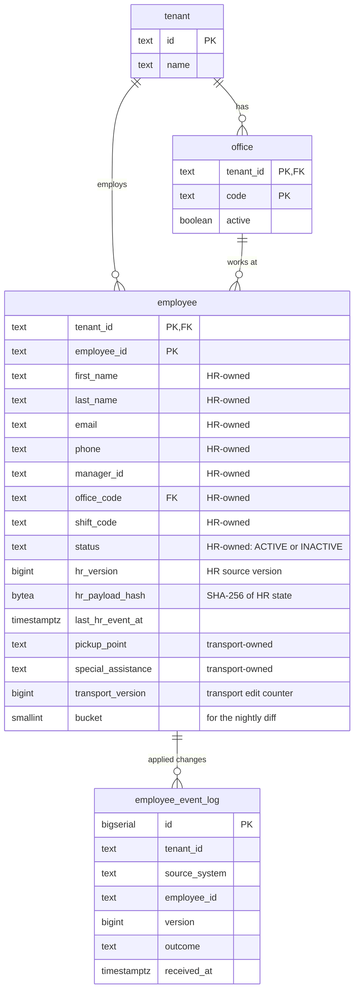

# HR Roster Sync

Companies keep their employee list in an HR system and send changes to MoveInSync, which plans employee cab transport: new joiners, office transfers, shift changes and exits. Those changes arrive one by one through an API during the day, and as a full file of up to 200,000 employees every night. In practice the same change can arrive twice, changes can arrive in the wrong order, some records contain bad data, and the nightly file is sometimes cut short. This service keeps MoveInSync's employee records correct anyway, and it refuses to act on a nightly file that looks broken until a person has checked it.

## Contents

1. [At a glance](#at-a-glance)
2. [The problem in plain words](#the-problem-in-plain-words)
3. [How it works — the big picture](#how-it-works--the-big-picture)
4. [The workflows, step by step](#the-workflows-step-by-step)
5. [The rules, explained](#the-rules-explained)
6. [Design decisions](#design-decisions)
7. [Trade-offs: consistency vs availability vs latency](#trade-offs-consistency-vs-availability-vs-latency)
8. [Security and tenant isolation](#security-and-tenant-isolation)
9. [Failure handling](#failure-handling)
10. [Monitoring — what on-call sees at 3 AM](#monitoring--what-on-call-sees-at-3-am)
11. [Caching](#caching)
12. [Performance and cost](#performance-and-cost)
13. [Data model](#data-model)
14. [API reference](#api-reference)
15. [Run it](#run-it)
16. [Project structure](#project-structure)
17. [Testing strategy](#testing-strategy)
18. [Assumptions](#assumptions)
19. [Deliberately left out](#deliberately-left-out)
20. [Glossary](#glossary)

## At a glance

_Pending._

## The problem in plain words

_Pending._

## How it works — the big picture

_Pending._

## The workflows, step by step

_Pending._

## The rules, explained

Each rule from the case study: what it says, what goes wrong without it, how it is solved, why this way, and the test that proves it.

### Validate at the boundary; one bad record never fails a batch

- **The rule.** Reject invalid records (malformed phone, unknown office code, missing fields) with a per-record error report. One bad record must never fail a whole batch.
- **Without it.** A typo in one of 100 joiners blocks the other 99 from getting a cab until someone fixes the file, or a malformed phone number is stored and the driver cannot call.
- **How.**
  - The batch endpoint keeps each event as raw JSON until it is that record's turn, so even a wrongly typed field rejects only its own record.
  - Each record is validated by a chain of validators ([`CompositeValidator`](src/main/java/com/moveinsync/rostersync/domain/validation/CompositeValidator.java)):
    - required fields;
    - email shape;
    - phone in canonical E.164, checked with Google's libphonenumber;
    - office code known for this client.
  - Each valid record is applied in **its own database transaction** ([`ApplyService`](src/main/java/com/moveinsync/rostersync/application/ApplyService.java)).
  - The response is `200` with one result per record: index, employee id, outcome, and an error code for rejections.
- **Why this way.** Wrapping the whole batch in one transaction would let a single database error roll back 99 good records. Per-record transactions cost more round trips but make every record independent.
- **Proof.**
  - [`IngestControllerIT.oneBadRecordDoesNotFailBatch`](src/test/java/com/moveinsync/rostersync/api/ingest/IngestControllerIT.java): 1 bad phone in 100 → 99 applied, 1 rejected with `INVALID_PHONE`.
  - `wronglyTypedFieldRejectsOnlyItsRecord`.
  - [`CompositeValidatorTest`](src/test/java/com/moveinsync/rostersync/domain/validation/CompositeValidatorTest.java).

### Per-employee order, idempotency key and version comparison

- **The rule.** Apply changes per employee in version order; a stale update is ignored and a duplicate is a no-op. Define the idempotency key and the version comparison.
- **Without it.** A retry is applied twice, or an older shift change that arrives late overwrites a newer transfer, and the employee is sent to the wrong office.
- **How.** Every event carries the source system's per-employee `version` and the employee's **full** HR-owned state, not just the changed field. Inside a transaction that locks the employee's row (`SELECT … FOR UPDATE`), [`VersionPolicy`](src/main/java/com/moveinsync/rostersync/domain/VersionPolicy.java) decides:

  | Stored | Incoming | Decision | Effect |
  |---|---|---|---|
  | nothing | any | APPLY | create the employee |
  | v | > v | APPLY | write HR fields, record the change |
  | v | = v, same content hash | DUPLICATE | nothing written |
  | v | = v, different content hash | REJECTED `VERSION_CONFLICT` | nothing written |
  | v | < v | STALE | nothing written |

  - **Idempotency key:** `(tenant_id, source_system, employee_id, version)`. The database enforces it with a unique key on the applied-event log.
  - **Content hash:** SHA-256 of the employee's HR state, in a fixed encoding.
  - **Defence in depth:** the write itself is conditional: `UPDATE … WHERE hr_version < :incoming`.
- **Why this way.**
  - Because events carry full state, "accept only newer versions" gives the same end result as applying every event in order, without queues or reordering buffers.
  - The lock serialises events for one employee only; different employees proceed in parallel.
  - The case study's example: a transfer (v7) arrives before a shift change (v6). v6 is stale, and the employee ends up in the new office with the v7 shift, which already contains the v6 change.
- **Proof.**
  - [`ExampleUseCaseIT.transferV7BeforeShiftV6`](src/test/java/com/moveinsync/rostersync/ExampleUseCaseIT.java).
  - [`ApplyServiceIT`](src/test/java/com/moveinsync/rostersync/application/ApplyServiceIT.java): `staleIgnored`, `duplicateIsNoOp`, `sameVersionWithDifferentContentIsRejectedAsConflict`.
  - [`ReplayFeedTwiceIT`](src/test/java/com/moveinsync/rostersync/ReplayFeedTwiceIT.java): a shuffled 1,000-event feed sent twice; after the second run every row, column by column including timestamps, and the change log are identical.
  - [`ConcurrentApplyIT`](src/test/java/com/moveinsync/rostersync/ConcurrentApplyIT.java): 32 threads, versions 1–200 shuffled → final version 200, no version applied twice, no lost update. Without the lock and the conditional update this test fails.

### Field ownership and the conflict rule

- **The rule.** HR owns name, email, manager and office; the transport admin owns pickup point and special-assistance needs. An HR update never overwrites a transport-owned field, and the conflict rule is written down.
- **Without it.** A routine HR update wipes the pickup point the transport admin set, and the cab goes to the wrong address.
- **The conflict rule.**
  1. Every field has exactly one owner ([`EmployeeField`](src/main/java/com/moveinsync/rostersync/domain/EmployeeField.java)). Phone, shift and status come from the HR system and are HR-owned (an assumption: the case study lists only name, email, manager and office).
  2. Only the owner's write path changes a field, and each owner has its own version (`hr_version`, `transport_version`), so neither can make the other's updates look stale.
  3. A value for a field the writer does not own is ignored and counted (`hr_owned_field_violation_total`); the rest of the record is still applied.
  4. There is no "last write wins" across owners.
- **How.** The HR update statement names only HR columns and the transport update only transport columns. Writes never go through the ORM, whose change tracking would write every column.
- **Proof.**
  - [`ApplyServiceIT.hrCannotOverwriteTransportFields`](src/test/java/com/moveinsync/rostersync/application/ApplyServiceIT.java).
  - [`IngestControllerIT.transportFieldsInAnHrPayloadAreIgnoredAndCounted`](src/test/java/com/moveinsync/rostersync/api/ingest/IngestControllerIT.java).
  - [`EmployeeRepositoryIT.hrWritesNeverTouchTransportColumns`](src/test/java/com/moveinsync/rostersync/infrastructure/persistence/EmployeeRepositoryIT.java).
  - [`FieldOwnershipPolicyTest`](src/test/java/com/moveinsync/rostersync/domain/FieldOwnershipPolicyTest.java).

### No personal data in logs or error reports

- **The rule.** Never write personal data into logs or error reports; use employee ids.
- **How.**
  - Logs are JSON lines carrying `traceId`, `tenantId` and `employeeId` as fields.
  - Error responses carry a stable `code` and the `traceId`, plus field *names* for validation errors.
  - Exception messages are never copied into a response or a log line, because a database message can contain the very value it rejected.
  - `toString()` of every domain object that holds personal data lists field names only.
- **Proof.**
  - [`IngestControllerIT.errorReportContainsNoPersonalData`](src/test/java/com/moveinsync/rostersync/api/ingest/IngestControllerIT.java).
  - [`GlobalExceptionHandlerTest`](src/test/java/com/moveinsync/rostersync/api/GlobalExceptionHandlerTest.java).
  - The domain `toString` tests.
  - A test that captures every log line of the whole suite comes with the monitoring work.

_Nightly reconciliation, the safety brake, the outbox and deactivation side effects are described as they are built._

## Design decisions

_Pending._

## Trade-offs: consistency vs availability vs latency

_Pending._

## Security and tenant isolation

Every request carries a signed token (a JWT: a small JSON document signed with a key only the server holds, so it cannot be forged or altered). The token says who is calling, which client (tenant) they belong to, and which roles they have.

### Roles

| Role | Who | May call |
|---|---|---|
| `HR_INTEGRATION` | The client's HR system (a machine, not a person) | `POST /api/v1/hr/events:batch` |
| `ADMIN` | MoveInSync transport admin | `GET /api/v1/employees/{id}`, `PATCH /api/v1/employees/{id}/transport` |
| `EMPLOYEE` | An employee | `GET /api/v1/employees/me` (own record only; the id is the token's subject) |
| `OPERATOR` | Reviews nightly reconciliation runs | the reconciliation endpoints, when they exist |

- Everything not listed is **denied by default**: a new endpoint is closed until someone decides who may use it.
- `HR_INTEGRATION` is an addition to the case study's three roles. The HR system is not a person, and giving it `ADMIN` would let it edit transport fields.
- Refusals are problem documents: `401 UNAUTHENTICATED` for a missing, expired, forged or tenant-less token; `403 FORBIDDEN` for the wrong role.

### How the tenant is decided

**Only from the verified token's `tenant_id` claim.** Never from the URL, the body or a header.
- Controllers receive the tenant as a typed parameter that only the token can fill, so there is no code path that reads it from the request.
- Every table's key starts with `tenant_id`, and every storage method requires the tenant.
- An employee's office must belong to the same tenant (a composite foreign key).

### Why another tenant's data answers 404, not 403

`403 Forbidden` would confirm that the record exists, just not for you. That alone leaks information, for example whether a competitor employs someone with a given id. A request for another tenant's employee gets exactly the same `404` body as a request for an id that exists nowhere.

Proof: [`TenantIsolationIT`](src/test/java/com/moveinsync/rostersync/TenantIsolationIT.java), and in it `anotherTenantsEmployeeLooksExactlyLikeAMissingOne`.

### Personal data

| Data | Stored in | Never appears in |
|---|---|---|
| Name, email, phone, manager | `employee` (HR-owned columns) | logs, error responses, metric labels, the batch report |
| Pickup point (a home location), special-assistance needs (possibly health data) | `employee` (transport-owned columns) | the same, and HR write paths |

These fields are returned only to an authorised caller: an `ADMIN` of the same tenant, or the employee themself.

### Tokens and keys

- Tokens are HS256-signed with `rostersync.security.jwt-secret`. The application refuses to start without it.
- `POST /dev/token` issues tokens for local evaluation. It exists **only** under the `dev` and `demo` profiles, logs a warning when enabled, and returns `404` everywhere else.
- A production deployment would use RS256 tokens from the company's identity provider, so the API holds only a public key. That is listed under "Deliberately left out".

## Failure handling

_Pending._

## Monitoring — what on-call sees at 3 AM

_Pending._

## Caching

_Pending._

## Performance and cost

_Pending._

## Data model

Every table carries the client's id (`tenant_id`), and every key starts with it, so a row can only be reached together with the client it belongs to. The schema is created by Flyway from [`V1__core_schema.sql`](src/main/resources/db/migration/V1__core_schema.sql); the application never creates tables itself.



| Table | What it holds |
|---|---|
| `tenant` | One row per corporate client. |
| `office` | A client's office codes. An event naming an office that is missing or inactive is rejected. |
| `employee` | The current state of each employee. HR-owned and transport-owned columns are written by separate statements, each checking its own version (`hr_version`, `transport_version`), so neither owner can overwrite the other. `bucket` is `floorMod(murmur3(employee_id), 64)`, the slice of the nightly comparison the employee belongs to. |
| `employee_event_log` | One row per applied HR change. The unique key `(tenant_id, source_system, employee_id, version)` means the database itself refuses to record the same change twice (idempotency). |

Tables for change events, bookings and nightly reconciliation are added by later migrations, alongside the code that uses them.

## API reference

All endpoints are under `/api/v1`, take and return JSON, and need a bearer token. The client (tenant) is taken from the token's `tenant_id` claim, never from the URL or body.

### `POST /api/v1/hr/events:batch`

Up to 1,000 HR events; each is handled on its own.

```json
{
  "sourceSystem": "workday",
  "events": [
    { "type": "UPDATE", "employeeId": "E000042", "version": 7, "occurredAt": "2026-10-30T08:00:07Z",
      "firstName": "…", "lastName": "…", "email": "…", "phone": "+919876543210",
      "managerId": "E000001", "officeCode": "HYD-02", "shiftCode": "NIGHT" },
    { "type": "DEACTIVATE", "employeeId": "E000043", "version": 12, "occurredAt": "2026-10-30T09:00:00Z" }
  ]
}
```

- `type` is `CREATE`, `UPDATE` or `DEACTIVATE`.
- A `DEACTIVATE` may send only the header, as above, or the full record (recommended): with the full record, an exit that arrives before any other event for that employee is still recorded.

Response `200`:
```json
{ "results": [
  { "index": 0, "employeeId": "E000042", "outcome": "APPLIED" },
  { "index": 1, "employeeId": "E000043", "outcome": "REJECTED", "errorCode": "UNKNOWN_EMPLOYEE" }
] }
```

`outcome` is `APPLIED`, `DUPLICATE`, `STALE` or `REJECTED`. Rejection codes:
- `MALFORMED_RECORD`
- `INVALID_EVENT_TYPE`
- `MISSING_REQUIRED_FIELD`
- `INVALID_VERSION`
- `INVALID_EMAIL`
- `INVALID_PHONE`
- `UNKNOWN_OFFICE`
- `UNKNOWN_EMPLOYEE`
- `VERSION_CONFLICT`

### `GET /api/v1/employees/{id}` (ADMIN) and `GET /api/v1/employees/me` (EMPLOYEE)

These return the employee record. The `ETag` header carries the transport version (`"0"`, `"1"`, …), which a transport edit must send back. An id that is not in the caller's tenant answers `404`.

### `PATCH /api/v1/employees/{id}/transport` (ADMIN)

```http
PATCH /api/v1/employees/E000042/transport
If-Match: "0"
Content-Type: application/json

{ "pickupPoint": "Gate 2, Tech Park" }
```

- `200` with the updated record and `ETag: "1"`.
- A field left out keeps its value; a field sent as `null` is cleared.
- `428 PRECONDITION_REQUIRED` without `If-Match`, and `412 TRANSPORT_VERSION_MISMATCH` if someone else edited first. Nothing changes in either case.
- `400 FIELD_NOT_OWNED` if the body names an HR-owned field (such as `officeCode`), and `400 INVALID_REQUEST` for an unknown field. Both list the field names.

### `POST /dev/token` (only under the `dev` / `demo` profiles)

```bash
curl -s -X POST localhost:8080/dev/token -H 'Content-Type: application/json' \
  -d '{"tenantId":"acme","subject":"workday","roles":["HR_INTEGRATION"]}'
# {"token":"eyJ…","expiresAt":"…"}
```

### Errors

Every error is an [RFC 7807](https://www.rfc-editor.org/rfc/rfc7807) problem document with a stable `code` and the request's `traceId`. The same id is returned in the `X-Trace-Id` header and appears on every log line of that request.

```json
{ "type": "urn:rostersync:error:invalid-request", "title": "Bad Request", "status": 400,
  "code": "INVALID_REQUEST", "fields": ["events"], "traceId": "6f1c…" }
```

## Run it

Prerequisites: JDK 21 and Docker. Maven is not required; the project ships with the Maven wrapper.

```bash
docker compose up -d postgres                          # Postgres 16 on localhost:5432 (local-only credentials)
./mvnw spring-boot:run -Dspring-boot.run.profiles=dev  # the API on localhost:8080, with a local-only signing key
./mvnw test                                            # unit tests, no Docker needed
./mvnw verify                                          # unit + integration tests; each run starts its own Postgres
docker compose down -v                                 # stop and delete the local database
```

The application refuses to start without a token signing key (`rostersync.security.jwt-secret`, at least 32 bytes). The `dev` profile supplies a local-only one; any real deployment must provide its own.

Integration tests never use the `docker compose` database: they start a separate Postgres through Testcontainers, so Docker must be running for `./mvnw verify`.

## Project structure

_Pending._

## Testing strategy

_Pending._

## Assumptions

_Pending._

## Deliberately left out

_Pending._

## Glossary

_Pending._
