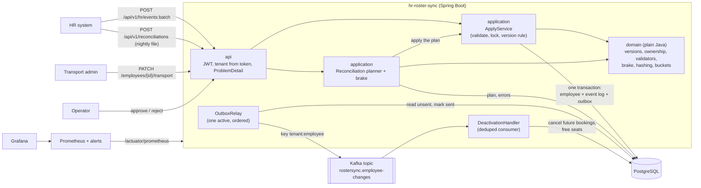

# HR Roster Sync — design note

A one-document view of how the service is built, why, and how it fails. The README explains each rule in depth; this note is the architecture, the two critical sequences, and the failure modes.

## 1. Context

Corporate HR systems send employee changes (joiners, transfers, shift changes, exits) to MoveInSync, which plans employee cab transport. Changes come in two ways:
- **Live**, as batches through an API during the day.
- **Nightly**, as a full file of up to 200,000 employees per client.

Both arrive duplicated, out of order, with bad rows, and the nightly file is sometimes cut short. The service keeps one correct employee record per client. It never lets HR overwrite what the transport team owns, and it tells downstream systems (bookings) about every change exactly once in effect.

## 2. Architecture



Layers (enforced by [`ArchitectureTest`](../src/test/java/com/moveinsync/rostersync/ArchitectureTest.java)):
- `api` → `application` → `domain` ← `infrastructure`.
- `domain` imports nothing but the JDK and libphonenumber, so every business rule is unit-tested without a server or database.
- `infrastructure` (JDBC, JPA, Kafka, caches) implements ports that `domain` and `application` declare.

## 3. The decisions that shape everything

| # | Decision | Why | Gave up |
|---|---|---|---|
| 1 | **A per-employee version from HR** decides every change: newer → apply, equal + same content → duplicate, equal + different content → conflict, older → ignore | One rule gives ordering and idempotency; no timestamps, no dedupe lookup | Depends on HR sending correct versions |
| 2 | **Events carry full HR state** | Ignoring a stale event loses nothing: the newer one already contains it | Larger payloads; HR must send complete records |
| 3 | **Row lock + conditional update**, one transaction per record | Concurrent updates for one employee serialise, and one bad record can't fail the batch | Per-record commit latency |
| 4 | **Separate write paths and versions per owner** (HR vs transport) | HR's SQL physically can't touch pickup point or special assistance | Two version columns, two endpoints |
| 5 | **Transactional outbox** + one ordered relay | The change and its event commit together; per-employee order survives retries and crashes | ≤ 200 ms extra latency; one relay is the throughput ceiling |
| 6 | **Nightly diff in 64 hash buckets, plan first, then a safety brake** | Bounded memory; nothing is applied until the whole file is known to be complete and plausible | Temp disk; two passes over the file |
| 7 | **CP for the employee store, eventual consistency downstream** | A wrong roster is worse than a short refusal; bookings can lag a second | Ingest is unavailable while the database is |

Each decision, with the problem it solves and the test that proves it, is in the [README](../README.md#the-problems-we-solved).

### The conflict rule (written down)
- **HR owns:** first and last name, email, phone, manager, office, shift and employment status.
- **The transport team owns:** pickup point and special assistance.
- An HR update **never** changes a transport-owned field. Such fields in an HR payload are ignored and counted (`hr_owned_field_violation_total`), and the rest of the record applies.
- A transport edit naming an HR-owned field is refused (`400 FIELD_NOT_OWNED`).
- Each side versions its own fields (`hr_version`, `transport_version`), so neither makes the other's next update look stale.
- Transport edits must name the version they are based on (`If-Match`). A stale one is refused (`412`), so two admins never silently overwrite each other.

## 4. Sequence: a live update

```mermaid
sequenceDiagram
    participant HR as HR system
    participant API as IngestController
    participant A as ApplyService
    participant DB as PostgreSQL
    participant R as OutboxRelay
    participant K as Kafka
    participant C as DeactivationHandler
    HR->>API: batch [E42 v7 (exit), ...] with JWT
    API->>API: tenant from token; parse each record on its own
    API->>A: apply(record)
    A->>A: validate (office from cache)
    A->>DB: BEGIN; SELECT ... FOR UPDATE (E42)
    A->>A: version rule: stored v6 < 7 → APPLY
    A->>DB: UPDATE HR columns WHERE hr_version < 7; INSERT event log; INSERT outbox; COMMIT
    A-->>API: APPLIED
    API-->>HR: per-record results (no field values)
    R->>DB: lock oldest unsent (one active relay)
    R->>K: send keyed tenant:E42, await ack
    R->>DB: mark sent
    K->>C: EMPLOYEE_DEACTIVATED
    C->>DB: BEGIN; record event id (dedupe); cancel future bookings, free seats; COMMIT
```

## 5. Sequence: the nightly file, the brake and approval

```mermaid
sequenceDiagram
    participant HR as HR system
    participant API as ReconciliationController
    participant P as Planner
    participant DB as PostgreSQL
    participant B as SafetyBrake
    participant O as Operator
    participant A as ApplyService
    HR->>API: upload file (header: tenant, as_of; trailer: count)
    API->>API: header names the caller's tenant?
    API-->>HR: 202 {runId}
    API->>P: plan (background thread)
    P->>P: pass 1: stream rows, validate, hash, append to 64 bucket files
    loop bucket 0..63
        P->>DB: stored rows of this bucket
        P->>P: diff: create / update / deactivate / conflict
        P->>DB: store plan items and bad lines (line + code only)
    end
    P->>B: activeBefore, toDeactivate, trailerOk
    alt trailer missing, or toDeactivate / activeBefore >= 0.30
        B-->>DB: AWAITING_APPROVAL (metric + alert; nothing applied)
        O->>API: GET run, GET errors
        alt approve
            O->>API: POST approve
            API->>A: apply plan item by item
            A->>DB: per employee: lock, re-check version and as_of, write + outbox
        else reject
            O->>API: POST reject (nothing applied)
        end
    else brake passes
        P->>A: apply plan item by item
    end
```

Why each step is there:
- **Plan before applying:** "30 % missing" is only known at the end of the file.
- **The whole plan waits:** a truncated or wrong file is suspect in every row.
- **Re-check on apply:** the live feed keeps running while a plan waits, so a deactivation is skipped if the employee changed after the file's `as_of` or since the plan.
- **Invalid lines count as present:** a broken line is not evidence that someone left.

## 6. Consistency, availability and latency

| Data | Consistency | In practice |
|---|---|---|
| Employee record (HR and transport fields) | Strong: a single Postgres primary, row locks, conditional updates | A write is visible to every reader of the database on commit |
| Admin read endpoints | Read-your-writes on the same instance; up to 30 s stale across instances (cache) | Writes never read the cache, so a stale view can only cause a `412`, never a lost edit |
| Office validity | Up to 5 min stale for a *deactivated* office; a new office is visible at once | Only "known" answers are cached |
| Change events, bookings | Eventually consistent, at least once, deduplicated | ≤ 200 ms relay poll + broker; measured oldest unsent ≤ 6.6 s at ~5,900 records/s |
| Nightly file | Applied only after the brake passes or an operator approves | Hours, by design, when the brake trips |

**Choice:** when the database is unavailable, ingest refuses rather than accepting changes it cannot store safely. HR systems retry, and versions make retries harmless. When the broker is unavailable, ingest continues; events wait in the outbox and drain in order.

## 7. Failure modes

| What fails | What the client sees | How the system recovers | Proof |
|---|---|---|---|
| Database down | Requests fail (500, or `PROCESSING_FAILED` per record); nothing half-written | HR retries; versions make retries harmless | Per-record rollback: [`OutboxIT.afterAFailedRecordTheNextOneStillApplies`](../src/test/java/com/moveinsync/rostersync/OutboxIT.java) |
| Broker down | Nothing: ingest keeps answering `APPLIED` | Events queue in the outbox; the relay retries the oldest with backoff (≤ 10 s); `OutboxNotDraining` pages after 60 s; the backlog drains in order | [`BrokerDownIT`](../src/test/java/com/moveinsync/rostersync/infrastructure/messaging/BrokerDownIT.java) |
| Crash after commit, before publish | Nothing | The row is still unsent; the next relay run sends it | [`OutboxCrashRecoveryIT`](../src/test/java/com/moveinsync/rostersync/OutboxCrashRecoveryIT.java) |
| Crash after publish, before marking | Nothing | The event is sent again; the consumer drops it by event id | [`OutboxCrashRecoveryIT`](../src/test/java/com/moveinsync/rostersync/OutboxCrashRecoveryIT.java) |
| Duplicate message (feed or broker) | `DUPLICATE` / no effect | Version rule; consumer dedupe table | [`ReplayFeedTwiceIT`](../src/test/java/com/moveinsync/rostersync/ReplayFeedTwiceIT.java), [`DeactivationConsumerIT`](../src/test/java/com/moveinsync/rostersync/DeactivationConsumerIT.java) |
| Late copy of an old exit after a rehire | No effect | Consumer dedupe by event id | `DeactivationConsumerIT.lateCopyOfAnOldExitDoesNotCancelBookingsMadeAfterRehire` |
| Out-of-order messages | `STALE` for the older one; final state = newest | Version rule over full-state events | [`ExampleUseCaseIT.transferV7BeforeShiftV6`](../src/test/java/com/moveinsync/rostersync/ExampleUseCaseIT.java), [`ConcurrentApplyIT`](../src/test/java/com/moveinsync/rostersync/ConcurrentApplyIT.java) |
| Bad rows | `REJECTED` + code for that record; the rest apply | Per-record parse, validation and transaction | [`IngestControllerIT.oneBadRecordDoesNotFailBatch`](../src/test/java/com/moveinsync/rostersync/api/ingest/IngestControllerIT.java) |
| Truncated nightly file | Run `AWAITING_APPROVAL`, `FILE_TRUNCATED` | Nothing applied; operator rejects or approves; alert fires | [`ExampleUseCaseIT.truncatedFileAt120kDeactivatesNobody`](../src/test/java/com/moveinsync/rostersync/ExampleUseCaseIT.java) |
| Operator never approves | The run stays `AWAITING_APPROVAL`; nothing changes | The next night's file is planned against the live data as usual; the old plan can still be rejected | [`ReconciliationApiIT`](../src/test/java/com/moveinsync/rostersync/api/reconciliation/ReconciliationApiIT.java) |
| Approval long after the plan | Some planned changes `skipped` | Each deactivation re-checked under the row lock against version and `as_of` | `ReconciliationIT.approvalLaterStillRespectsLiveChangesMadeInBetween` |
| App crash mid-reconciliation | The run stays `RUNNING` | Nothing half-applied (one transaction per employee); re-uploading the file is safe | Design; see limits below |
| Stale cache | An old view for ≤ 30 s (employee) or ≤ 5 min (deactivated office) | TTL; writes never use the cache; a stale ETag gets `412` | [`EmployeeReadCacheIT`](../src/test/java/com/moveinsync/rostersync/api/employee/EmployeeReadCacheIT.java) |
| Personal data in logs | — | Codes and ids only; checked across all flows | [`NoPiiInLogsIT`](../src/test/java/com/moveinsync/rostersync/NoPiiInLogsIT.java) |

## 8. Limits and next steps

- **Scale.**
  - One active outbox relay (≈ 7,000 events/s measured); next is relays partitioned by key hash, or CDC.
  - Per-record ingest transactions; next is an async inbox with workers by employee hash.
  - Reconciliation applies one employee per transaction; next is batched apply with the same per-row checks.
- **Security.** HS256 demo tokens; production uses RS256 from an identity provider. Postgres row-level security as defence in depth.
- **Operations.**
  - Sweep runs stuck in `RUNNING` to `FAILED` on startup.
  - A `503` with `Retry-After` when the database is down.
  - Health and metrics on an internal management port.
